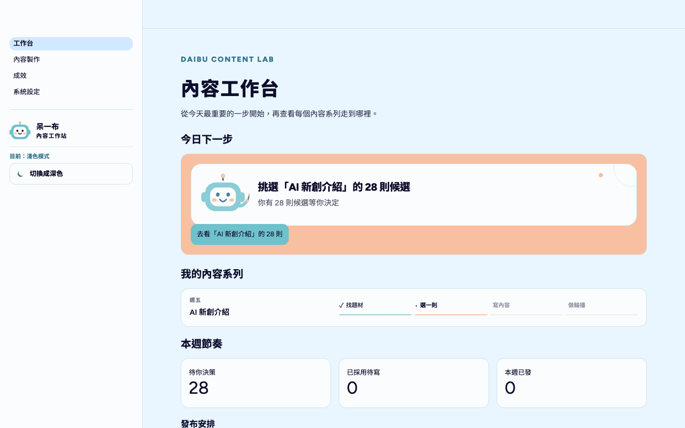
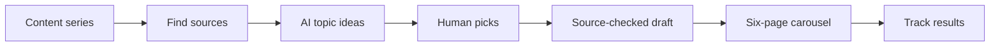
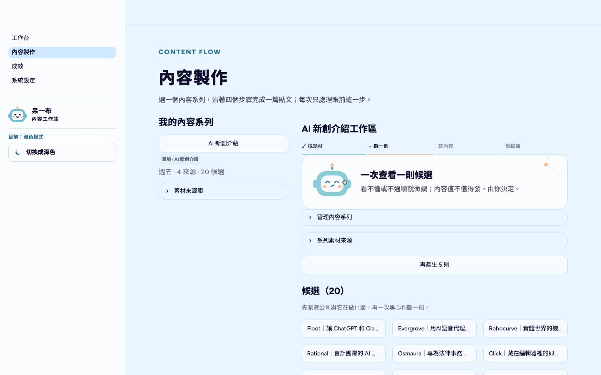

# Content Topic Brain

**A weekly social-content workstation: it finds sources, has AI propose topics, lets a human pick one, then drafts source-checked copy and renders carousel cards ready to post.**

AI 社群選題與輪播圖卡工作站：自動找題材、AI 提候選、由人挑選，再寫出查證過來源的文案並做成輪播圖卡。

> **Type** Personal project · **Status** Completed (2026-07 → 2026-09) · **Role** Solo project · **Stack** Python, Streamlit, SQLite, Gemini / Gemma, Groq, Tavily, Playwright



## Background

The AI learning community 呆一布 (Daibu) ran a weekly "AI startup spotlight" series. Writing wasn't the slow part; deciding what to cover each week was. This tool turns that decision, plus fact-checking and making the carousel, into one fixed workflow.

## What it does

- **Finds candidates** from RSS feeds, web pages, Tavily search and the YC company directory.
- **Proposes topics** with an angle; you approve, tweak or reject them one at a time.
- **Checks each startup** (founding year, acquired or public) against search evidence before suggesting it.
- **Drafts only from verified sources**, then renders a six-page carousel you can download as a ZIP.
- **Tracks results** per content series and shows the next step on one workbench.





## Key decisions

| Decision | Why |
| --- | --- |
| The human decides, AI does the legwork | Picking topics is the editorial judgment that matters; searching and first drafts are the busywork. |
| No verified source, no draft | A learning community loses trust fast if it posts wrong facts about a company. |
| Logos only from official websites, confirmed by a person | Avoids using the wrong or unlicensed brand image. |
| Free tiers only (Gemini / Gemma, Groq as fallback) | Running cost had to be zero for a weekly, one-person workflow. |

## Results

- Used for the "AI startup spotlight" series: 28 topic candidates generated and 26 startups checked (20 eligible, 4 rejected, 2 unclear), from the project's local database.
- 450+ commits and 742 automated tests, including browser tests of the carousel template editor.

## Run it locally

```bash
python3.11 -m venv .venv && source .venv/bin/activate
pip install -r requirements.txt
.venv/bin/playwright install chromium
cp .env.example .env    # free API keys: Gemini or Groq, plus Tavily
.venv/bin/streamlit run server.py
```

Open <http://localhost:8501>. Tests: `.venv/bin/pytest` · Keep it running after login on macOS: `.venv/bin/python -m daibu.local_service install` · Design notes: [`docs/specs/`](docs/specs/)

## 中文摘要

為 AI 共學社群「呆一布」每週的「AI 新創介紹」系列做的個人專案。最花時間的不是寫，而是決定這週要寫什麼。選題大腦把選題、查證和做輪播圖變成固定流程：自動找來源、AI 提題目、由人挑一則，接著只根據查證過的來源寫正文，並做成六頁輪播圖卡。實際用於該系列：產生 28 則候選、查證 26 家新創。
