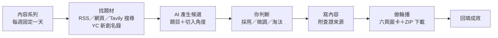

# 選題大腦（daibu-content-brain）

**經營社群最花時間的不是寫，而是決定「這週要寫什麼」。** 選題大腦把這件事變成一條固定流程：自動找題材、AI 提候選、你只負責判斷，接著寫正文、做成可直接發布的輪播圖卡，最後回填成效。

原本為「呆一布 AI 共學實驗室」的社群內容設計，主力系列是每週一篇的「AI 新創介紹」。個人專案，2026-07 至 2026-09 開發，450+ 次 commit、742 項自動測試。


## 它怎麼運作




## 幾個刻意的設計

- **人做判斷，AI 做苦工。** AI 只負責搜尋、整理和寫初稿；每一則要不要發，一次只給你看一則，由你決定。
- **內容只根據查證過的來源。** 圖卡草稿必須先有已查證的來源才會產生，文案規則也禁止加入未查證的數字。
- **先查證再介紹。** 介紹新創前，會用網路搜尋的證據核對成立年份與所有權狀態（是否已被收購或上市），不符合「新創」條件就不推薦。
- **Logo 只從官方網站找。** 候選 Logo 要經過人工確認才會用在圖卡上，不拿來路不明的圖。
- **免費額度就能跑。** LLM 用 Google AI Studio 免費層（Gemini／Gemma），Groq 當備援，可以隨時切換。

## 技術

Python 3.11、Streamlit、SQLite、Google Gemini／Gemma（備援 Groq）、Tavily 搜尋、Playwright。圖卡版型以 JSON 描述，內建版型編輯器，版本可回溯。

## 快速開始

```bash
python3.11 -m venv .venv && source .venv/bin/activate
pip install -r requirements.txt
.venv/bin/playwright install chromium
cp .env.example .env    # 填入免費 API key（Gemini 或 Groq、Tavily）
.venv/bin/streamlit run server.py
```

開啟 <http://localhost:8501>。

### Mac 登入後自動保持開啟

```bash
.venv/bin/python -m daibu.local_service install
.venv/bin/python -m daibu.local_service status
.venv/bin/python -m daibu.local_service uninstall   # 移除自動啟動，保留資料與設定
```

## 測試

```bash
.venv/bin/pytest
```

設計文件在 [`docs/specs/`](docs/specs/)。
