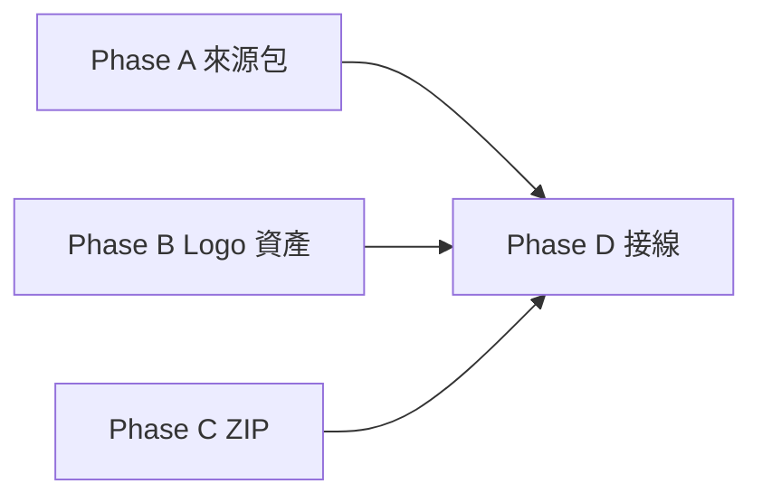

# 來源蒐集、Logo 上傳、ZIP 與選題頁接線 Implementation Plan

> **For agentic workers:** REQUIRED SUB-SKILL: Use
> superpowers:subagent-driven-development (recommended) or
> superpowers:executing-plans to implement this plan task-by-task. Steps use
> checkbox (`- [ ]`) syntax for tracking.

**Goal:** 讓使用者在選題頁的一則已採用題目底下，就能蒐集來源、上傳官方 Logo、
產出七頁草稿與七張 PNG，並打包成一個 ZIP 帶走。

**Architecture:** 已完成的「草稿 → PNG」引擎不動。這一輪只補三條進料管線
（來源包、Logo 資產、狀態判斷）與一條出料管線（ZIP），最後用一個 Streamlit 區塊
把它們串起來。所有判斷邏輯都放在純函式模組裡，Streamlit 頁面只負責畫畫面。

**Tech Stack:** Python 3.11+、SQLite、Pillow、`zipfile`、`urllib`＋`HTMLParser`、
Streamlit（含 `streamlit.testing.v1.AppTest`）、pytest。

## Global Constraints

- 設計依據：`docs/specs/2026-07-30-來源蒐集與出圖接線-design.md`。
- 嚴格 Red → Green → Refactor：**一次只加一個失敗測試**，綠了才寫下一個。
  紅綠循環只跑當前那一個測試檔；Task 收尾才跑一次全套。
- 既有 312 個測試不得因為這一輪變紅。既有的來源驗證（五欄必填、https、
  `YYYY-MM-DD`）、Logo 安全檢查、140–220 字門檻**一條都不放寬**。
- `logo_data_uri()` 既有行為不改。新的尺寸／像素／viewBox 檢查一律放在新的
  `validate_upload()`，避免 `test_logo_accepts_svg_with_local_gradient_and_symbol`
  這種既有綠燈測試被誤傷。
- 來源包（`idea_sources`）與來源快照（`carousel_sources`）是兩張表，不合併。
- 缺 Logo 只擋「產生七張圖」，**不擋「產生輪播草稿」**。
- 驗證失敗時不得清空使用者輸入、不得寫回半套資料。
- 不呼叫任何付費服務、不自動搜尋 Logo、不自動發文。
- 每個 Task 結束就 commit；一場對話只做一個 Phase，做完提醒使用者換新對話。

---

## 檔案結構

| 檔案 | 責任 | 動作 |
|---|---|---|
| `daibu/models.py` | 新增 `SourceSuggestion` 值型別 | 修改 |
| `daibu/db.py` | `idea_sources`、`brand_assets` 的建表、搬遷與 CRUD | 修改 |
| `daibu/cards/sources.py` | 來源包規則：1–8 筆、`S1`–`S8` 編號、新增／刪除 | 新增 |
| `daibu/fetch/page.py` | 貼網址抓建議值（純文字、meta 猜出版方與日期） | 新增 |
| `daibu/cards/logo.py` | 上傳檢查：檔案大小、像素、viewBox 與錯誤文案 | 修改 |
| `daibu/cards/assets.py` | Logo 落地存檔、與 `brand_assets` 的橋接 | 新增 |
| `daibu/cards/bundle.py` | 七張 PNG 打包成 ZIP、檔名規則 | 新增 |
| `daibu/cards/workbench.py` | 「還缺什麼」與草稿指紋等純狀態判斷 | 新增 |
| `pages/1_選題.py` | 已採用題目底下的「輪播圖」區塊 | 修改 |
| `.gitignore` | 排除 `assets/logos/` | 修改 |
| `tests/test_db.py` | 來源包與 Logo metadata 的 round-trip 與刪除一致性 | 修改 |
| `tests/test_db_migration.py` | 兩張新表的冪等搬遷 | 修改 |
| `tests/test_cards_sources.py` | 來源包規則 | 新增 |
| `tests/test_fetch_page.py` | 抓取建議值（含 contract） | 新增 |
| `tests/test_cards_logo.py` | 上傳上限與錯誤文案 | 修改 |
| `tests/test_cards_assets.py` | Logo 存檔與重用 | 修改 |
| `tests/test_cards_bundle.py` | ZIP 檔名、順序與內容 | 新增 |
| `tests/test_cards_workbench.py` | 缺件清單與指紋 | 新增 |
| `tests/test_app_smoke.py` | 選題頁四個狀態的 AppTest | 修改 |

---

## 產品理解與切片邊界



A、B、C 三條管線彼此不相依，各自都能單獨測到綠燈；D 才把它們接進畫面。這樣切的
好處是：畫面出錯時，可以立刻分辨是「資料進不來」還是「畫面接錯」。

**一場對話只做一個 Phase。** 做完在 `HANDOFF.md` 寫下本輪狀態，提醒使用者開新對話。

---

## Phase A — 來源包可蒐集、可編輯

### Task 1: 來源包能安全存回 SQLite

**Files:**
- Modify: `daibu/db.py`
- Modify: `tests/test_db_migration.py`
- Modify: `tests/test_db.py`

**Interfaces:**
- Produces:
  - `db.save_idea_sources(conn, idea_id, sources: tuple[VerifiedSource, ...]) -> None`
  - `db.get_idea_sources(conn, idea_id) -> tuple[VerifiedSource, ...]`
- Consumes: `daibu.cards.schema.VerifiedSource`。

- [ ] **Step 1: 寫 migration 失敗測試**

在 `tests/test_db_migration.py` 新增：

```python
def test_migration_adds_idea_source_pack_idempotently(tmp_path):
    path = tmp_path / "pack.db"
    conn = db.connect(str(path))
    db.init_schema(conn)
    conn.execute("DROP TABLE IF EXISTS idea_sources")
    conn.commit()

    db.init_schema(conn)
    db.init_schema(conn)

    columns = {
        row["name"] for row in conn.execute("PRAGMA table_info(idea_sources)")
    }
    assert {
        "idea_id",
        "source_key",
        "publisher",
        "published_at",
        "url",
        "excerpt",
    } <= columns
```

- [ ] **Step 2: 確認 Red**

Run: `.venv/bin/pytest tests/test_db_migration.py::test_migration_adds_idea_source_pack_idempotently -q`

Expected: FAIL — `no such table: idea_sources`。

- [ ] **Step 3: 最小實作**

在 `init_schema()` 的 `executescript` 加入 `CREATE TABLE IF NOT EXISTS
idea_sources`，欄位與 `carousel_sources` 相同（`idea_id`、`source_key`、
`publisher`、`published_at`、`url`、`excerpt`，主鍵 `(idea_id, source_key)`，
外鍵指向 `ideas(id)`）。**不要動 `carousel_sources`。**

Run 同一條指令。Expected: PASS。

- [ ] **Step 4: 寫 round-trip 與刪除一致性的失敗測試**

在 `tests/test_db.py` 新增：

```python
def test_idea_source_pack_round_trip_and_cascade_delete(tmp_path):
    from daibu.llm.base import Idea
    from tests.card_fixtures import verified_sources

    conn = db.connect(str(tmp_path / "t.db"))
    db.init_schema(conn)
    idea_id = db.add_idea(conn, None, Idea("t", "a", ""))
    expected = verified_sources()

    db.save_idea_sources(conn, idea_id, expected)

    assert db.get_idea_sources(conn, idea_id) == expected
    assert db.get_idea_sources(conn, idea_id + 999) == ()

    db.save_idea_sources(conn, idea_id, expected[:1])
    assert db.get_idea_sources(conn, idea_id) == expected[:1]

    db.delete_idea(conn, idea_id)
    assert conn.execute(
        "SELECT COUNT(*) FROM idea_sources"
    ).fetchone()[0] == 0
```

- [ ] **Step 5: 確認 Red**

Run: `.venv/bin/pytest tests/test_db.py::test_idea_source_pack_round_trip_and_cascade_delete -q`

Expected: FAIL — `module 'daibu.db' has no attribute 'save_idea_sources'`。

- [ ] **Step 6: 實作**

- `save_idea_sources()`：包在 `with conn:` 裡，先 `DELETE` 該 `idea_id` 的全部列
  再 `executemany` 插入——整包替換，不做逐筆 upsert，避免半套狀態。存之前呼叫
  `schema.validate_sources(sources)`；空 tuple 允許（代表清空來源包）。
- `get_idea_sources()`：`ORDER BY source_key`，回傳 `tuple[VerifiedSource, ...]`。
- `delete_idea()` 與 `delete_theme()` 各補一條 `DELETE FROM idea_sources`，位置
  比照既有的 `carousel_sources`。

- [ ] **Step 7: 確認 Green 與回歸**

Run: `.venv/bin/pytest tests/test_db.py tests/test_db_migration.py -q`

Expected: PASS，既有草稿與刪除測試維持綠燈。

- [ ] **Step 8: Commit**

```bash
git add daibu/db.py tests/test_db.py tests/test_db_migration.py && git commit -m "feat(db): persist per-idea source packs"
```

---

### Task 2: 來源包的新增、刪除與編號規則

**Files:**
- Create: `daibu/cards/sources.py`
- Create: `tests/test_cards_sources.py`

**Interfaces:**
- Produces:
  - `sources.MAX_SOURCES = 8`
  - `sources.next_source_id(pack) -> str`
  - `sources.add(pack, publisher, published_at, url, excerpt) -> tuple[VerifiedSource, ...]`
  - `sources.remove(pack, source_id) -> tuple[VerifiedSource, ...]`

- [ ] **Step 1: 寫編號規則的失敗測試**

建立 `tests/test_cards_sources.py`：

```python
import pytest

from daibu.cards import sources
from tests.card_fixtures import verified_sources


def test_new_sources_take_the_smallest_free_number():
    pack = verified_sources()
    assert sources.next_source_id(()) == "S1"
    assert sources.next_source_id(pack) == "S4"

    without_middle = sources.remove(pack, "S2")

    assert [item.source_id for item in without_middle] == ["S1", "S3"]
    assert sources.next_source_id(without_middle) == "S2"
```

- [ ] **Step 2: 確認 Red**

Run: `.venv/bin/pytest tests/test_cards_sources.py -q`

Expected: FAIL — 找不到 `daibu.cards.sources`。

- [ ] **Step 3: 最小實作**

`next_source_id()` 取 `S1`–`S8` 中最小的未使用號碼；`remove()` 只過濾，
**不重新編號**（設計規格 §4.3）。

Run 同一條指令。Expected: PASS。

- [ ] **Step 4: 寫上限與必填的失敗測試**

追加：

```python
def test_pack_rejects_incomplete_rows_and_caps_at_eight():
    pack = verified_sources()

    with pytest.raises(ValueError, match="出版方"):
        sources.add(pack, "  ", "2026-07-20", "https://a.example/x", "內容夠長")
    with pytest.raises(ValueError, match="https"):
        sources.add(pack, "A", "2026-07-20", "http://a.example/x", "內容夠長")
    with pytest.raises(ValueError, match="YYYY-MM-DD"):
        sources.add(pack, "A", "2026/07/20", "https://a.example/x", "內容夠長")

    full = pack
    while len(full) < sources.MAX_SOURCES:
        full = sources.add(
            full,
            "A",
            "2026-07-20",
            f"https://a.example/{len(full)}",
            "這段引文足夠長，用來代表已查證的原文片段。",
        )

    assert len(full) == 8
    with pytest.raises(ValueError, match="最多 8 筆"):
        sources.add(
            full,
            "A",
            "2026-07-20",
            "https://a.example/9",
            "這段引文足夠長，用來代表已查證的原文片段。",
        )
```

- [ ] **Step 5: 確認 Red，再實作**

`add()` 的檢查順序：先擋滿 8 筆（訊息含「最多 8 筆」），再逐欄檢查空白
（訊息要指名是哪一欄，例如「請填出版方」），最後用
`schema.validate_sources()` 檢查整包——**不要自己重寫 https 與日期規則**，
直接讓既有驗證器回錯，必要時把它的訊息包成更白話的句子。

Run: `.venv/bin/pytest tests/test_cards_sources.py -q`

Expected: PASS。

- [ ] **Step 6: Commit**

```bash
git add daibu/cards/sources.py tests/test_cards_sources.py && git commit -m "feat(cards): manage per-idea source packs"
```

---

### Task 3: 貼網址就能抓到建議值

**Files:**
- Modify: `daibu/models.py`
- Create: `daibu/fetch/page.py`
- Create: `tests/test_fetch_page.py`

**Interfaces:**
- Produces:
  - `models.SourceSuggestion(publisher, published_at, url, excerpt)`
  - `page.fetch_suggestion(url, download=None) -> SourceSuggestion`
- `download` 參數只為了測試注入，預設走真實網路。

- [ ] **Step 1: 寫解析建議值的失敗測試**

建立 `tests/test_fetch_page.py`：

```python
import pytest

from daibu.fetch import page

HTML = """
<html><head>
<meta property="og:site_name" content="Example News">
<meta property="article:published_time" content="2026-07-20T08:30:00Z">
</head><body><article>
<h1>公司發表新的語音模型</h1>
<p>官方說明這個模型能保留語氣與節奏，並提供內容製作工具。</p>
<script>console.log("不該出現在引文裡")</script>
</article></body></html>
"""


def test_suggestion_prefills_publisher_date_and_excerpt():
    result = page.fetch_suggestion(
        "https://news.example/story",
        download=lambda _url: HTML,
    )

    assert result.publisher == "Example News"
    assert result.published_at == "2026-07-20"
    assert result.url == "https://news.example/story"
    assert "保留語氣與節奏" in result.excerpt
    assert "console.log" not in result.excerpt
```

- [ ] **Step 2: 確認 Red**

Run: `.venv/bin/pytest tests/test_fetch_page.py -q`

Expected: FAIL — 找不到 `daibu.fetch.page`。

- [ ] **Step 3: 最小實作**

- 在 `daibu/models.py` 新增 `@dataclass(frozen=True) class SourceSuggestion`。
- `daibu/fetch/page.py` 用 `HTMLParser` 抽 `<meta>` 與純文字：
  - 出版方：`og:site_name` → 沒有就用網域（去掉 `www.`）。
  - 日期：`article:published_time` 或第一個 `<time datetime=...>`，取前 10 碼
    並用 `date.fromisoformat` 驗證；**驗不過就回空字串，不可用今天充數**。
  - 引文：略過 `<script>`、`<style>`、`<nav>`、`<footer>` 的內容，合併空白後
    取前 300 字。

Run 同一條指令。Expected: PASS。

- [ ] **Step 4: 寫錯誤處理的失敗測試**

追加：

```python
def test_suggestion_rejects_non_https_and_reports_download_failure():
    with pytest.raises(ValueError, match="https"):
        page.fetch_suggestion("http://news.example/story")

    def explode(_url):
        raise OSError("boom")

    with pytest.raises(ValueError, match="抓不到這個網址"):
        page.fetch_suggestion("https://news.example/story", download=explode)
```

- [ ] **Step 5: 確認 Red，再實作**

- https 檢查放在下載之前。
- 真實下載函式：沿用 `rss._download` 的 `User-Agent` 與 `certifi` context、
  15 秒 timeout，但**最多讀 1 MB**（`response.read(1_048_576)`）。
- 任何 `OSError`／解碼失敗都轉成
  `ValueError("抓不到這個網址，請確認它公開可讀，或直接手動填寫。")`。
- 在模組 docstring 註明：這是本機單人工具，不做內網 IP 阻擋。

Run: `.venv/bin/pytest tests/test_fetch_page.py -q`。Expected: PASS。

- [ ] **Step 6: 補真實邊界契約測試**

追加（真實網路，預設 deselected）：

```python
@pytest.mark.contract
def test_real_page_returns_readable_text():
    result = page.fetch_suggestion("https://techcrunch.com/")

    assert result.publisher
    assert len(result.excerpt) > 80
```

Run: `.venv/bin/pytest tests/test_fetch_page.py -q -m contract`

Expected: PASS。**失敗時要修抓取邏輯或換一個穩定網址，不可改成 mock 讓它假綠。**

- [ ] **Step 7: Commit**

```bash
git add daibu/models.py daibu/fetch/page.py tests/test_fetch_page.py && git commit -m "feat(fetch): suggest source metadata from a pasted url"
```

**Phase A 收尾：** `.venv/bin/pytest -q` 跑一次全套，記錄數字，更新 `HANDOFF.md`
本輪狀態，提醒使用者開新對話接 Phase B。

---

## Phase B — Logo 可以上傳、可以重用

### Task 4: 上傳上限與錯誤文案

**Files:**
- Modify: `daibu/cards/logo.py`
- Modify: `tests/test_cards_logo.py`

**Interfaces:**
- Produces:
  - `logo.MAX_FILE_BYTES = 2 * 1024 * 1024`
  - `logo.MAX_EDGE_PX = 4096`
  - `logo.MAX_TOTAL_PX = 8_000_000`
  - `logo.MIN_EDGE_PX = 64`
  - `logo.validate_upload(data: bytes, filename: str) -> None`

- [ ] **Step 1: 寫檔案大小與副檔名的失敗測試**

在 `tests/test_cards_logo.py` 新增：

```python
def test_upload_rejects_oversized_files_and_wrong_types():
    with pytest.raises(logo.InvalidBrandAsset, match="超過 2 MB"):
        logo.validate_upload(b"x" * (logo.MAX_FILE_BYTES + 1), "logo.png")

    with pytest.raises(logo.InvalidBrandAsset, match="只接受 SVG 或去背 PNG"):
        logo.validate_upload(b"x" * 100, "logo.jpg")
```

- [ ] **Step 2: 確認 Red，再實作**

Run: `.venv/bin/pytest tests/test_cards_logo.py::test_upload_rejects_oversized_files_and_wrong_types -q`

Expected: FAIL — 沒有 `validate_upload`。

實作順序很重要：**先看檔案大小，再看副檔名，最後才解碼**。錯誤文案照設計規格
§5.3 的表格逐字使用，大小要用 MB 顯示到小數一位。

Expected: PASS。

- [ ] **Step 3: 寫像素上下限的失敗測試（用 Pillow 真的生圖，不 mock）**

先在 `tests/card_fixtures.py` 加一個共用產圖器，Task 5 會再用一次：

```python
def solid_png(width: int, height: int) -> bytes:
    from io import BytesIO

    from PIL import Image

    buffer = BytesIO()
    Image.new("RGBA", (width, height), (10, 20, 30, 255)).save(
        buffer, format="PNG"
    )
    return buffer.getvalue()
```

在 `tests/test_cards_logo.py` 追加（`from tests.card_fixtures import solid_png`）：

```python
def test_upload_rejects_out_of_range_png_dimensions():
    with pytest.raises(logo.InvalidBrandAsset, match="超過 4096 px"):
        logo.validate_upload(solid_png(4200, 120), "logo.png")

    with pytest.raises(logo.InvalidBrandAsset, match="800 萬"):
        logo.validate_upload(solid_png(3000, 3000), "logo.png")

    with pytest.raises(logo.InvalidBrandAsset, match="至少 64 px"):
        logo.validate_upload(solid_png(32, 32), "logo.png")

    logo.validate_upload(solid_png(240, 80), "logo.png")
```

- [ ] **Step 4: 確認 Red，再實作**

- 用 `Image.open(BytesIO(data))` 讀 `.size` 就判斷，**不要呼叫 `load()`**，
  超標的圖不進記憶體。
- 模組載入時設定 `Image.MAX_IMAGE_PIXELS = MAX_TOTAL_PX` 當第二道防線。
- 檢查順序：單邊上限 → 總像素 → 單邊下限。
- 通過尺寸後才做既有的 `_validate_png()`（透明色版檢查）。

Run: `.venv/bin/pytest tests/test_cards_logo.py -q`

Expected: PASS，**既有 6 個測試全部維持綠燈**。

- [ ] **Step 5: 寫 SVG viewBox 的失敗測試**

追加：

```python
def test_upload_requires_svg_to_declare_its_own_box():
    naked = b'<svg xmlns="http://www.w3.org/2000/svg"><path d="M0 0h8v8H0z"/></svg>'
    with pytest.raises(logo.InvalidBrandAsset, match="viewBox"):
        logo.validate_upload(naked, "logo.svg")

    boxed = (
        b'<svg xmlns="http://www.w3.org/2000/svg" viewBox="0 0 24 24">'
        b'<path d="M0 0h8v8H0z"/></svg>'
    )
    logo.validate_upload(boxed, "logo.svg")
```

- [ ] **Step 6: 確認 Red，再實作**

viewBox 檢查**只放在 `validate_upload()`**，不要塞進 `_validate_svg()`——後者是
安全檢查，且既有的
`test_logo_accepts_svg_with_local_gradient_and_symbol` 用的 SVG 沒有 viewBox，
改動它會誤傷既有綠燈。`validate_upload()` 對 SVG 仍要呼叫 `_validate_svg()`
做安全檢查。

Run: `.venv/bin/pytest tests/test_cards_logo.py -q`。Expected: PASS。

- [ ] **Step 7: Commit**

```bash
git add daibu/cards/logo.py tests/test_cards_logo.py && git commit -m "feat(cards): cap uploaded logo size and pixels"
```

---

### Task 5: Logo 存得住、換得掉、同公司可重用

**Files:**
- Modify: `daibu/db.py`
- Create: `daibu/cards/assets.py`
- Modify: `tests/test_db_migration.py`
- Modify: `tests/test_cards_assets.py`
- Modify: `.gitignore`

**Interfaces:**
- Produces:
  - `db.save_brand_asset(conn, asset: BrandAsset) -> None`
  - `db.get_brand_asset(conn, company: str) -> BrandAsset | None`
  - `assets.logo_dir() -> Path`（讀 `DAIBU_LOGO_DIR`，預設 `assets/logos`）
  - `assets.store_logo(conn, company, filename, data, official_source_url, verified_at) -> BrandAsset`

- [ ] **Step 1: 寫 `brand_assets` migration 失敗測試**

在 `tests/test_db_migration.py` 新增一個與 Task 1 同型的冪等測試，欄位為
`company_key`、`company`、`local_path`、`official_source_url`、`verified_at`，
主鍵 `company_key`。

- [ ] **Step 2: 確認 Red，再實作，確認 Green**

Run: `.venv/bin/pytest tests/test_db_migration.py -q`

- [ ] **Step 3: 寫存檔與重用的失敗測試**

`tests/test_cards_assets.py` 目前只測吉祥物素材，要補上
`from daibu import db`、`from daibu.cards import assets`、
`from tests.card_fixtures import solid_png` 三行，然後新增：

```python
def test_uploaded_logo_is_stored_once_and_reused_by_company(
    tmp_path, monkeypatch
):
    monkeypatch.setenv("DAIBU_LOGO_DIR", str(tmp_path / "logos"))
    conn = db.connect(str(tmp_path / "t.db"))
    db.init_schema(conn)
    data = solid_png(240, 80)

    stored = assets.store_logo(
        conn,
        "ElevenLabs",
        "official.png",
        data,
        "https://elevenlabs.io/about",
        "2026-07-30",
    )

    assert stored.local_path.is_file()
    assert stored.local_path.read_bytes() == data
    assert db.get_brand_asset(conn, "elevenlabs") == stored

    again = assets.store_logo(
        conn,
        "ElevenLabs",
        "official.png",
        data,
        "https://elevenlabs.io/about",
        "2026-07-30",
    )

    assert again.local_path == stored.local_path
    assert len(list(assets.logo_dir().iterdir())) == 1
```

- [ ] **Step 4: 確認 Red，再實作**

- 檔名 `<公司 slug>-<sha256 前 12 碼>.<副檔名>`；slug 用小寫、非英數轉 `-`。
- `store_logo()` 順序：`logo.validate_upload()` → 建資料夾 → 寫檔 →
  `db.save_brand_asset()` → **最後呼叫 `logo.logo_data_uri()` 當最終驗收**，
  讓不安全或缺 metadata 的檔在上傳當下就被擋，而不是等到出圖才炸。
- 換 Logo 時覆蓋 `brand_assets` 同一列；**舊檔留在磁碟不自動刪**（可能還被別的
  地方引用，刪錯比留著糟）。
- `.gitignore` 加一行 `assets/logos/`。

Run: `.venv/bin/pytest tests/test_cards_assets.py -q`。Expected: PASS。

- [ ] **Step 5: 寫「壞檔不留痕跡」的失敗測試**

追加：驗證用 `solid_png(4200, 120)` 呼叫 `store_logo()` 會 raise
`InvalidBrandAsset`，且 `assets.logo_dir()` 底下沒有留下任何檔案、
`db.get_brand_asset()` 仍回 `None`——**檢查要在寫檔之前，不是寫完再回頭刪**。

- [ ] **Step 6: 確認 Red，再實作，確認 Green**

Run: `.venv/bin/pytest tests/test_cards_assets.py tests/test_cards_logo.py -q`

- [ ] **Step 7: Commit**

```bash
git add daibu/db.py daibu/cards/assets.py .gitignore tests/test_cards_assets.py tests/test_db_migration.py && git commit -m "feat(cards): store verified brand logos per company"
```

**Phase B 收尾：** 跑全套、更新 `HANDOFF.md`、提醒換對話。

---

## Phase C — 七張圖可以打包帶走

### Task 6: ZIP 檔名、順序與內容

**Files:**
- Create: `daibu/cards/bundle.py`
- Create: `tests/test_cards_bundle.py`

**Interfaces:**
- Produces:
  - `bundle.PAGE_FILENAMES: tuple[str, ...]`
  - `bundle.company_slug(company) -> str`
  - `bundle.zip_name(company, today: date) -> str`
  - `bundle.carousel_zip(pngs: list[bytes]) -> bytes`

- [ ] **Step 1: 寫打包的失敗測試**

建立 `tests/test_cards_bundle.py`：

```python
import zipfile
from datetime import date
from io import BytesIO

import pytest

from daibu.cards import bundle


def test_zip_contains_seven_numbered_pages_in_order():
    pngs = [f"png-{index}".encode() for index in range(7)]

    archive = bundle.carousel_zip(pngs)

    with zipfile.ZipFile(BytesIO(archive)) as bundled:
        assert bundled.namelist() == [
            "01-cover.png",
            "02-who.png",
            "03-problem.png",
            "04-how-ai.png",
            "05-results.png",
            "06-why-care.png",
            "07-cta.png",
        ]
        assert bundled.read("04-how-ai.png") == b"png-3"


def test_zip_rejects_a_wrong_number_of_pages():
    with pytest.raises(ValueError, match="七張"):
        bundle.carousel_zip([b"only-one"])


def test_zip_name_is_traceable():
    assert bundle.zip_name("ElevenLabs", date(2026, 7, 30)) == (
        "elevenlabs-carousel-20260730.zip"
    )
    assert bundle.zip_name("Hugging Face!", date(2026, 7, 30)) == (
        "hugging-face-carousel-20260730.zip"
    )
```

- [ ] **Step 2: 確認 Red，再實作**

Run: `.venv/bin/pytest tests/test_cards_bundle.py -q`

`PAGE_FILENAMES` 由 `pages.PAGE_TYPES` 加編號組出來，**不要另外寫死一份頁型
清單**——兩份清單遲早會分岔。`carousel_zip()` 用
`zipfile.ZipFile(..., "w", zipfile.ZIP_DEFLATED)` 寫進 `BytesIO`。
`company_slug()` 空字串時回 `"carousel"`。

Expected: PASS。

- [ ] **Step 3: 補真實出圖到打包的契約測試**

在 `tests/test_cards_shoot.py` 追加一條：用既有 fixture 的草稿與一張合法 PNG
Logo 真的跑 `shoot.carousel_pngs()`，把結果丟給 `bundle.carousel_zip()`，
解開後驗證七個檔案的位元組都以 PNG magic number `\x89PNG` 開頭。
這條是真實邊界，不可用假位元組取代。

Run: `.venv/bin/pytest tests/test_cards_shoot.py tests/test_cards_bundle.py -q`

- [ ] **Step 4: Commit**

```bash
git add daibu/cards/bundle.py tests/test_cards_bundle.py tests/test_cards_shoot.py && git commit -m "feat(cards): bundle carousel pngs into a numbered zip"
```

---

## Phase D — 選題頁接線

> 這個 Phase 每一個 Task 都要用 `streamlit.testing.v1.AppTest` 跑真實頁面，
> 手法照 `tests/test_app_smoke.py` 既有寫法：`monkeypatch.setenv("DAIBU_DB_PATH", ...)`
> → 用 `db` 直接建資料 → `AppTest.from_file(PROJECT_ROOT / "pages" / "1_選題.py")`
> → `app.run()` → 斷言 `not app.exception` 與畫面上的字串。

### Task 7: 「還缺什麼」講得出來

**Files:**
- Create: `daibu/cards/workbench.py`
- Create: `tests/test_cards_workbench.py`
- Modify: `pages/1_選題.py`
- Modify: `tests/test_app_smoke.py`

**Interfaces:**
- Produces:
  - `workbench.missing_requirements(idea, pack, asset) -> tuple[str, ...]`
  - `workbench.draft_fingerprint(draft) -> str`

- [ ] **Step 1: 寫缺件清單的失敗測試**

在 `tests/test_cards_workbench.py` 驗證三種情況：沒有公司名、來源包是空的、
兩者都缺；並驗證齊備時回 `()`。缺 Logo **不進這個清單**（它只擋產圖），
另外用 `workbench.can_render(idea, pack, asset)` 表達。

- [ ] **Step 2: 確認 Red，再實作，確認 Green**

`missing_requirements()` 的文案要能直接印在畫面上，例如
「這則題目還沒有公司名」「還沒有任何已查證來源」。

- [ ] **Step 3: 寫頁面顯示缺件的 AppTest 失敗測試**

在 `tests/test_app_smoke.py` 新增：建一個已採用、沒有公司名的題目，跑選題頁，
斷言畫面文字含「這則題目還沒有公司名」。

- [ ] **Step 4: 確認 Red，再接線，確認 Green**

在 `pages/1_選題.py` 的已採用 expander 內、正文欄位下方，新增一個
`st.expander("輪播圖")`，先只畫「資料未齊」狀態與公司名輸入欄
（存檔用新增的 `db.set_idea_company()`）。

- [ ] **Step 5: 寫來源包編輯的 AppTest 失敗測試，再接線**

畫面元素：貼網址欄 ＋「抓取內容」按鈕 ＋ 出版方／日期／引文四欄 ＋「加入來源」，
下方列出已有的來源（`S1` 標籤、出版方、日期、可點的網址、刪除鍵）。
抓取失敗時顯示 `ValueError` 的訊息，**不清空使用者已填的欄位**。

- [ ] **Step 6: Commit**

```bash
git add daibu/cards/workbench.py daibu/db.py pages/1_選題.py tests/test_cards_workbench.py tests/test_app_smoke.py && git commit -m "feat(ui): collect verified sources under an adopted idea"
```

---

### Task 8: 產草稿與草稿檢視、編輯

**Files:**
- Modify: `pages/1_選題.py`
- Modify: `tests/test_app_smoke.py`

- [ ] **Step 1: 寫「產生輪播草稿」的 AppTest 失敗測試**

用 `monkeypatch` 把 provider 換成回傳 `structured_llm_response()` 的假 provider
（手法照既有 `test_app_smoke.py` 對 `base.get_provider_from_env` 的替換），
斷言按下按鈕後 `db.get_carousel_draft()` 存得到七頁。

- [ ] **Step 2: 確認 Red，再接線，確認 Green**

按鈕在 `missing_requirements()` 非空時 disabled；旁註「會呼叫 AI，約 10–40 秒」。
產生時用 `st.spinner`。`LLMResponseError` 要轉成看得懂的訊息，**且不刪既有草稿**。

- [ ] **Step 3: 寫草稿顯示的失敗測試，再接線**

七個區塊：頁型標籤、標題、每個 section 的 label、可編輯文字、來源標示。
label 與 `source_ids` 唯讀。

- [ ] **Step 4: 寫「驗證失敗不清空、不寫回」的失敗測試**

這條是本 Task 最重要的一條。測試要做的事：把某一頁的文字改成過短（違反 140 字
下限）→ 按「儲存草稿」→ 斷言三件事：
1. 畫面出現字數相關的錯誤訊息；
2. `db.get_carousel_draft()` 讀回來的還是**原本那份**；
3. 使用者剛打的字仍在 widget 裡（`app.text_area(key=...).value`）。

- [ ] **Step 5: 確認 Red，再實作，確認 Green**

儲存流程：從 widget 值重建 `CarouselDraft` → `validate_draft()` →
成功才 `db.save_carousel_draft()` 並清掉舊圖快取；失敗就把錯誤逐條印出來，
**不進資料庫**。

- [ ] **Step 6: 寫「重新產生要二次確認」的失敗測試，再接線**

用 `st.popover` 包住確認鍵，文案寫明「會覆蓋目前的七頁內容，且無法復原」。

- [ ] **Step 7: Commit**

```bash
git add pages/1_選題.py tests/test_app_smoke.py && git commit -m "feat(ui): generate and edit structured carousel drafts"
```

---

### Task 9: Logo 上傳接線

**Files:**
- Modify: `pages/1_選題.py`
- Modify: `tests/test_app_smoke.py`

- [ ] **Step 1: 寫 Logo 區塊的 AppTest 失敗測試**

沒有 Logo 時：顯示「還沒有 {公司} 的官方 Logo」與上傳欄，且「產生七張圖」
按鈕 disabled。已有 Logo 時：顯示縮圖、來源網址、確認日期與「換一張」。

- [ ] **Step 2: 確認 Red，再接線，確認 Green**

`st.file_uploader(type=["png", "svg"])` ＋ 官方來源網址欄 ＋ 確認日期
（預設今天）。送出時呼叫 `assets.store_logo()`，`InvalidBrandAsset` 直接把訊息
印在上傳欄下方。

- [ ] **Step 3: 寫「上傳被擋時畫面不崩」的失敗測試，再修**

用 4200×120 的 PNG 走一次上傳流程，斷言 `not app.exception` 且畫面出現
「超過 4096 px」。

- [ ] **Step 4: Commit**

```bash
git add pages/1_選題.py tests/test_app_smoke.py && git commit -m "feat(ui): upload and reuse official company logos"
```

---

### Task 10: 產圖、ZIP 下載與快取失效

**Files:**
- Modify: `daibu/cards/workbench.py`
- Modify: `pages/1_選題.py`
- Modify: `tests/test_cards_workbench.py`
- Modify: `tests/test_app_smoke.py`

- [ ] **Step 1: 寫指紋失效的失敗測試（純函式層）**

在 `tests/test_cards_workbench.py` 驗證：同一份草稿的 `draft_fingerprint()`
穩定；改一個字後指紋改變；用 `workbench.cached_pngs(state, idea_id, draft)`
在指紋不符時回 `None`。

- [ ] **Step 2: 確認 Red，再實作，確認 Green**

指紋＝草稿序列化後的 sha256 前 16 碼。快取存在
`state[f"carousel-png-{idea_id}"] = (fingerprint, pngs)`。

- [ ] **Step 3: 寫產圖與下載的 AppTest 失敗測試**

Logo 與草稿都齊備時，按「產生七張圖」後畫面出現七張圖與一個
`st.download_button`，其 `data` 解開後有七個檔案。**這條會真的開 Chromium，
歸在較慢的測試，可以接受。**

- [ ] **Step 4: 確認 Red，再接線，確認 Green**

出圖用 `st.spinner("正在出圖，約 10 秒")`；`RuntimeError`（版面爆版）與
`BrandAssetRequired` 都要轉成看得懂的訊息。下載鍵的 `file_name` 用
`bundle.zip_name()`。

- [ ] **Step 5: 寫「改草稿讓舊圖作廢」的失敗測試，再修**

產完圖 → 改一段文字並存檔 → 斷言下載鍵消失、要重按才會有新圖。

- [ ] **Step 6: Commit**

```bash
git add daibu/cards/workbench.py pages/1_選題.py tests/test_cards_workbench.py tests/test_app_smoke.py && git commit -m "feat(ui): render and download the carousel as a zip"
```

---

### Task 11: 視覺自檢與收尾

- [ ] **Step 1: 跑全套**

Run: `.venv/bin/pytest -q`。記下數字，應高於 312。

- [ ] **Step 2: 起本機預覽（用複本，不要動真實 daibu.db）**

```bash
cp daibu.db /tmp/daibu-test.db && DAIBU_DB_PATH=/tmp/daibu-test.db .venv/bin/streamlit run app.py --server.port 8502
```

- [ ] **Step 3: 第一輪截圖自檢（只截兩張）**

桌機 1280×800 與手機 375×812 各一張，對照全域前端檢查清單逐項自評，
**明確寫出哪幾項不合格**。特別看：輪播圖區塊在手機寬度會不會破版、
四個狀態的層次是否清楚、錯誤訊息是不是紅字但不刺眼。

- [ ] **Step 4: 修正後第二輪截圖，直到全部通過**

- [ ] **Step 5: 合併回 `main` 並在 `main` 重跑全套，再 push**

依全域收尾規則自動執行；有 merge conflict 或全測不過就停下回報，不硬推。

- [ ] **Step 6: 更新文件**

`STATUS.md` 的進度與測試基線、`HANDOFF.md` 的本輪狀態、
`docs/open-questions.md` 若有新的未決事項就補上。

---

## 完工清單

- [ ] 貼網址能抓到出版方／日期／引文的建議值，人確認後存成來源包一筆
- [ ] 來源包最多 8 筆，刪中間一筆不會讓其他筆重新編號
- [ ] 上傳 4200×120 的 PNG 被擋下並顯示「超過 4096 px」，磁碟上不留檔
- [ ] 上傳合法去背 PNG 後，同一家公司下次自動帶出，不用重傳
- [ ] 缺 Logo 時「產生輪播草稿」仍可按，「產生七張圖」不可按
- [ ] 草稿存檔違反 140 字下限時：顯示錯誤、輸入還在、資料庫沒被改
- [ ] 下載的 zip 解開有 `01-cover.png` 到 `07-cta.png` 七個檔
- [ ] 改動草稿後舊圖自動作廢
- [ ] 全套測試綠燈且數量高於 312；contract 測試在有網路時另跑一次
- [ ] 兩輪截圖自檢通過，最終截圖已附給使用者
