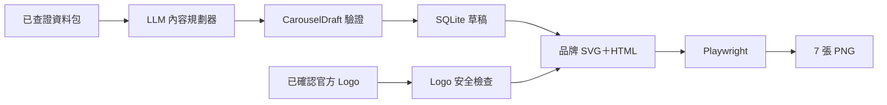

# 輪播圖資訊架構與品牌視覺重製 Implementation Plan

> **For agentic workers:** REQUIRED SUB-SKILL: Use
> superpowers:subagent-driven-development (recommended) or
> superpowers:executing-plans to implement this plan task-by-task. Steps use
> checkbox (`- [ ]`) syntax for tracking.

**Goal:** 輸入一包已查證的公司資料與一個已確認的官方 Logo，穩定產出七張資訊完整、
品牌一致、沒有大塊空洞的 1080×1350 PNG。

**Architecture:** 先把來源、文字區塊與示意圖節點整理成可驗證的 `CarouselDraft`，
再交給固定的 Logo 檢查器、品牌 SVG 元件與 HTML 模板出圖。LLM 只選敘事與圖解結構，
不能畫圖、不能提供來源以外的事實；Playwright 只負責把已驗證的 HTML 印成 PNG。

**Tech Stack:** Python 3.11+、dataclasses、SQLite JSON text、Streamlit 專案既有 LLM
adapter、Playwright Chromium、Pillow、LINE Seed TW、HTML/CSS/inline SVG、pytest。

## Global Constraints

- 設計依據：
  `docs/specs/2026-07-29-輪播圖資訊架構與品牌視覺修訂-design.md`。
- 嚴格 Red → Green → Refactor；一次只新增一個失敗測試，通過後才進下一個。
- 七頁 slug 保持 `cover`、`who`、`problem`、`how-ai`、`results`、
  `why-care`、`cta`，避免破壞既有資料。
- 第 2–6 頁敘事文字各 140–220 個非空白字元；資料不足時明說限制，不得補造。
- 每個事實 section 都要引用已知 `source_id`；模型輸出的來源名稱與日期不可信任，
  一律由程式依來源資料組合。
- Logo 只接受已確認的 SVG 或透明 PNG；第 1 頁大 Logo，第 2–7 頁右上小 Logo。
- Logo 缺少、公司不符、來源網址或確認日期缺少時阻擋產圖；已存草稿不得刪除。
- 第 3–6 頁使用固定品牌圖解元件；第 4 頁只能選分析、生成、預測、自動執行、
  基礎設施五種 AI 角色之一。
- 第 4 頁採 A1 大字直式步驟卡＋M1 無底框 Q 版頭像；不得有虛線或頭像背景框。
- 不呼叫圖片生成 API，不從一般圖片搜尋結果自動抓 Logo。
- 畫布固定 1080×1350；字體只用 LINE Seed TW 400／700／800。
- 色票固定：`#D5E6F4`、`#FBFCFE`、`#47819A`、`#8F8FA2`、
  `#F8C5A9`、`#8ACDD6`；不得使用 theme CSS variables。
- 來源跟在內容後方，不得使用 `margin-top: auto` 把來源釘到頁底。
- 第 7 頁只含三點摘要與按讚／追蹤，不含外部試用、註冊或投資建議。
- 本計畫只完成「結構化草稿 → 七張 PNG」引擎；選題頁操作、來源蒐集 UI、
  Logo 上傳與 ZIP 下載另立接線計畫。

---

## 產品理解與切片邊界

「結構化草稿」是把一大段文章拆成有名稱的小抽屜：誰受影響、原本代價、AI 角色、
人仍負責什麼，各自放進不同抽屜。它在產品裡的作用，是讓程式能檢查資訊有沒有缺，
也讓排版器知道哪段文字該放在哪裡，不必重新猜一整段自然語言。



主方案是先完成可單獨測試的產圖引擎，再接 Streamlit 使用流程。優點是事實、Logo、
排版三種錯誤能分層定位，視覺重做不會同時碰真實選題資料；限制是本計畫完成時仍需
由程式傳入來源包與 Logo。備援是一次把來源蒐集、上傳、ZIP 與畫面全接好，表面較快，
但任一頁資料不足時很難分辨是來源、模型還是排版出錯，因此不採用。

## 檔案結構

| 檔案 | 責任 | 動作 |
|---|---|---|
| `daibu/cards/pages.py` | 七頁語意、必要 section、字數與圖解種類 | 修改 |
| `daibu/cards/schema.py` | 來源、section、圖解、草稿、品牌資產型別與驗證 | 新增 |
| `daibu/cards/logo.py` | 驗證並轉成安全 data URI | 新增 |
| `daibu/cards/mascot.py` | M1 Q 版表情頭 inline SVG | 新增 |
| `daibu/cards/diagrams.py` | 第 3–6 頁固定品牌圖解元件 | 新增 |
| `daibu/cards/draft.py` | 由來源包呼叫 LLM、驗證後保存 | 修改 |
| `daibu/llm/prompt.py` | 結構化七頁 prompt 與 parser | 修改 |
| `daibu/llm/base.py` | provider 公開 `generate_text` 契約 | 修改 |
| `daibu/llm/gemini.py` | 公開文字生成入口 | 修改 |
| `daibu/llm/groq.py` | 公開文字生成入口 | 修改 |
| `daibu/db.py` | 新版草稿與來源的 migration／CRUD | 修改 |
| `daibu/cards/render.py` | 結構化頁面＋Logo＋圖解轉 HTML | 修改 |
| `daibu/cards/templates/ai-startup.html` | 新版畫布骨架 | 修改 |
| `daibu/cards/templates/ai-startup.css` | 滿版垂直敘事與 A1／M1 視覺 | 修改 |
| `daibu/cards/shoot.py` | 一次開 Chromium 輸出七張與量測版面 | 修改 |
| `tests/__init__.py` | 讓共用測資可穩定以 `tests.card_fixtures` 匯入 | 新增 |
| `tests/card_fixtures.py` | 共用的完整七頁測資 | 新增 |
| `tests/test_cards_schema.py` | 內容契約 | 新增 |
| `tests/test_db_migration.py` | 舊資料庫補欄／補表 | 修改 |
| `tests/test_db.py` | 新版草稿 round-trip 與刪除一致性 | 修改 |
| `tests/test_llm.py` | prompt／parser | 修改 |
| `tests/test_llm_contract.py` | 真實免費 provider 結構契約 | 修改 |
| `tests/test_cards_logo.py` | Logo 安全與必填規則 | 新增 |
| `tests/test_cards_diagrams.py` | 固定 SVG 與 A1／M1 | 新增 |
| `tests/test_cards_render.py` | 七頁 HTML 與品牌規則 | 修改 |
| `tests/test_cards_shoot.py` | PNG、Logo 像素、底界與 overflow | 修改 |

---

## Phase A — 先讓內容可驗證

### Task 1: 七頁結構化內容契約

**Files:**
- Modify: `daibu/cards/pages.py`
- Create: `daibu/cards/schema.py`
- Create: `tests/__init__.py`
- Create: `tests/card_fixtures.py`
- Create: `tests/test_cards_schema.py`
- Modify: `tests/test_cards_pages.py`

**Interfaces:**
- Produces:
  - `VerifiedSource(source_id, publisher, published_at, url, excerpt)`
  - `ContentSection(label, text, source_ids)`
  - `DiagramNode(title, text, expression)`
  - `DiagramSpec(kind, nodes)`
  - `CarouselPage(page_no, page_type, heading, sections, diagram, source_label)`
  - `CarouselDraft(sources, pages)`
  - `BrandAsset(company, local_path, official_source_url, verified_at)`
  - `validate_draft(draft) -> None`
  - `page_from_mapping(value, sources) -> CarouselPage`
- Consumes: 無。

- [ ] **Step 1: 寫一個會因型別不存在而失敗的完整草稿測試**

建立 `tests/__init__.py`：

```python
"""Project test support package."""
```

建立 `tests/card_fixtures.py`。測資第 2–6 頁每頁的 `text` 總長必須落在
140–220 個非空白字元；用 `assert` 固定這個前提，避免日後縮短測資讓版面測試失真。

```python
from pathlib import Path

from daibu.cards.schema import (
    BrandAsset,
    CarouselDraft,
    CarouselPage,
    ContentSection,
    DiagramNode,
    DiagramSpec,
    VerifiedSource,
)


def verified_sources() -> tuple[VerifiedSource, ...]:
    return (
        VerifiedSource(
            "S1",
            "ElevenLabs",
            "2026-07-12",
            "https://elevenlabs.io/about",
            "公司開發能保留語氣、節奏與情緒的語音模型，並提供內容製作工具。",
        ),
        VerifiedSource(
            "S2",
            "ElevenLabs",
            "2026-07-18",
            "https://elevenlabs.io/use-cases",
            "官方列出的使用情境包含有聲書、遊戲、影音內容與多語在地化。",
        ),
        VerifiedSource(
            "S3",
            "Verified News",
            "2026-07-20",
            "https://news.example/elevenlabs-profile",
            "報導說明專業配音需要錄音、重錄與逐段調整，製作排程會受人力與錄音室限制。",
        ),
    )


def _section(label: str, text: str, *source_ids: str) -> ContentSection:
    return ContentSection(label, text, tuple(source_ids))


def carousel_draft() -> CarouselDraft:
    pages = (
        CarouselPage(
            1,
            "cover",
            "讓每段文字保留說話方式",
            (
                _section(
                    "一句話定位",
                    "ElevenLabs 用 AI 生成與轉換保有語氣的聲音。",
                    "S1",
                ),
                _section("產業分類", "生成式語音", "S1"),
            ),
            None,
            "來源：ElevenLabs · 2026-07-12",
        ),
        CarouselPage(
            2,
            "who",
            "先認識 ElevenLabs",
            (
                _section(
                    "白話定位",
                    "它不是單純把文字念出來，而是把語氣、節奏和情緒一起當成聲音內容來處理。這讓創作者能先做出可調整的版本，再決定哪些地方需要真人補錄。因此它比較像聲音製作工具，而不是取代整段製作的朗讀按鈕。",
                    "S1",
                ),
                _section(
                    "基本資料",
                    "公司把產品放在內容製作流程裡，服務有聲書、遊戲、影音與多語在地化等情境。公開資料若沒有完整創辦資訊，就只呈現已確認的市場與服務對象。",
                    "S1",
                    "S2",
                ),
            ),
            None,
            "來源：ElevenLabs · 2026-07-12、2026-07-18",
        ),
        CarouselPage(
            3,
            "problem",
            "配音慢的不是朗讀本身",
            (
                _section(
                    "誰受影響",
                    "有聲書、遊戲與影音團隊常要處理大量台詞；一段內容改字，就可能重新安排配音員、錄音室與後製。小團隊尤其難同時負擔多語版本，同一作品版本越多，這些安排就越容易互相牽動。",
                    "S2",
                    "S3",
                ),
                _section(
                    "原本的代價",
                    "真正的成本不只是一小時錄音費，還有等待檔期、反覆重錄、逐段校正與版本管理。內容越常修改，前後協調時間越容易累積；如果最後才發現語氣不對，前面的流程還要再走一次。",
                    "S3",
                ),
            ),
            DiagramSpec(
                "problem-chain",
                (
                    DiagramNode("內容團隊", "大量台詞與多語版本", "listen"),
                    DiagramNode("傳統阻礙", "排檔、重錄、逐段調整", "think"),
                    DiagramNode("累積成本", "時間、人力與版本管理", "concerned"),
                ),
            ),
            "來源：ElevenLabs · 2026-07-18；Verified News · 2026-07-20",
        ),
        CarouselPage(
            4,
            "how-ai",
            "AI 重建的是說話方式",
            (
                _section(
                    "傳統做法",
                    "傳統合成語音多半把每個字念對，卻不容易保留一個人的停頓、重音與情緒；創作者仍要花時間重錄或逐句修正。",
                    "S1",
                    "S3",
                ),
                _section(
                    "AI 的角色",
                    "模型從聲音範例辨認說話特徵，再依新文字安排語氣。它處理的是可重複調整的聲音版本，不是替內容團隊決定要說什麼。",
                    "S1",
                ),
                _section(
                    "人仍負責",
                    "人要決定內容、語氣是否合適，也要確認聲音授權與最後品質。AI 先產生版本，並不等於可以不經審核直接發布。",
                    "S1",
                ),
                _section(
                    "本頁要記住",
                    "改變不是『有沒有聲音』，而是說話方式能被保存、調整，再放進新的內容。",
                    "S1",
                ),
            ),
            DiagramSpec(
                "ai-generate",
                (
                    DiagramNode("提供聲音範例", "讓模型辨認節奏與表達", "listen"),
                    DiagramNode("AI 理解特徵", "依新文字安排說話方式", "think"),
                    DiagramNode("產生可調版本", "交由人員審核與修正", "happy"),
                ),
            ),
            "來源：ElevenLabs · 2026-07-12；Verified News · 2026-07-20",
        ),
        CarouselPage(
            5,
            "results",
            "誰會把它放進工作裡",
            (
                _section(
                    "代表使用者",
                    "需要大量聲音內容的有聲書、遊戲、影音與在地化團隊，會先用它製作可聽、可修改的版本，再把人工時間留給內容判斷。",
                    "S2",
                ),
                _section(
                    "使用前後",
                    "過去每次改字都可能重新錄音；現在可以先更新文字並產生新版本，快速確認節奏與方向。需要精細演出的段落仍可回到真人錄製。",
                    "S1",
                    "S3",
                ),
                _section(
                    "購買關係",
                    "付費方買的是可整合進內容流程的語音能力與製作工具，不只是單一音檔。沒有公開客戶案例時，只描述官方展示的代表情境。",
                    "S1",
                    "S2",
                ),
            ),
            DiagramSpec(
                "before-after",
                (
                    DiagramNode("以前", "改字後重新排錄音與後製", "concerned"),
                    DiagramNode("AI 介入", "先產生可聽、可修改版本", "think"),
                    DiagramNode("現在", "人力集中在內容與品質", "happy"),
                ),
            ),
            "來源：ElevenLabs · 2026-07-12、2026-07-18；Verified News · 2026-07-20",
        ),
        CarouselPage(
            6,
            "why-care",
            "接下來看三個訊號",
            (
                _section(
                    "觀察訊號 1",
                    "聲音是否能長時間維持一致，而不是只在短句示範裡自然。這會決定產品能不能進入有聲書、遊戲等長內容。",
                    "S1",
                    "S2",
                ),
                _section(
                    "觀察訊號 2",
                    "內容團隊是否真的減少重錄與版本往返，而不只是多一個生成步驟。工作流程的改變，比單次展示更能說明價值。",
                    "S2",
                    "S3",
                ),
                _section(
                    "觀察訊號 3",
                    "聲音授權、審核和追溯機制能否跟上使用規模。生成品質越高，能不能清楚管理誰有權使用聲音就越重要。",
                    "S1",
                ),
                _section(
                    "證據限制",
                    "目前公開資料能看出產品方向與使用情境，但不足以證明所有團隊都能得到相同成果。",
                ),
            ),
            DiagramSpec(
                "signals",
                (
                    DiagramNode("長內容一致性", "不只短句自然", "listen"),
                    DiagramNode("流程是否縮短", "少重錄、少往返", "think"),
                    DiagramNode("授權可追溯", "能管理與審核", "happy"),
                ),
            ),
            "來源：ElevenLabs · 2026-07-12、2026-07-18；Verified News · 2026-07-20",
        ),
        CarouselPage(
            7,
            "cta",
            "三件值得記住的事",
            (
                _section(
                    "公司定位",
                    "它把語氣與節奏一起放進生成式語音。",
                    "S1",
                ),
                _section(
                    "AI 的角色",
                    "先產生能反覆調整的聲音版本。",
                    "S1",
                ),
                _section(
                    "觀察重點",
                    "看長內容、工作流程與聲音授權。",
                    "S1",
                    "S2",
                    "S3",
                ),
                _section("互動邀請", "按讚並追蹤呆一布，繼續看懂 AI 公司。"),
            ),
            None,
            "來源：ElevenLabs；Verified News",
        ),
    )
    draft = CarouselDraft(verified_sources(), pages)
    assert all(
        140
        <= sum(
            len("".join(section.text.split()))
            for section in page.sections
        )
        <= 220
        for page in draft.pages[1:6]
    )
    return draft


def brand_asset(path: Path) -> BrandAsset:
    return BrandAsset(
        "ElevenLabs",
        path,
        "https://elevenlabs.io/about",
        "2026-07-29",
    )
```

建立 `tests/test_cards_schema.py`：

```python
from dataclasses import replace

import pytest

from daibu.cards.schema import ContentSection, validate_draft
from tests.card_fixtures import carousel_draft


def test_complete_seven_page_draft_passes_the_content_contract():
    draft = carousel_draft()

    validate_draft(draft)

    assert len(draft.pages) == 7
    assert draft.pages[3].diagram.kind == "ai-generate"


def test_draft_rejects_unverified_metadata_and_unknown_source_ids():
    draft = carousel_draft()
    bad_source = replace(draft.sources[0], publisher="")
    with pytest.raises(ValueError, match="來源資料不完整"):
        validate_draft(replace(draft, sources=(bad_source, *draft.sources[1:])))

    first_page = draft.pages[0]
    bad_section = ContentSection("一句話定位", "內容", ("S404",))
    bad_page = replace(
        first_page,
        sections=(bad_section, first_page.sections[1]),
    )
    with pytest.raises(ValueError, match="不存在的來源"):
        validate_draft(replace(draft, pages=(bad_page, *draft.pages[1:])))
```

- [ ] **Step 2: 確認 Red**

Run:
`.venv/bin/pytest tests/test_cards_schema.py::test_complete_seven_page_draft_passes_the_content_contract -q`

Expected: FAIL — `ModuleNotFoundError: No module named 'daibu.cards.schema'`。

- [ ] **Step 3: 最小實作型別與驗證**

把 `daibu/cards/pages.py` 改成：

```python
PAGE_TYPES = (
    "cover",
    "who",
    "problem",
    "how-ai",
    "results",
    "why-care",
    "cta",
)

LABELS = {
    "cover": "封面",
    "who": "公司身分卡",
    "problem": "它解決什麼問題",
    "how-ai": "AI 在裡面扮演什麼角色",
    "results": "誰會用、怎麼用",
    "why-care": "接下來觀察什麼",
    "cta": "三件值得記住的事",
}

REQUIRED_SECTIONS = {
    "cover": {"一句話定位", "產業分類"},
    "who": {"白話定位", "基本資料"},
    "problem": {"誰受影響", "原本的代價"},
    "how-ai": {"傳統做法", "AI 的角色", "人仍負責", "本頁要記住"},
    "results": {"代表使用者", "使用前後", "購買關係"},
    "why-care": {"觀察訊號 1", "觀察訊號 2", "證據限制"},
    "cta": {"公司定位", "AI 的角色", "觀察重點", "互動邀請"},
}

AI_ROLE_KINDS = {
    "ai-analyze",
    "ai-generate",
    "ai-predict",
    "ai-automate",
    "ai-infrastructure",
}
DIAGRAM_FOR = {
    "problem": {"problem-chain"},
    "how-ai": AI_ROLE_KINDS,
    "results": {"before-after"},
    "why-care": {"signals"},
}
LIMITS = {
    "hook": 26,
    "company": 20,
    "heading": 24,
    "inner_min": 140,
    "inner_max": 220,
}


def label(page_type: str) -> str:
    return LABELS[page_type]
```

建立 `daibu/cards/schema.py`：

```python
from dataclasses import dataclass
from datetime import date
from pathlib import Path
from typing import Mapping
from urllib.parse import urlparse

from daibu.cards import pages


@dataclass(frozen=True)
class VerifiedSource:
    source_id: str
    publisher: str
    published_at: str
    url: str
    excerpt: str


@dataclass(frozen=True)
class ContentSection:
    label: str
    text: str
    source_ids: tuple[str, ...]


@dataclass(frozen=True)
class DiagramNode:
    title: str
    text: str
    expression: str = ""


@dataclass(frozen=True)
class DiagramSpec:
    kind: str
    nodes: tuple[DiagramNode, ...]


@dataclass(frozen=True)
class CarouselPage:
    page_no: int
    page_type: str
    heading: str
    sections: tuple[ContentSection, ...]
    diagram: DiagramSpec | None
    source_label: str


@dataclass(frozen=True)
class CarouselDraft:
    sources: tuple[VerifiedSource, ...]
    pages: tuple[CarouselPage, ...]


@dataclass(frozen=True)
class BrandAsset:
    company: str
    local_path: Path
    official_source_url: str
    verified_at: str


def narrative_chars(page: CarouselPage) -> int:
    return sum(len("".join(section.text.split())) for section in page.sections)


def _source_label(
    sections: tuple[ContentSection, ...],
    sources: tuple[VerifiedSource, ...],
) -> str:
    used = {item for section in sections for item in section.source_ids}
    entries = []
    for source in sources:
        if source.source_id in used:
            label = f"{source.publisher} · {source.published_at}"
            if label not in entries:
                entries.append(label)
    return "來源：" + "；".join(entries)


def page_from_mapping(
    value: Mapping[str, object],
    sources: tuple[VerifiedSource, ...],
) -> CarouselPage:
    sections = tuple(
        ContentSection(
            str(item["label"]),
            str(item["text"]),
            tuple(str(source_id) for source_id in item.get("source_ids", [])),
        )
        for item in value.get("sections", [])
    )
    raw_diagram = value.get("diagram")
    diagram = None
    if isinstance(raw_diagram, Mapping):
        diagram = DiagramSpec(
            str(raw_diagram.get("kind", "")),
            tuple(
                DiagramNode(
                    str(node.get("title", "")),
                    str(node.get("text", "")),
                    str(node.get("expression", "")),
                )
                for node in raw_diagram.get("nodes", [])
                if isinstance(node, Mapping)
            ),
        )
    return CarouselPage(
        int(value["page_no"]),
        str(value["page_type"]),
        str(value["heading"]),
        sections,
        diagram,
        _source_label(sections, sources),
    )


def validate_draft(draft: CarouselDraft) -> None:
    source_ids = [source.source_id for source in draft.sources]
    if len(source_ids) != len(set(source_ids)):
        raise ValueError("來源 ID 不可重複")
    for source in draft.sources:
        values = (
            source.source_id,
            source.publisher,
            source.published_at,
            source.url,
            source.excerpt,
        )
        if not all(value.strip() for value in values):
            raise ValueError("來源資料不完整")
        parsed = urlparse(source.url)
        if parsed.scheme != "https" or not parsed.netloc:
            raise ValueError("來源網址必須是 https")
        try:
            date.fromisoformat(source.published_at)
        except ValueError as error:
            raise ValueError("來源日期必須是 YYYY-MM-DD") from error

    expected = list(enumerate(pages.PAGE_TYPES, start=1))
    actual = [(page.page_no, page.page_type) for page in draft.pages]
    if actual != expected:
        raise ValueError("輪播必須依固定順序包含七頁")

    known_sources = {source.source_id for source in draft.sources}
    for page in draft.pages:
        labels = {section.label for section in page.sections}
        missing = pages.REQUIRED_SECTIONS[page.page_type] - labels
        if missing:
            raise ValueError(
                f"{page.page_type} 缺少 section：{', '.join(sorted(missing))}"
            )

        if page.page_type in pages.DIAGRAM_FOR:
            if page.diagram is None:
                raise ValueError(f"{page.page_type} 缺少品牌圖解")
            if page.diagram.kind not in pages.DIAGRAM_FOR[page.page_type]:
                raise ValueError(f"{page.page_type} 使用了不相容的圖解")
        elif page.diagram is not None:
            raise ValueError(f"{page.page_type} 不應放主圖解")

        if page.page_type in pages.PAGE_TYPES[1:6]:
            count = narrative_chars(page)
            if not pages.LIMITS["inner_min"] <= count <= pages.LIMITS["inner_max"]:
                raise ValueError(
                    f"{page.page_type} 文字需為 "
                    f"{pages.LIMITS['inner_min']}–{pages.LIMITS['inner_max']} 字，"
                    f"目前 {count} 字"
                )

        for section in page.sections:
            unknown = set(section.source_ids) - known_sources
            if unknown:
                raise ValueError(f"引用不存在的來源：{', '.join(sorted(unknown))}")
            may_be_unsourced = section.label in {"互動邀請", "證據限制"}
            if not section.source_ids and not may_be_unsourced:
                raise ValueError(f"{section.label} 是事實區塊，必須附來源")

    cta = " ".join(section.text for section in draft.pages[-1].sections)
    if any(word in cta for word in ("試用", "註冊", "下載", "投資", "官網看看")):
        raise ValueError("第 7 頁只能邀請按讚或追蹤")
```

- [ ] **Step 4: 確認 Green，並修正既有 page 常數測試**

更新 `tests/test_cards_pages.py`，把舊 label 與 60 字上限斷言改為：

```python
def test_page_labels_match_the_approved_reader_tasks():
    assert pages.label("results") == "誰會用、怎麼用"
    assert pages.label("why-care") == "接下來觀察什麼"
    assert pages.label("cta") == "三件值得記住的事"


def test_inner_pages_have_a_narrative_density_target():
    assert pages.LIMITS["inner_min"] == 140
    assert pages.LIMITS["inner_max"] == 220
    assert pages.AI_ROLE_KINDS == {
        "ai-analyze",
        "ai-generate",
        "ai-predict",
        "ai-automate",
        "ai-infrastructure",
    }
```

刪除既有 `MASCOT_FOR` 與舊 `LIMITS == {...body: 60}` 的兩個測試。

Run: `.venv/bin/pytest tests/test_cards_schema.py tests/test_cards_pages.py -q`

Expected: PASS。

- [ ] **Step 5: Commit**

```bash
git add daibu/cards/pages.py daibu/cards/schema.py tests/__init__.py \
  tests/card_fixtures.py \
  tests/test_cards_schema.py tests/test_cards_pages.py
git commit -m "feat(cards): define verified seven-page content contract"
```

---

### Task 2: 結構化草稿與來源可安全存回 SQLite

**Files:**
- Modify: `daibu/db.py`
- Modify: `tests/test_db_migration.py`
- Modify: `tests/test_db.py`

**Interfaces:**
- Consumes: Task 1 的 `CarouselDraft`、`CarouselPage`、`VerifiedSource`。
- Produces:
  - `db.save_carousel_draft(conn, idea_id, draft) -> None`
  - `db.get_carousel_draft(conn, idea_id) -> CarouselDraft | None`
- 保留既有 `save_carousel`／`get_carousel`，直到 Streamlit 接線階段移除舊編輯介面。

- [ ] **Step 1: 寫 migration 失敗測試**

在 `tests/test_db_migration.py` 新增：

```python
def test_migration_adds_structured_carousel_storage_idempotently(tmp_path):
    path = tmp_path / "carousel.db"
    conn = db.connect(str(path))
    db.init_schema(conn)
    conn.execute("ALTER TABLE carousel_pages DROP COLUMN sections_json")
    conn.execute("ALTER TABLE carousel_pages DROP COLUMN diagram_json")
    conn.execute("ALTER TABLE carousel_pages DROP COLUMN source_label")
    conn.execute("DROP TABLE carousel_sources")
    conn.commit()

    db.init_schema(conn)
    db.init_schema(conn)

    columns = {
        row["name"]
        for row in conn.execute("PRAGMA table_info(carousel_pages)")
    }
    assert {"sections_json", "diagram_json", "source_label"} <= columns
    assert conn.execute(
        "SELECT name FROM sqlite_master "
        "WHERE type='table' AND name='carousel_sources'"
    ).fetchone()
```

- [ ] **Step 2: 確認 Red**

Run:
`.venv/bin/pytest tests/test_db_migration.py::test_migration_adds_structured_carousel_storage_idempotently -q`

Expected: FAIL — `no such column: "sections_json"` 或找不到 `carousel_sources`。

- [ ] **Step 3: 最小 migration**

在 `init_schema()` 的 `executescript` 加入：

```sql
CREATE TABLE IF NOT EXISTS carousel_sources (
    idea_id INTEGER NOT NULL,
    source_key TEXT NOT NULL,
    publisher TEXT NOT NULL,
    published_at TEXT NOT NULL,
    url TEXT NOT NULL,
    excerpt TEXT NOT NULL,
    PRIMARY KEY (idea_id, source_key),
    FOREIGN KEY (idea_id) REFERENCES ideas(id)
);
```

把 `carousel_pages` 的建表定義補成：

```sql
sections_json TEXT NOT NULL DEFAULT '[]',
diagram_json TEXT NOT NULL DEFAULT '',
source_label TEXT NOT NULL DEFAULT '',
```

在 `idea_columns` 補欄邏輯後加入：

```python
    page_columns = _table_columns(conn, "carousel_pages")
    structured_columns = {
        "sections_json": "'[]'",
        "diagram_json": "''",
        "source_label": "''",
    }
    for column, default in structured_columns.items():
        if column not in page_columns:
            conn.execute(
                "ALTER TABLE carousel_pages "
                f"ADD COLUMN {column} TEXT NOT NULL DEFAULT {default}"
            )
```

Run:
`.venv/bin/pytest tests/test_db_migration.py::test_migration_adds_structured_carousel_storage_idempotently -q`

Expected: PASS。

- [ ] **Step 4: 寫 round-trip 失敗測試**

在 `tests/test_db.py` 新增：

```python
def test_structured_carousel_round_trip_and_delete(tmp_path):
    from daibu.llm.base import Idea
    from tests.card_fixtures import carousel_draft

    conn = db.connect(str(tmp_path / "t.db"))
    db.init_schema(conn)
    idea_id = db.add_idea(conn, None, Idea("t", "a", ""))
    expected = carousel_draft()

    db.save_carousel_draft(conn, idea_id, expected)

    assert db.get_carousel_draft(conn, idea_id) == expected
    db.delete_idea(conn, idea_id)
    assert conn.execute(
        "SELECT COUNT(*) FROM carousel_sources"
    ).fetchone()[0] == 0
```

- [ ] **Step 5: 確認 Red**

Run:
`.venv/bin/pytest tests/test_db.py::test_structured_carousel_round_trip_and_delete -q`

Expected: FAIL — `AttributeError: module 'daibu.db' has no attribute 'save_carousel_draft'`。

- [ ] **Step 6: 實作原子寫入與讀回**

在 `daibu/db.py` 匯入 `json`、`asdict` 與 schema 型別，新增：

```python
import json
from dataclasses import asdict

from daibu.cards.schema import (
    CarouselDraft,
    CarouselPage,
    ContentSection,
    DiagramNode,
    DiagramSpec,
    VerifiedSource,
    validate_draft,
)


def save_carousel_draft(
    conn: sqlite3.Connection,
    idea_id: int,
    draft: CarouselDraft,
) -> None:
    validate_draft(draft)
    with conn:
        conn.execute(
            "DELETE FROM carousel_pages WHERE idea_id = ?",
            (idea_id,),
        )
        conn.execute(
            "DELETE FROM carousel_sources WHERE idea_id = ?",
            (idea_id,),
        )
        conn.executemany(
            """
            INSERT INTO carousel_sources (
                idea_id, source_key, publisher, published_at, url, excerpt
            ) VALUES (?, ?, ?, ?, ?, ?)
            """,
            [
                (
                    idea_id,
                    source.source_id,
                    source.publisher,
                    source.published_at,
                    source.url,
                    source.excerpt,
                )
                for source in draft.sources
            ],
        )
        conn.executemany(
            """
            INSERT INTO carousel_pages (
                idea_id, page_no, page_type, heading, body,
                grounding, source_quote, sections_json, diagram_json,
                source_label, updated_at
            ) VALUES (?, ?, ?, ?, ?, 'source', '', ?, ?, ?, ?)
            """,
            [
                (
                    idea_id,
                    page.page_no,
                    page.page_type,
                    page.heading,
                    "\n".join(section.text for section in page.sections),
                    json.dumps(
                        [asdict(section) for section in page.sections],
                        ensure_ascii=False,
                    ),
                    (
                        json.dumps(asdict(page.diagram), ensure_ascii=False)
                        if page.diagram
                        else ""
                    ),
                    page.source_label,
                    _now(),
                )
                for page in draft.pages
            ],
        )


def get_carousel_draft(
    conn: sqlite3.Connection,
    idea_id: int,
) -> CarouselDraft | None:
    source_rows = conn.execute(
        """
        SELECT source_key, publisher, published_at, url, excerpt
        FROM carousel_sources
        WHERE idea_id = ?
        ORDER BY source_key
        """,
        (idea_id,),
    ).fetchall()
    page_rows = conn.execute(
        """
        SELECT page_no, page_type, heading, sections_json,
               diagram_json, source_label
        FROM carousel_pages
        WHERE idea_id = ? AND sections_json != '[]'
        ORDER BY page_no
        """,
        (idea_id,),
    ).fetchall()
    if not page_rows:
        return None

    sources = tuple(
        VerifiedSource(
            row["source_key"],
            row["publisher"],
            row["published_at"],
            row["url"],
            row["excerpt"],
        )
        for row in source_rows
    )
    pages = []
    for row in page_rows:
        sections = tuple(
            ContentSection(
                item["label"],
                item["text"],
                tuple(item["source_ids"]),
            )
            for item in json.loads(row["sections_json"])
        )
        raw_diagram = (
            json.loads(row["diagram_json"])
            if row["diagram_json"]
            else None
        )
        diagram = (
            DiagramSpec(
                raw_diagram["kind"],
                tuple(
                    DiagramNode(
                        node["title"],
                        node["text"],
                        node.get("expression", ""),
                    )
                    for node in raw_diagram["nodes"]
                ),
            )
            if raw_diagram
            else None
        )
        pages.append(
            CarouselPage(
                row["page_no"],
                row["page_type"],
                row["heading"],
                sections,
                diagram,
                row["source_label"],
            )
        )
    draft = CarouselDraft(sources, tuple(pages))
    validate_draft(draft)
    return draft
```

在 `delete_idea()` 刪 `ideas` 前加入：

```python
    conn.execute(
        "DELETE FROM carousel_sources WHERE idea_id = ?",
        (idea_id,),
    )
```

在 `delete_theme()` 刪 `ideas` 前加入：

```python
    conn.execute(
        """
        DELETE FROM carousel_sources
        WHERE idea_id IN (SELECT id FROM ideas WHERE theme_id = ?)
        """,
        (theme_id,),
    )
```

- [ ] **Step 7: 確認 Green 與回歸**

Run:
`.venv/bin/pytest tests/test_db.py tests/test_db_migration.py -q`

Expected: PASS，既有舊草稿測試也維持綠燈。

- [ ] **Step 8: Commit**

```bash
git add daibu/db.py tests/test_db.py tests/test_db_migration.py
git commit -m "feat(db): persist sourced carousel drafts"
```

---

### Task 3: LLM 只能依來源包產生七頁結構

**Files:**
- Modify: `daibu/llm/prompt.py`
- Modify: `daibu/cards/draft.py`
- Modify: `daibu/llm/base.py`
- Modify: `daibu/llm/gemini.py`
- Modify: `daibu/llm/groq.py`
- Modify: `tests/card_fixtures.py`
- Modify: `tests/test_llm.py`
- Modify: `tests/test_cards_draft.py`
- Modify: `tests/test_llm_contract.py`

**Interfaces:**
- Consumes: `VerifiedSource`、`CarouselDraft`、`db.save_carousel_draft`。
- Produces:
  - `prompt.build_carousel(company, title, angle, sources) -> str`
  - `prompt.parse_carousel(raw, sources) -> CarouselDraft`
  - `LLMProvider.generate_text(prompt_text) -> str`
  - `draft.generate(conn, idea, sources, generate_text) -> CarouselDraft`

- [ ] **Step 1: 寫 prompt／parser 失敗測試**

在 `tests/card_fixtures.py` 新增：

```python
import json
from dataclasses import asdict


def structured_llm_response() -> str:
    payload = []
    for page in carousel_draft().pages:
        payload.append(
            {
                "page_no": page.page_no,
                "page_type": page.page_type,
                "heading": page.heading,
                "sections": [asdict(section) for section in page.sections],
                "diagram": asdict(page.diagram) if page.diagram else None,
            }
        )
    return json.dumps(payload, ensure_ascii=False)
```

把 `tests/test_llm.py` 舊 `parse_carousel` 與 60 字 prompt 測試換成：

```python
def test_carousel_prompt_and_parser_use_only_verified_source_ids():
    from daibu.cards import pages
    from tests.card_fixtures import (
        structured_llm_response,
        verified_sources,
    )

    sources = verified_sources()
    text = prompt.build_carousel("ElevenLabs", "t", "a", sources)
    draft = prompt.parse_carousel(structured_llm_response(), sources)

    assert [page.page_type for page in draft.pages] == list(pages.PAGE_TYPES)
    assert draft.pages[3].diagram.kind == "ai-generate"
    assert draft.pages[0].source_label.startswith("來源：ElevenLabs")
    assert "140–220" in text
    assert "ai-infrastructure" in text
    assert "來源中沒有的公司、人物、客戶、數字或能力" in text
    assert "目前公開證據有限" in text
```

- [ ] **Step 2: 確認 Red**

Run:
`.venv/bin/pytest tests/test_llm.py::test_carousel_prompt_and_parser_use_only_verified_source_ids -q`

Expected: FAIL — 現有函式仍接收 `source_excerpt: str`，parser 也回傳 `list[dict]`。

- [ ] **Step 3: 實作結構化 prompt／parser**

`daibu/llm/prompt.py` 保留選題用的 `build`／`parse_ideas`，以以下函式取代舊輪播版本：

```python
def build_carousel(
    company: str,
    title: str,
    angle: str,
    sources: tuple["VerifiedSource", ...],
) -> str:
    from dataclasses import asdict

    from daibu.cards import pages

    source_payload = [asdict(source) for source in sources]
    return f"""
你是「呆一布 AI 共學實驗室」的公司介紹編輯。
請把下列已查證資料整理成剛好七頁 IG 輪播。

公司：{company}
既有定位：{title}
選題角度：{angle}
已查證資料：
{json.dumps(source_payload, ensure_ascii=False)}

固定頁序：
1 cover：大型 Logo 之外，提供一句話定位與產業分類
2 who：白話定位、成立年份、地點、創辦人；缺少其中一項時，
  只用來源已確認的主要市場、服務對象或所在地替代
3 problem：誰受影響、原本的時間／金錢／操作／能力代價
4 how-ai：傳統做法、AI 的角色、人仍負責、本頁要記住
5 results：代表使用者、使用前後、購買關係；缺案例就用官方示範情境
6 why-care：觀察訊號 1、觀察訊號 2、可選訊號 3、證據限制
7 cta：公司定位、AI 的角色、觀察重點、按讚／追蹤邀請

第 4 頁 diagram.kind 只能選：
ai-analyze、ai-generate、ai-predict、ai-automate、ai-infrastructure。
第 3、5、6 頁依序使用 problem-chain、before-after、signals。
第 1、2、7 頁 diagram 必須是 null。

第 2–6 頁 sections 的 text 合計各 140–220 個非空白字元。
每個事實 section 的 source_ids 只能引用上方已提供的 source_id。
不得加入來源中沒有的公司、人物、客戶、數字或能力。
資料不足時刪掉數字，或明寫「目前公開證據有限」，不可用模型常識補齊。
source_label 不要輸出，由程式依 source_ids 組合。
第 7 頁不可引導外部試用、註冊、下載或投資，只能按讚與追蹤。
語氣要淺顯、講因果、降低焦慮，不寫「不學就被取代」。

只輸出 JSON 陣列。每頁只含 page_no、page_type、heading、sections、diagram。
section 只含 label、text、source_ids。
diagram 只含 kind、nodes；每個 node 只含 title、text、expression。
""".strip()


def parse_carousel(
    raw: str,
    sources: tuple["VerifiedSource", ...],
) -> "CarouselDraft":
    from daibu.cards.schema import (
        CarouselDraft,
        page_from_mapping,
        validate_draft,
    )

    array_start = raw.find("[")
    if array_start < 0:
        raise ValueError("LLM 回覆中找不到 JSON 陣列")
    decoded, _ = json.JSONDecoder().raw_decode(raw[array_start:])
    if not isinstance(decoded, list):
        raise ValueError("輪播 JSON 必須是陣列")
    pages = tuple(
        page_from_mapping(item, sources)
        for item in decoded
        if isinstance(item, dict)
    )
    draft = CarouselDraft(sources, pages)
    validate_draft(draft)
    return draft
```

在 `TYPE_CHECKING` 區塊匯入 schema 型別，避免 runtime import cycle：

```python
from typing import TYPE_CHECKING

if TYPE_CHECKING:
    from daibu.cards.schema import CarouselDraft, VerifiedSource
```

- [ ] **Step 4: 確認 prompt／parser Green**

Run:
`.venv/bin/pytest tests/test_llm.py::test_carousel_prompt_and_parser_use_only_verified_source_ids -q`

Expected: PASS。

- [ ] **Step 5: 寫產生後保存的失敗測試**

把 `tests/test_cards_draft.py::test_generate_saves_seven_pages` 改成：

```python
def test_generate_validates_and_saves_structured_draft(tmp_path):
    from tests.card_fixtures import (
        structured_llm_response,
        verified_sources,
    )

    conn = db.connect(str(tmp_path / "t.db"))
    db.init_schema(conn)
    idea_id = db.add_idea(
        conn,
        None,
        Idea(
            title="讓文字保留說話方式",
            angle="聲音內容工作被改寫",
            source_url="https://elevenlabs.io/about",
            company="ElevenLabs",
            source_excerpt=LONG_EXCERPT,
        ),
    )
    idea = next(item for item in db.get_ideas(conn) if item.id == idea_id)

    result = draft.generate(
        conn,
        idea,
        verified_sources(),
        lambda _text: structured_llm_response(),
    )

    assert result == db.get_carousel_draft(conn, idea_id)
```

- [ ] **Step 6: 確認 Red，然後改 `draft.generate`**

Run:
`.venv/bin/pytest tests/test_cards_draft.py::test_generate_validates_and_saves_structured_draft -q`

Expected: FAIL — 舊 `generate` 參數數量不符。

`daibu/cards/draft.py` 改為：

```python
def generate(
    conn: sqlite3.Connection,
    idea: StoredIdea,
    sources: tuple["VerifiedSource", ...],
    generate_text: Callable[[str], str],
) -> "CarouselDraft":
    if not idea.company.strip():
        raise ValueError("這則題目沒有公司名，無法產生輪播草稿")
    if not sources:
        raise ValueError("至少需要一筆已查證來源")

    prompt_text = prompt.build_carousel(
        idea.company,
        idea.title,
        idea.angle,
        sources,
    )
    last_raw = ""
    last_error: ValueError | None = None
    for _ in range(2):
        last_raw = generate_text(prompt_text)
        try:
            result = prompt.parse_carousel(last_raw, sources)
            db.save_carousel_draft(conn, idea.id, result)
            return result
        except ValueError as error:
            last_error = error
    raise base.LLMResponseError(last_raw) from last_error
```

在檔頭加入：

```python
from typing import TYPE_CHECKING
from daibu.llm import base

if TYPE_CHECKING:
    from daibu.cards.schema import CarouselDraft, VerifiedSource
```

Run: `.venv/bin/pytest tests/test_cards_draft.py -q`

Expected: PASS；並把舊 `_fake_response()` 與舊 signature 測試同步改用
`structured_llm_response()`、`verified_sources()`。

- [ ] **Step 7: 公開 provider 的文字生成契約**

在 `LLMProvider` protocol 加入：

```python
    def generate_text(self, prompt_text: str) -> str: ...
```

`GeminiProvider` 與 `GroqProvider` 都把 `_generate_text` 政名為 `generate_text`，
`generate_ideas()` 內也改成：

```python
        return generate_and_parse(self.generate_text, text)
```

在 `tests/test_llm_contract.py` 新增真實邊界測試：

```python
@pytest.mark.contract
@pytest.mark.skipif(
    not os.getenv("GEMINI_API_KEY") and not os.getenv("GROQ_API_KEY"),
    reason="無 LLM key",
)
def test_real_llm_returns_valid_sourced_carousel():
    from daibu.llm import prompt
    from tests.card_fixtures import verified_sources

    provider = base.get_provider_from_env()
    sources = verified_sources()
    raw = provider.generate_text(
        prompt.build_carousel("ElevenLabs", "生成式語音", "理解工作改變", sources)
    )

    result = prompt.parse_carousel(raw, sources)

    assert len(result.pages) == 7
    assert all(page.sections for page in result.pages)
```

Run:
`.venv/bin/pytest tests/test_llm.py tests/test_cards_draft.py -q`

Expected: PASS。

Run（有 key 的環境才執行）:
`.venv/bin/pytest tests/test_llm_contract.py::test_real_llm_returns_valid_sourced_carousel -q -m contract`

Expected: PASS；若免費模型無法遵守 schema，應調整 prompt 或 parser 的清楚度，不得放寬
來源與字數驗證來讓測試假綠。

- [ ] **Step 8: Commit**

```bash
git add daibu/llm/prompt.py daibu/cards/draft.py daibu/llm/base.py \
  daibu/llm/gemini.py daibu/llm/groq.py tests/card_fixtures.py \
  tests/test_llm.py tests/test_cards_draft.py tests/test_llm_contract.py
git commit -m "feat(cards): generate sourced structured carousel copy"
```

---

## Phase B — 讓視覺資產可控

### Task 4: 官方 Logo 是產圖硬門檻

**Files:**
- Create: `daibu/cards/logo.py`
- Create: `tests/test_cards_logo.py`

**Interfaces:**
- Consumes: `BrandAsset`。
- Produces:
  - `BrandAssetRequired(ValueError)`
  - `InvalidBrandAsset(ValueError)`
  - `logo_data_uri(asset, company) -> str`

- [ ] **Step 1: 寫缺 Logo 與合法 PNG 的失敗測試**

建立 `tests/test_cards_logo.py`：

```python
from pathlib import Path

import pytest
from PIL import Image

from daibu.cards import logo
from tests.card_fixtures import brand_asset


def test_logo_is_required_and_verified_png_becomes_data_uri(tmp_path):
    with pytest.raises(logo.BrandAssetRequired, match="官方 Logo"):
        logo.logo_data_uri(None, "ElevenLabs")

    path = Path(tmp_path) / "logo.png"
    Image.new("RGBA", (80, 40), (201, 50, 120, 255)).save(path)

    result = logo.logo_data_uri(brand_asset(path), "ElevenLabs")

    assert result.startswith("data:image/png;base64,")
```

- [ ] **Step 2: 確認 Red**

Run:
`.venv/bin/pytest tests/test_cards_logo.py::test_logo_is_required_and_verified_png_becomes_data_uri -q`

Expected: FAIL — 找不到 `daibu.cards.logo`。

- [ ] **Step 3: 實作 PNG／metadata 驗證**

建立 `daibu/cards/logo.py`：

```python
import base64
from datetime import date
from urllib.parse import urlparse
from xml.etree import ElementTree

from daibu.cards.schema import BrandAsset


class BrandAssetRequired(ValueError):
    pass


class InvalidBrandAsset(ValueError):
    pass


def _validate_metadata(asset: BrandAsset, company: str) -> None:
    if asset.company.strip().casefold() != company.strip().casefold():
        raise InvalidBrandAsset("Logo 公司名稱與輪播公司不符")
    source = urlparse(asset.official_source_url)
    if source.scheme != "https" or not source.netloc:
        raise InvalidBrandAsset("Logo 必須保留官方 https 來源網址")
    try:
        date.fromisoformat(asset.verified_at)
    except ValueError as error:
        raise InvalidBrandAsset("Logo 確認日期必須是 YYYY-MM-DD") from error
    if not asset.local_path.is_file():
        raise InvalidBrandAsset("找不到已確認的 Logo 檔案")


def logo_data_uri(
    asset: BrandAsset | None,
    company: str,
) -> str:
    if asset is None:
        raise BrandAssetRequired("請提供或確認官方 Logo")
    _validate_metadata(asset, company)
    suffix = asset.local_path.suffix.lower()
    data = asset.local_path.read_bytes()
    if suffix == ".png":
        if not data.startswith(b"\x89PNG\r\n\x1a\n"):
            raise InvalidBrandAsset("PNG Logo 檔案格式不正確")
        mime = "image/png"
    elif suffix == ".svg":
        _validate_svg(data)
        mime = "image/svg+xml"
    else:
        raise InvalidBrandAsset("Logo 只接受 SVG 或透明 PNG")
    encoded = base64.b64encode(data).decode("ascii")
    return f"data:{mime};base64,{encoded}"
```

- [ ] **Step 4: 寫危險 SVG 失敗測試，再補安全檢查**

新增：

```python
def test_logo_rejects_svg_with_script(tmp_path):
    path = Path(tmp_path) / "logo.svg"
    path.write_text(
        '<svg xmlns="http://www.w3.org/2000/svg">'
        '<script>alert(1)</script></svg>',
        encoding="utf-8",
    )

    with pytest.raises(logo.InvalidBrandAsset, match="不安全"):
        logo.logo_data_uri(brand_asset(path), "ElevenLabs")
```

Run:
`.venv/bin/pytest tests/test_cards_logo.py::test_logo_rejects_svg_with_script -q`

Expected: FAIL — `_validate_svg` 尚不存在。

在 `logo.py` 加入：

```python
def _local_name(value: str) -> str:
    return value.rsplit("}", maxsplit=1)[-1].lower()


def _validate_svg(data: bytes) -> None:
    try:
        root = ElementTree.fromstring(data)
    except ElementTree.ParseError as error:
        raise InvalidBrandAsset("SVG Logo 無法解析") from error
    if _local_name(root.tag) != "svg":
        raise InvalidBrandAsset("SVG Logo 根節點必須是 svg")

    blocked_tags = {"script", "foreignobject", "iframe", "object", "embed"}
    for element in root.iter():
        if _local_name(element.tag) in blocked_tags:
            raise InvalidBrandAsset("SVG Logo 含不安全內容")
        for name, value in element.attrib.items():
            local_name = _local_name(name)
            if local_name.startswith("on"):
                raise InvalidBrandAsset("SVG Logo 含不安全事件")
            if local_name in {"href", "src"} and (
                value.startswith("http:") or value.startswith("https:")
            ):
                raise InvalidBrandAsset("SVG Logo 不可載入外部資源")
```

Run: `.venv/bin/pytest tests/test_cards_logo.py -q`

Expected: PASS。

- [ ] **Step 5: Commit**

```bash
git add daibu/cards/logo.py tests/test_cards_logo.py
git commit -m "feat(cards): require verified company logos"
```

---

### Task 5: 固定品牌圖解與 M1 Q 版表情

**Files:**
- Create: `daibu/cards/mascot.py`
- Create: `daibu/cards/diagrams.py`
- Create: `tests/test_cards_diagrams.py`

**Interfaces:**
- Consumes: `DiagramSpec`。
- Produces:
  - `mascot.q_head_svg(expression) -> str`
  - `diagrams.diagram_html(spec) -> str`

- [ ] **Step 1: 寫所有圖解種類與 A1／M1 的失敗測試**

建立 `tests/test_cards_diagrams.py`：

```python
import pytest

from daibu.cards import diagrams
from daibu.cards.schema import DiagramNode, DiagramSpec


@pytest.mark.parametrize(
    "kind",
    (
        "problem-chain",
        "ai-analyze",
        "ai-generate",
        "ai-predict",
        "ai-automate",
        "ai-infrastructure",
        "before-after",
        "signals",
    ),
)
def test_every_diagram_uses_the_fixed_brand_component_set(kind):
    spec = DiagramSpec(
        kind,
        (
            DiagramNode("第一步", "先理解情境", "listen"),
            DiagramNode("第二步", "整理關係", "think"),
            DiagramNode("第三步", "交給人判斷", "happy"),
        ),
    )

    result = diagrams.diagram_html(spec)

    assert f'data-diagram-kind="{kind}"' in result
    assert "<svg" in result
    assert "http://" not in result and "https://" not in result


def test_ai_role_diagram_is_a1_with_unframed_m1_heads_and_no_dotted_line():
    spec = DiagramSpec(
        "ai-generate",
        (
            DiagramNode("聲音範例", "辨認說話方式", "listen"),
            DiagramNode("AI 理解", "安排新文字語氣", "think"),
            DiagramNode("人員確認", "審核並微調", "happy"),
        ),
    )

    result = diagrams.diagram_html(spec)

    assert result.count('class="q-head"') == 3
    assert 'class="step-row"><svg class="q-head"' in result
    assert 'class="step-card"' in result
    assert "mascot-frame" not in result
    assert "stroke-dasharray" not in result
    assert "connector-line" not in result
```

- [ ] **Step 2: 確認 Red**

Run: `.venv/bin/pytest tests/test_cards_diagrams.py -q`

Expected: FAIL — 找不到 `diagrams`。

- [ ] **Step 3: 實作 M1 頭像**

建立 `daibu/cards/mascot.py`：

```python
EXPRESSIONS = {"listen", "think", "happy", "concerned"}


def q_head_svg(expression: str) -> str:
    if expression not in EXPRESSIONS:
        expression = "think"
    eyes = {
        "listen": '<circle cx="39" cy="51" r="5"/><circle cx="65" cy="51" r="5"/>',
        "think": '<circle cx="39" cy="51" r="5"/><circle cx="65" cy="49" r="3"/>',
        "happy": (
            '<path d="M34 49q5 7 10 0" fill="none"/>'
            '<path d="M60 49q5 7 10 0" fill="none"/>'
        ),
        "concerned": '<circle cx="39" cy="51" r="5"/><circle cx="65" cy="51" r="5"/>',
    }[expression]
    mouth = {
        "listen": "M43 66q9 8 18 0",
        "think": "M44 68q8-3 16 0",
        "happy": "M40 64q12 14 24 0",
        "concerned": "M43 72q9-8 18 0",
    }[expression]
    return (
        '<svg class="q-head" viewBox="0 0 104 96" '
        'aria-hidden="true" focusable="false">'
        '<path d="M52 16V8" stroke="#47819A" stroke-width="4" '
        'stroke-linecap="round"/>'
        '<circle cx="52" cy="7" r="6" fill="#F8C5A9"/>'
        '<path d="M20 32Q20 20 34 20H70Q84 20 84 32V63'
        'Q84 80 68 80H36Q20 80 20 63Z" fill="#FBFCFE" '
        'stroke="#8ACDD6" stroke-width="6"/>'
        '<circle cx="17" cy="51" r="5" fill="#F8C5A9"/>'
        '<circle cx="87" cy="51" r="5" fill="#F8C5A9"/>'
        f'<g fill="#47819A" stroke="#47819A" stroke-width="3" '
        f'stroke-linecap="round">{eyes}'
        f'<path d="{mouth}" fill="none"/></g>'
        '<circle cx="32" cy="63" r="4" fill="#F8C5A9" opacity=".65"/>'
        '<circle cx="72" cy="63" r="4" fill="#F8C5A9" opacity=".65"/>'
        "</svg>"
    )
```

- [ ] **Step 4: 實作四種固定 layout**

建立 `daibu/cards/diagrams.py`：

```python
import html

from daibu.cards.mascot import q_head_svg
from daibu.cards.schema import DiagramNode, DiagramSpec


def _node(node: DiagramNode, class_name: str) -> str:
    return (
        f'<div class="{class_name}">'
        f'{q_head_svg(node.expression)}'
        '<div class="diagram-copy">'
        f'<strong>{html.escape(node.title)}</strong>'
        f'<span>{html.escape(node.text)}</span>'
        "</div></div>"
    )


def _step(node: DiagramNode) -> str:
    return (
        '<div class="step-row">'
        f'{q_head_svg(node.expression)}'
        '<div class="step-card"><div class="diagram-copy">'
        f'<strong>{html.escape(node.title)}</strong>'
        f'<span>{html.escape(node.text)}</span>'
        "</div></div></div>"
    )


def _arrow_svg() -> str:
    return (
        '<svg class="diagram-arrow" viewBox="0 0 48 24" aria-hidden="true">'
        '<path d="M4 12h34m-8-8 8 8-8 8" fill="none" '
        'stroke="#F8C5A9" stroke-width="5" stroke-linecap="round" '
        'stroke-linejoin="round"/></svg>'
    )


def diagram_html(spec: DiagramSpec) -> str:
    kind = html.escape(spec.kind)
    if spec.kind.startswith("ai-"):
        items = "".join(_step(node) for node in spec.nodes)
        return (
            f'<div class="diagram diagram--steps" data-diagram-kind="{kind}">'
            f"{items}</div>"
        )
    if spec.kind == "before-after":
        items = _arrow_svg().join(
            _node(node, "state-card") for node in spec.nodes
        )
        return (
            f'<div class="diagram diagram--before-after" '
            f'data-diagram-kind="{kind}">{items}</div>'
        )
    class_name = (
        "diagram--signals" if spec.kind == "signals" else "diagram--chain"
    )
    items = "".join(_node(node, "metric-card") for node in spec.nodes)
    return (
        f'<div class="diagram {class_name}" data-diagram-kind="{kind}">'
        f"{items}</div>"
    )
```

Run: `.venv/bin/pytest tests/test_cards_diagrams.py -q`

Expected: PASS。

- [ ] **Step 5: Commit**

```bash
git add daibu/cards/mascot.py daibu/cards/diagrams.py \
  tests/test_cards_diagrams.py
git commit -m "feat(cards): add branded diagrams and q mascot heads"
```

---

## Phase C — 把內容與資產印成不空洞的七張圖

### Task 6: 新版滿版垂直敘事 HTML

**Files:**
- Modify: `daibu/cards/render.py`
- Modify: `daibu/cards/templates/ai-startup.html`
- Modify: `daibu/cards/templates/ai-startup.css`
- Modify: `tests/test_cards_render.py`

**Interfaces:**
- Consumes: `CarouselPage`、`BrandAsset`、`logo_data_uri`、`diagram_html`。
- Produces: `render.page_html(page, company, brand_asset) -> str`。

- [ ] **Step 1: 寫七頁 Logo、section、來源與安全跳脫的失敗測試**

以以下測試取代 `tests/test_cards_render.py` 內依賴舊 `heading/body` 的測試：

```python
from pathlib import Path

from PIL import Image

from daibu.cards import render
from tests.card_fixtures import brand_asset, carousel_draft


def _logo(tmp_path: Path) -> Path:
    path = tmp_path / "logo.png"
    Image.new("RGBA", (120, 60), (71, 129, 154, 255)).save(path)
    return path


def test_every_page_has_logo_sections_and_naturally_flowing_source(tmp_path):
    asset = brand_asset(_logo(tmp_path))
    outputs = [
        render.page_html(page, "ElevenLabs", asset)
        for page in carousel_draft().pages
    ]

    assert all('class="company-logo' in output for output in outputs)
    assert 'company-logo company-logo--cover' in outputs[0]
    assert all('company-logo company-logo--small' in output for output in outputs[1:])
    assert "原本的代價" in outputs[2]
    assert 'data-diagram-kind="ai-generate"' in outputs[3]
    assert "來源：ElevenLabs" in outputs[4]
    assert "margin-top: auto" not in outputs[4]
    assert "<script" not in render.page_html(
        carousel_draft().pages[1],
        "<script>alert(1)</script>",
        asset,
    )
```

- [ ] **Step 2: 確認 Red**

Run:
`.venv/bin/pytest tests/test_cards_render.py::test_every_page_has_logo_sections_and_naturally_flowing_source -q`

Expected: FAIL — 舊 `page_html` 不接受 `CarouselPage` 與 `BrandAsset`。

- [ ] **Step 3: 換掉 HTML 骨架**

`daibu/cards/templates/ai-startup.html`：

```html
<!doctype html>
<html lang="zh-Hant">
  <head>
    <meta charset="utf-8">
    <style>__CSS__</style>
  </head>
  <body>
    <article class="canvas page--__PAGE_TYPE__">
      <div class="frame-pattern frame-pattern--dots"></div>
      <div class="frame-pattern frame-pattern--stripes"></div>
      <section class="card">
        __CONTENT__
      </section>
      <div class="handle">@呆一布</div>
    </article>
  </body>
</html>
```

- [ ] **Step 4: 實作 renderer**

以以下內容取代 `daibu/cards/render.py` 的 `_mascot_svg` 與舊 `page_html`：

```python
import html
from pathlib import Path

from daibu.cards import diagrams, logo, pages
from daibu.cards.schema import BrandAsset, CarouselPage, ContentSection

ASSETS = Path(__file__).resolve().parent.parent.parent / "assets"
TEMPLATES = Path(__file__).resolve().parent / "templates"

FONT_FILES = {
    "__FONT_RG__": "LINESeedTW_OTF_Rg.otf",
    "__FONT_BD__": "LINESeedTW_OTF_Bd.otf",
    "__FONT_EB__": "LINESeedTW_OTF_Eb.otf",
}


def _section_html(section: ContentSection) -> str:
    return (
        '<section class="content-block">'
        f'<div class="content-label">{html.escape(section.label)}</div>'
        f'<p>{html.escape(section.text)}</p>'
        "</section>"
    )


def _header(page: CarouselPage, company: str, logo_uri: str) -> str:
    return (
        '<header class="page-header">'
        f'<div class="page-tag">{page.page_no:02d}｜'
        f'{html.escape(pages.label(page.page_type))}</div>'
        f''
        "</header>"
    )


def _cover(page: CarouselPage, company: str, logo_uri: str) -> str:
    by_label = {section.label: section for section in page.sections}
    return (
        '<div class="cover-content">'
        f''
        f'<div class="industry-tag">'
        f'{html.escape(by_label["產業分類"].text)}</div>'
        f'<h1>{html.escape(company)}</h1>'
        f'<p class="cover-summary">'
        f'{html.escape(by_label["一句話定位"].text)}</p>'
        "</div>"
    )


def _inner(page: CarouselPage, company: str, logo_uri: str) -> str:
    sections = "".join(_section_html(section) for section in page.sections)
    diagram = diagrams.diagram_html(page.diagram) if page.diagram else ""
    return (
        f"{_header(page, company, logo_uri)}"
        '<main class="content-stack">'
        f'<h1>{html.escape(page.heading)}</h1>'
        f'<div class="section-list">{sections}</div>'
        f"{diagram}"
        f'<div class="source-label">{html.escape(page.source_label)}</div>'
        "</main>"
    )


def page_html(
    page: CarouselPage,
    company: str,
    brand_asset: BrandAsset | None,
) -> str:
    css = (TEMPLATES / "ai-startup.css").read_text(encoding="utf-8")
    for token, filename in FONT_FILES.items():
        css = css.replace(token, (ASSETS / "fonts" / filename).as_uri())
    logo_uri = logo.logo_data_uri(brand_asset, company)
    content = (
        _cover(page, company, logo_uri)
        if page.page_type == "cover"
        else _inner(page, company, logo_uri)
    )
    return (
        (TEMPLATES / "ai-startup.html")
        .read_text(encoding="utf-8")
        .replace("__CSS__", css)
        .replace("__PAGE_TYPE__", html.escape(page.page_type))
        .replace("__CONTENT__", content)
    )
```

- [ ] **Step 5: 換成滿版垂直 CSS**

`daibu/cards/templates/ai-startup.css` 完整內容：

```css
@font-face {
  font-family: "LINE Seed TW";
  font-weight: 400;
  src: url("__FONT_RG__") format("opentype");
}
@font-face {
  font-family: "LINE Seed TW";
  font-weight: 700;
  src: url("__FONT_BD__") format("opentype");
}
@font-face {
  font-family: "LINE Seed TW";
  font-weight: 800;
  src: url("__FONT_EB__") format("opentype");
}

* { box-sizing: border-box; }
html, body { margin: 0; padding: 0; }
body { background: #D5E6F4; }

.canvas {
  position: relative;
  width: 1080px;
  height: 1350px;
  overflow: hidden;
  background: #D5E6F4;
  color: #47819A;
  font-family: "LINE Seed TW", sans-serif;
  font-weight: 400;
}
.frame-pattern { position: absolute; pointer-events: none; }
.frame-pattern--dots {
  top: 0;
  right: 0;
  width: 360px;
  height: 280px;
  background-image: radial-gradient(rgba(255,255,255,.85) 24%, transparent 26%);
  background-size: 32px 32px;
  -webkit-mask-image: linear-gradient(to bottom left, #000 12%, transparent 75%);
}
.frame-pattern--stripes {
  left: 0;
  bottom: 0;
  width: 400px;
  height: 260px;
  background: repeating-linear-gradient(
    -16deg, rgba(255,255,255,.9) 0 14px, transparent 14px 42px
  );
  -webkit-mask-image: linear-gradient(to top right, #000 20%, transparent 78%);
}
.card {
  position: absolute;
  inset: 48px 48px 64px;
  overflow: hidden;
  border-radius: 40px;
  background: #FBFCFE;
  box-shadow: 0 6px 36px rgba(38,38,65,.06);
  padding: 52px 64px 48px;
}
.handle {
  position: absolute;
  right: 84px;
  bottom: 16px;
  color: #8F8FA2;
  font-size: 24px;
  letter-spacing: .1em;
}
.page-header {
  display: flex;
  min-height: 64px;
  align-items: center;
  justify-content: space-between;
  border-bottom: 2px solid #D5E6F4;
  padding-bottom: 20px;
}
.page-tag {
  color: #8F8FA2;
  font-size: 24px;
  font-weight: 700;
  letter-spacing: .08em;
}
.company-logo { display: block; object-fit: contain; }
.company-logo--small { width: 132px; height: 52px; object-position: right center; }
.company-logo--cover { width: 300px; height: 168px; margin-bottom: 36px; }
.content-stack { display: flex; flex-direction: column; gap: 24px; padding-top: 28px; }
h1 {
  margin: 0;
  color: #47819A;
  font-size: 56px;
  font-weight: 800;
  line-height: 1.22;
  letter-spacing: .02em;
}
.section-list { display: grid; gap: 16px; }
.content-block {
  border-left: 8px solid #F8C5A9;
  border-radius: 0 24px 24px 0;
  background: rgba(213,230,244,.38);
  padding: 16px 24px 18px;
}
.content-label {
  margin-bottom: 6px;
  font-size: 25px;
  font-weight: 700;
}
.content-block p {
  margin: 0;
  font-size: 29px;
  line-height: 1.48;
}
.source-label {
  border-top: 2px solid #D5E6F4;
  padding-top: 14px;
  color: #8F8FA2;
  font-size: 21px;
  line-height: 1.35;
}
.diagram {
  display: grid;
  gap: 14px;
  border-radius: 28px;
  background: rgba(213,230,244,.46);
  padding: 20px;
}
.diagram--steps {
  gap: 12px;
  background: transparent;
  padding: 0;
}
.step-row {
  display: grid;
  grid-template-columns: 86px 1fr;
  align-items: center;
  gap: 18px;
}
.step-card, .metric-card, .state-card {
  display: flex;
  min-height: 104px;
  align-items: center;
  gap: 18px;
  border: 2px solid #8ACDD6;
  border-radius: 24px;
  background: #FBFCFE;
  padding: 12px 20px;
}
.step-card { width: 100%; }
.q-head { width: 86px; height: 80px; flex: 0 0 86px; overflow: visible; }
.diagram-copy { display: grid; gap: 4px; }
.diagram-copy strong { font-size: 36px; font-weight: 700; line-height: 1.2; }
.diagram-copy span { font-size: 30px; line-height: 1.35; }
.diagram--before-after {
  grid-template-columns: 1fr 48px 1fr 48px 1fr;
  align-items: center;
}
.diagram--before-after .state-card {
  min-height: 180px;
  flex-direction: column;
  text-align: center;
}
.diagram-arrow { width: 48px; height: 24px; }
.diagram--signals { grid-template-columns: repeat(3, 1fr); }
.diagram--signals .metric-card {
  min-height: 184px;
  flex-direction: column;
  text-align: center;
}
.diagram--chain { grid-template-columns: repeat(3, 1fr); }
.diagram--chain .metric-card {
  min-height: 176px;
  flex-direction: column;
  text-align: center;
}
.diagram--signals .diagram-copy strong,
.diagram--chain .diagram-copy strong,
.diagram--before-after .diagram-copy strong { font-size: 28px; }
.diagram--signals .diagram-copy span,
.diagram--chain .diagram-copy span,
.diagram--before-after .diagram-copy span { font-size: 24px; }
.cover-content {
  display: flex;
  height: 100%;
  flex-direction: column;
  align-items: flex-start;
  justify-content: center;
  padding: 32px 56px;
}
.industry-tag {
  border-radius: 999px;
  background: #D5E6F4;
  padding: 10px 22px;
  font-size: 26px;
  font-weight: 700;
}
.cover-content h1 {
  margin-top: 28px;
  font-size: 96px;
  line-height: 1.05;
}
.cover-summary {
  max-width: 760px;
  margin: 32px 0 0;
  font-size: 46px;
  line-height: 1.45;
}
.page--who .content-block { padding-top: 24px; padding-bottom: 26px; }
.page--cta .section-list { grid-template-columns: 1fr; }
.page--cta .content-block { padding: 22px 28px; }
```

Run: `.venv/bin/pytest tests/test_cards_render.py -q`

Expected: PASS。保留並改寫既有的字型、固定色票、1080×1350、禁用 theme variables、
只用 400／700／800 的測試，讓它們改呼叫新版 fixture。

- [ ] **Step 6: Commit**

```bash
git add daibu/cards/render.py daibu/cards/templates/ai-startup.html \
  daibu/cards/templates/ai-startup.css tests/test_cards_render.py
git commit -m "feat(cards): render full-page sourced carousel layouts"
```

---

### Task 7: 七張 PNG 的瀏覽器契約

**Files:**
- Modify: `daibu/cards/shoot.py`
- Modify: `tests/test_cards_shoot.py`

**Interfaces:**
- Consumes: `CarouselDraft`、`BrandAsset`、`render.page_html`。
- Produces:
  - `LayoutReport(canvas_overflow, content_overflow, source_bottom, logo_visible)`
  - `shoot.carousel_pngs(draft, company, brand_asset) -> list[bytes]`
  - `shoot.inspect_html(html_text) -> LayoutReport`

- [ ] **Step 1: 寫七張、Logo 像素、無 overflow 與下半部有內容的失敗測試**

以新版 fixture 改寫 `tests/test_cards_shoot.py`：

```python
import io
import struct
from pathlib import Path

import pytest
from PIL import Image

from daibu import db
from daibu.cards import logo, render, shoot
from daibu.llm.base import Idea
from tests.card_fixtures import brand_asset, carousel_draft


def _png_size(data: bytes) -> tuple[int, int]:
    return struct.unpack(">II", data[16:24])


def _test_logo(tmp_path: Path) -> Path:
    path = tmp_path / "logo.png"
    Image.new("RGBA", (120, 60), (201, 50, 120, 255)).save(path)
    return path


def test_seven_pngs_have_logo_content_in_lower_third_and_no_overflow(tmp_path):
    asset = brand_asset(_test_logo(tmp_path))

    outputs = shoot.carousel_pngs(carousel_draft(), "ElevenLabs", asset)

    assert len(outputs) == 7
    assert all(_png_size(data) == (1080, 1350) for data in outputs)
    for data in outputs:
        image = Image.open(io.BytesIO(data)).convert("RGB")
        magenta = sum(
            1
            for pixel in image.getdata()
            if pixel[0] > 180 and pixel[1] < 90 and pixel[2] > 90
        )
        lower_ink = sum(
            1
            for y in range(900, 1200, 4)
            for x in range(120, 960, 4)
            if image.getpixel((x, y)) not in {
                (251, 252, 254),
                (213, 230, 244),
            }
        )
        assert magenta > 100
        assert lower_ink > 120

    reports = [
        shoot.inspect_html(render.page_html(page, "ElevenLabs", asset))
        for page in carousel_draft().pages
    ]
    assert all(report.logo_visible for report in reports)
    assert all(not report.canvas_overflow for report in reports)
    assert all(not report.content_overflow for report in reports)
    assert all(report.source_bottom <= 1260 for report in reports[1:])
```

- [ ] **Step 2: 確認 Red**

Run:
`.venv/bin/pytest tests/test_cards_shoot.py::test_seven_pngs_have_logo_content_in_lower_third_and_no_overflow -q`

Expected: FAIL — `carousel_pngs` 與 `inspect_html` 尚不存在。

- [ ] **Step 3: 一個 Chromium session 輸出七張並量測 DOM**

`daibu/cards/shoot.py` 改為：

```python
import tempfile
from dataclasses import dataclass
from pathlib import Path

from playwright.sync_api import Page, sync_playwright

from daibu.cards import render
from daibu.cards.schema import BrandAsset, CarouselDraft, validate_draft

WIDTH = 1080
HEIGHT = 1350


@dataclass(frozen=True)
class LayoutReport:
    canvas_overflow: bool
    content_overflow: bool
    source_bottom: float
    logo_visible: bool


def _open_html(page: Page, path: Path) -> None:
    page.goto(path.as_uri(), wait_until="load")
    page.evaluate("() => document.fonts.ready")
    fonts_loaded = page.evaluate(
        """() => [400, 700, 800].every(
            weight => document.fonts.check(`${weight} 32px "LINE Seed TW"`)
        )"""
    )
    if not fonts_loaded:
        raise RuntimeError("LINE Seed TW bundled fonts failed to load")


def _report(page: Page) -> LayoutReport:
    raw = page.evaluate(
        """() => {
          const canvas = document.querySelector(".canvas");
          const card = document.querySelector(".card");
          const source = document.querySelector(".source-label");
          const logo = document.querySelector(".company-logo");
          const children = [...card.querySelectorAll("*")];
          const cardRect = card.getBoundingClientRect();
          return {
            canvasOverflow:
              canvas.scrollWidth > canvas.clientWidth ||
              canvas.scrollHeight > canvas.clientHeight,
            contentOverflow: children.some((element) => {
              const rect = element.getBoundingClientRect();
              return rect.right > cardRect.right + 1 ||
                     rect.bottom > cardRect.bottom + 1 ||
                     rect.left < cardRect.left - 1;
            }),
            sourceBottom: source ? source.getBoundingClientRect().bottom : 0,
            logoVisible: Boolean(
              logo && logo.getBoundingClientRect().width > 20 &&
              logo.getBoundingClientRect().height > 20
            ),
          };
        }"""
    )
    return LayoutReport(
        raw["canvasOverflow"],
        raw["contentOverflow"],
        float(raw["sourceBottom"]),
        raw["logoVisible"],
    )


def carousel_pngs(
    draft: CarouselDraft,
    company: str,
    brand_asset: BrandAsset | None,
) -> list[bytes]:
    validate_draft(draft)
    html_pages = [
        render.page_html(page, company, brand_asset)
        for page in draft.pages
    ]
    outputs = []
    with tempfile.TemporaryDirectory() as directory:
        paths = []
        for index, html_text in enumerate(html_pages, start=1):
            path = Path(directory) / f"{index:02d}.html"
            path.write_text(html_text, encoding="utf-8")
            paths.append(path)
        with sync_playwright() as driver:
            browser = driver.chromium.launch()
            try:
                page = browser.new_page(
                    viewport={"width": WIDTH, "height": HEIGHT},
                    device_scale_factor=1,
                )
                for path in paths:
                    _open_html(page, path)
                    report = _report(page)
                    if report.canvas_overflow or report.content_overflow:
                        raise RuntimeError(f"輪播內容超出版面：{path.name}")
                    outputs.append(
                        page.locator(".canvas").screenshot(type="png")
                    )
            finally:
                browser.close()
    return outputs


def inspect_html(html_text: str) -> LayoutReport:
    with tempfile.TemporaryDirectory() as directory:
        path = Path(directory) / "card.html"
        path.write_text(html_text, encoding="utf-8")
        with sync_playwright() as driver:
            browser = driver.chromium.launch()
            try:
                page = browser.new_page(
                    viewport={"width": WIDTH, "height": HEIGHT}
                )
                _open_html(page, path)
                return _report(page)
            finally:
                browser.close()


def png_bytes(html_text: str) -> bytes:
    with tempfile.TemporaryDirectory() as directory:
        path = Path(directory) / "card.html"
        path.write_text(html_text, encoding="utf-8")
        with sync_playwright() as driver:
            browser = driver.chromium.launch()
            try:
                page = browser.new_page(
                    viewport={"width": WIDTH, "height": HEIGHT}
                )
                _open_html(page, path)
                return page.locator(".canvas").screenshot(type="png")
            finally:
                browser.close()
```

Run:
`.venv/bin/pytest tests/test_cards_shoot.py::test_seven_pngs_have_logo_content_in_lower_third_and_no_overflow -q`

Expected: PASS。若 `lower_ink` 或 DOM overflow 失敗，只調整 Task 6 的內容分組、字級、
gap 或 padding；不得刪減必要 section 或降低 140 字門檻。

- [ ] **Step 4: 寫 Logo 缺失仍保留草稿的失敗測試**

在同一測試檔新增：

```python
def test_missing_logo_blocks_pngs_without_deleting_saved_draft(tmp_path):
    conn = db.connect(str(tmp_path / "t.db"))
    db.init_schema(conn)
    idea_id = db.add_idea(
        conn,
        None,
        Idea("t", "a", "", company="ElevenLabs"),
    )
    expected = carousel_draft()
    db.save_carousel_draft(conn, idea_id, expected)

    with pytest.raises(logo.BrandAssetRequired, match="官方 Logo"):
        shoot.carousel_pngs(expected, "ElevenLabs", None)

    assert db.get_carousel_draft(conn, idea_id) == expected
```

Run:
`.venv/bin/pytest tests/test_cards_shoot.py::test_missing_logo_blocks_pngs_without_deleting_saved_draft -q`

Expected: PASS；如果失敗，修正必須在出圖前檢查 Logo，不得在錯誤處理中呼叫任何
`DELETE` 或 `save_carousel_draft`。

- [ ] **Step 5: Task 收尾回歸**

Run:
`.venv/bin/pytest tests/test_cards_schema.py tests/test_cards_logo.py tests/test_cards_diagrams.py tests/test_cards_render.py tests/test_cards_shoot.py -q`

Expected: PASS。

- [ ] **Step 6: Commit**

```bash
git add daibu/cards/shoot.py tests/test_cards_shoot.py
git commit -m "feat(cards): export seven validated branded pngs"
```

---

### Task 8: 兩輪視覺驗收、全測與交接

**Files:**
- Modify only if inspection finds a defect:
  `daibu/cards/templates/ai-startup.css`
- Modify: `HANDOFF.md`
- Modify: `STATUS.md`

**Interfaces:**
- Consumes: Task 7 的七張 PNG。
- Produces:
  - `.screenshots/carousel-redesign/round1/desktop.png`
  - `.screenshots/carousel-redesign/round1/mobile.png`
  - `.screenshots/carousel-redesign/round2/desktop.png`
  - `.screenshots/carousel-redesign/round2/mobile.png`
  - 更新後的驗收證據與下一階段交接。

- [ ] **Step 1: 用測試來源與測試 Logo 輸出七張**

先在 `/tmp/render_carousel_preview.py` 放一個只供驗收的腳本；用 `apply_patch` 建立，
驗收完從 `/tmp` 移除，不加入 git。腳本必須呼叫 `tests.card_fixtures.carousel_draft()`、
用 Pillow 產生標記為 `TEST LOGO` 的測試資產，再呼叫 `shoot.carousel_pngs()`，
輸出 `01-cover.png` 至 `07-cta.png`。測試 Logo 不得冒充任何真實公司官方資產。

完整腳本：

```python
import sys
from pathlib import Path

from PIL import Image, ImageDraw

from daibu.cards import shoot
from tests.card_fixtures import brand_asset, carousel_draft


def main(target: str) -> None:
    output = Path(target)
    output.mkdir(parents=True, exist_ok=True)
    logo_path = output / "test-logo.png"
    logo_image = Image.new("RGBA", (360, 160), (251, 252, 254, 0))
    draw = ImageDraw.Draw(logo_image)
    draw.rounded_rectangle(
        (4, 4, 356, 156),
        radius=32,
        fill=(71, 129, 154, 255),
    )
    draw.text((88, 64), "TEST LOGO", fill=(251, 252, 254, 255))
    logo_image.save(logo_path)

    slugs = (
        "cover",
        "who",
        "problem",
        "how-ai",
        "results",
        "why-care",
        "cta",
    )
    pngs = shoot.carousel_pngs(
        carousel_draft(),
        "ElevenLabs",
        brand_asset(logo_path),
    )
    for index, (slug, data) in enumerate(zip(slugs, pngs), start=1):
        (output / f"{index:02d}-{slug}.png").write_bytes(data)
    cards = "\n".join(
        f''
        for index, slug in enumerate(slugs, start=1)
    )
    gallery = f"""<!doctype html>
<meta charset="utf-8">
<style>
  body {{ margin: 0; background: #20242b; font-family: sans-serif; }}
  main {{
    display: grid;
    grid-template-columns: repeat(auto-fit, minmax(min(320px, 100%), 1fr));
    gap: 24px;
    padding: 24px;
  }}
  img {{
    display: block;
    width: 100%;
    border-radius: 16px;
    box-shadow: 0 12px 40px rgba(0,0,0,.28);
    transition: transform 160ms ease, box-shadow 160ms ease;
  }}
  img:hover {{
    transform: translateY(-3px);
    box-shadow: 0 18px 48px rgba(0,0,0,.34);
  }}
  @media (prefers-reduced-motion: reduce) {{
    img {{ transition: none; }}
  }}
</style>
<main>{cards}</main>
"""
    (output.parent / "index.html").write_text(gallery, encoding="utf-8")


if __name__ == "__main__":
    main(sys.argv[1])
```

Run:
`.venv/bin/python /tmp/render_carousel_preview.py .screenshots/carousel-redesign/cards`

Expected: 目錄內剛好七張 1080×1350 PNG。

- [ ] **Step 2: 建立響應式檢視頁並啟動本機 server**

同一腳本要建立 `.screenshots/carousel-redesign/index.html`，內容為：

```html
<!doctype html>
<meta charset="utf-8">
<style>
  body { margin: 0; background: #20242b; font-family: sans-serif; }
  main {
    display: grid;
    grid-template-columns: repeat(auto-fit, minmax(min(320px, 100%), 1fr));
    gap: 24px;
    padding: 24px;
  }
  img {
    display: block;
    width: 100%;
    border-radius: 16px;
    box-shadow: 0 12px 40px rgba(0,0,0,.28);
    transition: transform 160ms ease, box-shadow 160ms ease;
  }
  img:hover {
    transform: translateY(-3px);
    box-shadow: 0 18px 48px rgba(0,0,0,.34);
  }
  @media (prefers-reduced-motion: reduce) {
    img { transition: none; }
  }
</style>
<main>
  
  
  
  
  
  
  
</main>
```

Run:
`.venv/bin/python -m http.server 8503 --directory .screenshots/carousel-redesign`

Expected: `http://localhost:8503/` 可開。

- [ ] **Step 3: 第一輪桌機＋手機截圖**

依 `playwright-cli` skill 操作：

```bash
playwright-cli open http://localhost:8503/
playwright-cli resize 1280 800
playwright-cli screenshot --filename=.screenshots/carousel-redesign/round1/desktop.png
playwright-cli resize 375 812
playwright-cli screenshot --filename=.screenshots/carousel-redesign/round1/mobile.png
```

逐項記錄層次、留白、字體、配色、對齊、375px 橫向捲動、狀態與 hover／
reduced-motion。另開第 4 張原圖確認：

- 三個步驟標題約 36px、說明約 30px；
- 頭像與文字垂直對齊；
- 沒有虛線、沒有頭像背景框；
- 來源緊接內容；
- 下半部沒有連續的大塊純白。

- [ ] **Step 4: 修正第一輪不合格項目**

每次只針對一個不合格項目，在 `tests/test_cards_render.py` 或
`tests/test_cards_shoot.py` 先補一個失敗測試，再改 CSS／renderer，跑該測試確認綠燈。
不可用縮小所有文字或刪除 section 的方式消除 overflow。

- [ ] **Step 5: 第二輪桌機＋手機截圖**

```bash
playwright-cli resize 1280 800
playwright-cli screenshot --filename=.screenshots/carousel-redesign/round2/desktop.png
playwright-cli resize 375 812
playwright-cli screenshot --filename=.screenshots/carousel-redesign/round2/mobile.png
```

Expected: 八項檢查全部合格；瀏覽器 console 為 0 個關鍵 error／warning。若仍有任何
不合格項，回到 Step 4，不得進入全測。

- [ ] **Step 6: 產品理解檢查點**

在 `HANDOFF.md` 用九個短項目記錄：

1. 產品能力：已查證來源＋官方 Logo 可產七張圖。
2. 使用者體驗：每頁回答一個問題，Logo 每頁可見，缺 Logo 清楚阻擋。
3. 技術結構：schema、DB、LLM、Logo、SVG、HTML、Playwright。
4. 資料流程：來源包 → 草稿 → 驗證 → 儲存 → Logo → HTML → PNG。
5. 設計理由：固定讀者任務、彈性 AI 角色、自然垂直敘事。
6. 替代方案：全接 UI 的風險與本輪分層方案的理由。
7. 安全與成本：Logo metadata／SVG 清理、零圖片生成費。
8. 測試證據：局部、全套、兩輪截圖與 console 結果。
9. 剩餘限制：來源蒐集、Logo 上傳、ZIP、選題頁接線尚未進入本輪。

- [ ] **Step 7: 全套測試**

Run: `.venv/bin/pytest -q`

Expected: 既有 `220 passed, 8 deselected` 只可增加，不得有失敗。

Run（有免費 provider key 才執行）:
`.venv/bin/pytest -q -m contract`

Expected: carousel 真實 LLM 契約通過；任何既有外部來源臨時失敗要逐項記錄，不可把
contract test 改成無條件 skip。

- [ ] **Step 8: 更新交接並 commit**

`HANDOFF.md` 維持 4 KB 內；舊本輪狀態移到
`docs/history/HANDOFF-2026-07-29-carousel-b2.md`。`STATUS.md` 把本階段標成完成，
下一步寫成「另開對話規劃來源蒐集＋Logo 上傳＋ZIP＋選題頁接線」。

```bash
git add daibu/cards daibu/llm daibu/db.py tests HANDOFF.md STATUS.md
git commit -m "test(cards): verify redesigned carousel end to end"
```

---

## 最終驗收門檻

- `CarouselDraft` 七頁順序、必要 section、140–220 字、圖解種類與來源 ID 全部可驗證。
- LLM 無法引用不存在的來源；來源名稱與日期由程式生成。
- Logo 缺失或不可信時完全不產圖，DB 草稿仍存在。
- 七張都能在 PNG 像素中找到 Logo；封面與內頁尺寸不同。
- 第 3–6 張使用固定品牌元件；第 4 張為 A1＋M1、無虛線、無頭像底框。
- 七張皆為 1080×1350、字型實際載入、無 DOM overflow、下半部有實質內容。
- 第 7 張沒有外部試用／註冊／投資 CTA。
- 兩輪桌機／手機視覺自檢與完整 pytest 證據已寫入 `HANDOFF.md`。

## 本計畫刻意不做

- 不在 Streamlit 內蒐集多來源。
- 不做 Logo 上傳、官方來源確認畫面或自動抓 Logo。
- 不做 ZIP、選題頁「產貼圖」按鈕或正式發布。
- 不下載或提交任何未經確認的真實公司 Logo；自動測試只用明確標成測試的資產。

這些項目要在本引擎驗收後另寫一份接線計畫，沿用本計畫已固定的資料與錯誤介面。
