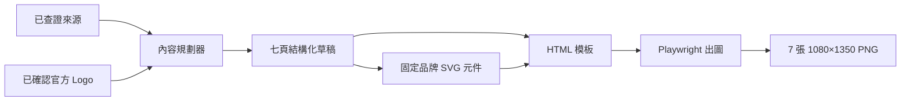

# 輪播圖資訊架構與品牌視覺修訂

> 日期：2026-07-29
> 狀態：使用者已核可 written spec，可進入 TDD 實作
> 適用範圍：AI 新創介紹輪播圖
> 優先順序：本文件取代
> `2026-07-28-貼文輪播圖產生器-design.md` 中與七頁內容、資訊密度、Logo、
> 示意圖、吉祥物及版面配置衝突的段落；其餘既有決策繼續有效。

## 1. 為什麼要改

Task 14 的第一版已能穩定輸出 1080×1350 PNG，但實際成品有三個產品問題：

1. 內頁只有短標題與少量文字，讀完仍不知道公司如何運用 AI、解決了什麼問題。
2. 大量空白來自內容集中在上半部、來源被硬釘頁底，不是有意義的留白。
3. 畫面只有呆一布吉祥物，沒有被介紹公司的官方 Logo；通用矩形流程圖也缺少品牌辨識。

本輪目標不是「把字塞滿」，而是讓每一頁都回答一個清楚問題，以淺顯因果敘事帶讀者
理解公司，同時保持呆一布一致的視覺語言。

## 2. 產品結果

看完七張後，讀者應能回答：

- 這家公司是誰？
- 它想解決誰的什麼問題？
- AI 在產品或服務裡扮演什麼角色？
- 誰會使用它，工作方式如何改變？
- 接下來要觀察哪些訊號，才能判斷公司是否真的走得下去？

這是一套「公司介紹」模板，不是產品教學、新聞摘要或投資推薦。

## 3. 核心設計原則

### 3.1 固定讀者任務，內容模組彈性

七張的閱讀順序固定，但不強迫所有公司符合「輸入 → AI → 輸出」。
第 4 張依公司實際類型選擇最合適的 AI 角色：

- 分析／辨識
- 生成／創作
- 預測／決策
- 自動執行／協調
- 提供資料、模型或運算基礎設施

固定的是讀者需要得到的答案，不是硬套同一種產品流程。

### 3.2 事實有來源，AI 只負責說清楚

- 公司、人物、客戶、數字、能力與成果都必須能回指來源。
- AI 可以改寫成白話、整理因果與補過場，不得新增來源中沒有的事實。
- 找不到資料時使用已定義的替代欄位，不能靠模型常識補齊。
- 每張含事實主張的內頁都顯示「來源名稱＋日期」；完整網址放貼文說明。

### 3.3 滿版不等於密不透風

- 第 2–6 張目標為約 140–220 個中文字，不含標籤與來源。
- 每頁使用 2–4 個有不同任務的內容區塊，而不是一段長文章。
- 內容自然由上而下排列，來源緊接內容，不使用 `margin-top: auto` 硬釘頁底。
- 畫面下半部若沒有新資訊，應重新分配版面或補上有價值的解釋，不用裝飾填空。

## 4. 七頁資訊架構

| 頁 | 頁型 | 讀者任務 | 必須包含 | 示意圖 |
|---|---|---|---|---|
| 1 | 封面 | 一眼知道它是誰 | 大型官方 Logo、公司名、一句「它用 AI 做什麼」、產業分類標籤 | 不放主示意圖 |
| 2 | 公司身分卡 | 建立基本輪廓 | 白話定位、成立年份、地點、創辦人、逐頁來源 | 不放主示意圖 |
| 3 | 它解決什麼問題 | 理解誰受困、原本付出什麼成本 | 受影響的人、具體困境、時間／金錢／操作／能力成本、有資料才放的證據 | 人物 → 困境關係圖 |
| 4 | AI 在裡面扮演什麼角色 | 看懂 AI 放在哪個環節 | 傳統做法的問題、適配的 AI 角色模組、AI 真正改變什麼、人仍負責什麼、本頁重點 | 品牌化步驟或關係圖 |
| 5 | 誰會用、怎麼用 | 把產品帶進真實工作 | 代表使用者、使用前流程、使用環節、使用後變化、誰付費與購買什麼、有資料才放的案例 | 使用者工作前後圖 |
| 6 | 接下來觀察什麼 | 學會繼續判斷公司 | 2–3 個關鍵訊號、各自為何重要、公開證據的限制 | 三個觀察指標模組 |
| 7 | 三件值得記住的事 | 加強記憶並安全收尾 | 公司定位、AI 的角色、下一步觀察的三點摘要、按讚／追蹤邀請、呆一布署名 | 不放主示意圖 |

### 4.1 缺資料時的替代規則

- 第 2 張缺創辦人資料：改放主要市場、服務對象或公司所在地。
- 第 3 張缺可靠數字：保留具體使用者困境，不放猜測數據。
- 第 5 張缺公開客戶案例：使用官方產品示範描述代表使用情境。
- 第 6 張公開證據有限：直接寫「目前公開證據有限」，把需要觀察的訊號寫成問題。
- 七張數量不變；替換的是可查證內容模組，不刪頁、不補造。

## 5. Logo 是必要資產

### 5.1 顯示規則

- 第 1 張：大型官方 Logo，與公司名同為視覺主角。
- 第 2–7 張：右上固定放小型官方 Logo，確保單張被分享時仍能辨識公司。
- 不任意重繪、改色或改比例；只使用官方提供的版本。

### 5.2 可信來源

Logo 只接受：

1. 公司官網；
2. 官方品牌素材包／媒體中心；
3. 使用者確認後上傳的 SVG 或透明 PNG。

禁止從一般圖片搜尋結果抓第一張圖，也禁止用公司名稱純文字冒充 Logo。

### 5.3 缺少 Logo 的錯誤處理

Logo 是產圖前置條件。找不到或無法確認官方版本時：

- 停止產圖；
- 顯示「請提供或確認官方 Logo」；
- 保留草稿資料，不清空、不降級成錯誤成品；
- 使用者補齊後可從同一草稿繼續。

## 6. 品牌 SVG 示意圖系統

### 6.1 產生方式

AI 只根據已查證資料選擇「要畫哪種關係」，實際圖形由固定 SVG 元件組合：

- 人物／團隊
- 問題／阻礙
- 資料／模型／AI
- 動作／箭頭／因果
- 結果／觀察指標
- 呆一布 Q 版表情頭像

像使用同一盒品牌積木：公司可以不同，線條、色票、圓角、圖示比例與文字層級一致。
不得呼叫圖片生成 API。

### 6.2 第 4 張的定案視覺

- 使用 A1 大字直式步驟卡。
- 使用 M1 無底框 Q 版頭像。
- 機器人頭像直接浮在白卡，不放淡藍底板、外框或虛線。
- 三步依內容使用聆聽、思考、完成等表情，但機身輪廓、耳朵、腮紅、眼睛與線條粗細一致。
- 步驟標題成品目標約 36px，說明文字約 30px；實際仍須以手機縮放後可讀為準。

### 6.3 吉祥物與公司 Logo 的角色分工

- 公司 Logo 回答「這篇在介紹誰」，每張必須出現。
- 呆一布吉祥物回答「這段關係怎麼理解」，只在有資訊作用時出現。
- 吉祥物不能再次成為內頁中央的大型裝飾，不能擠掉正文與示意圖。

## 7. 版面結構

第 2–6 張採滿版垂直敘事，依頁型選用以下區塊：

1. 頁型與小型官方 Logo；
2. 白話主標；
3. 情境／問題段落；
4. 品牌 SVG 示意圖；
5. 深入解釋或人機分工；
6. 本頁要記住；
7. 逐頁來源。

不是每頁都要七個區塊，但內容必須使用畫面下半部。來源跟在最後內容後方，不另外把整段
空白留給頁尾。

## 8. 系統資料流



白話比喻：來源是採訪筆記，內容規劃器是編輯，SVG 元件是品牌插圖積木，Playwright
則是最後的印刷機。任何一層缺資料都要在該層停下，不能讓後面自行猜測。

## 9. 結構化內容介面

現有單一 `heading`／`body` 不足以描述新頁面。實作計畫應把草稿擴充為可驗證區塊：

```text
CarouselPage
  page_type
  heading
  sections[]
    label
    text
    source_ids[]
  diagram
    kind
    nodes[]
  source_label

BrandAsset
  company
  local_path
  official_source_url
  verified_at
```

這不是要求立即使用特定 Python 類別，而是要求資料能分辨「文字區塊、證據與示意圖節點」，
避免渲染器重新解析一大段自然語言。

## 10. 方案取捨

| 決策 | 主方案 | 未採用方案 | 原因 |
|---|---|---|---|
| 七頁彈性 | 固定讀者任務＋彈性內容模組 | 每種公司一套模板／AI 自由排頁 | 避免模板爆炸與漏頁 |
| Logo 缺失 | 阻擋並要求確認 | 純文字代替／搜尋抓圖 | Logo 是硬需求且有錯版、授權風險 |
| 示意圖 | AI 選結構＋固定 SVG 元件 | 圖片生成 API／逐張人工畫 | 一致、可版控、零按次費用 |
| 來源 | 每頁小型標示＋貼文說明放完整網址 | 只放第 7 張／只放貼文說明 | 單張分享仍保有證據脈絡 |
| 結尾 | 三點摘要＋按讚／追蹤 | 引導外部試用／開放討論題 | 避免看起來替品牌背書 |

## 11. 安全、成本與限制

- 官方 Logo 可能有商標使用規範；只使用官方資產，不宣稱合作或背書。
- 不呼叫圖片生成 API，不增加圖片生成費用。
- 官方 Logo 與來源可能變更，需保存來源網址與確認日期。
- SVG 示意圖只能表達已查證關係；不能把示意圖畫成不存在的產品介面。
- 140–220 字是資訊目標，不是硬湊字數；資料不足要誠實呈現，而不是加入空泛評論。

## 12. 驗收條件

### 12.1 內容

- 七張都出現正確的公司官方 Logo；封面大、內頁小。
- 第 2–6 張各自完成表格中定義的讀者任務。
- 每個事實區塊能回指來源；沒有無來源的客戶、數字或能力。
- 缺資料時使用定義的替代模組，不出現 AI 補造內容。
- 第 7 張只有摘要與按讚／追蹤，不引導外部試用。

### 12.2 視覺

- 1080×1350 固定尺寸，LINE Seed TW 與既有品牌色不變。
- 第 4 張使用 A1＋M1：大字直式步驟卡、無底框 Q 版表情頭像、無虛線。
- 來源緊接內容；頁面下半部不得因固定頁尾產生大塊空洞。
- 示意圖全部使用固定品牌 SVG 元件，不出現通用圖示庫拼貼或風格漂移。
- 手機縮放後主標、內文、來源仍可閱讀，文字沒有裁切或溢出。

### 12.3 測試

- 單元測試：七頁必要區塊、彈性角色模組、缺資料替代規則。
- 來源測試：每個事實 section 至少有一個 `source_id`。
- Logo 測試：七頁皆嵌入已確認資產；Logo 缺失會阻擋且保留草稿。
- 邊界測試：若自動取得官方 Logo，必須真的驗證一次官網／品牌素材邊界。
- 瀏覽器契約測試：實際輸出 PNG，檢查尺寸、Logo 像素、字型、內容底界與無溢出。
- 視覺自檢：桌機一張、手機一張，至少兩輪；最終 console 無關鍵錯誤。

## 13. Non-goals

- 不替公司製作或重設 Logo。
- 不使用圖片生成模型畫主視覺。
- 不自動替被介紹公司背書、評分或推薦投資。
- 不在本規格中做自動發文、留言或多人協作。

## 14. 對既有計畫的影響

`docs/plan-carousel.md` 的 Task 15–17 建立在舊的短文字與單一 `heading`／`body` 結構上，
不可直接照舊執行。written spec 核可後，必須另寫 TDD 實作計畫，先處理結構化草稿、
Logo 必要資產與新版渲染，再接回超長文字、zip 與選題頁按鈕。
