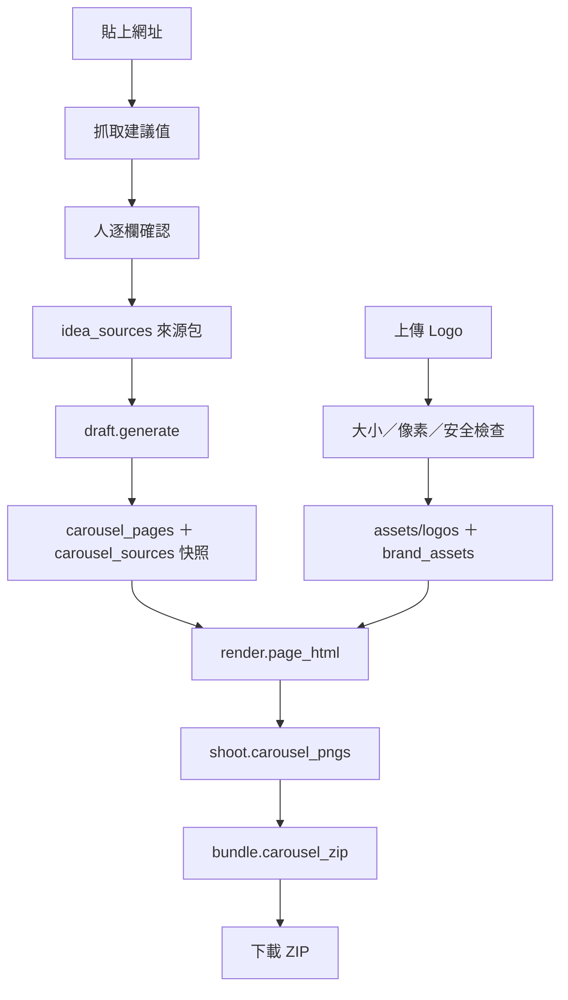

# 來源蒐集、Logo 上傳、ZIP 與選題頁接線 — 設計規格

> 2026-07-30 由 Claude 撰寫。前置規格：
> `docs/specs/2026-07-29-輪播圖資訊架構與品牌視覺修訂-design.md`。
> 實作計畫：`docs/plan-cards-wiring.md`。

## 一句話

把已經做好的「結構化草稿 → 七張 PNG」引擎，接上人真正會做的四件事：
**蒐集來源、確認 Logo、按下產圖、把七張圖打包帶走**。

---

## 1. 現在卡在哪

Phase A–C 完成後，程式已經能做到：給它一包 `VerifiedSource`、一個
`BrandAsset`，它會產出七頁草稿並印成七張 1080×1350 的 PNG。全部 312 個測試通過。

但**沒有任何一個畫面能製造出那包來源，也沒有地方能上傳 Logo**。目前只有測試檔
`tests/card_fixtures.py` 裡的假資料能餵進去。對使用者來說，這個功能等於不存在。

這一輪要補的就是這段「人怎麼把東西放進去、怎麼把東西拿出來」。

---

## 2. 範圍

### 做

1. **來源蒐集**：每則題目可以蒐集 1–8 筆已查證來源，可貼網址讓系統抓建議值。
2. **Logo 上傳**：上傳 SVG／去背 PNG，通過安全與尺寸檢查後入庫，同一家公司可重用。
3. **ZIP 下載**：七張 PNG 打包成一個 zip，檔名有編號與頁型。
4. **選題頁接線**：以上三件事全部收在「已採用的那則題目」底下，一個區塊完成。

### 不做（本輪明確排除）

- 不做自動找 Logo（不從圖片搜尋結果抓第一張圖）——延續前一版規格的禁令。
- 不做來源的全自動蒐集（貼網址就直接存）——理由見 §4.2。
- 不做草稿的 section 增刪、label 改名、來源重新指派——本輪只開放改文字。
- 不做分平台文字、不做其他兩個主題的模板。

---

## 3. 名詞先講清楚

| 名詞 | 白話 | 比喻 |
|---|---|---|
| **來源包**（source pack） | 這則題目手上蒐集到的 1–8 筆已查證資料 | 記者的**採訪筆記本**，隨時可以再加一頁、劃掉一頁 |
| **來源快照** | 產草稿那一刻，實際被引用進七頁的那幾筆 | 已經**排版付印的那一版**，事後改筆記本不會動到它 |
| **BrandAsset** | 一個已確認的官方 Logo 檔，含來源網址與確認日期 | 素材櫃裡貼了標籤的一張圖：哪家公司、哪裡拿的、哪天確認的 |
| **解壓縮炸彈** | 檔案很小、解開後極大的圖片 | 一個壓扁的充氣城堡：搬得動，一充氣就塞滿整個房間 |
| **指紋**（fingerprint） | 把草稿內容算成一串固定長度的碼 | 文件的**封蠟印**：內容改一個字，印就對不上 |

---

## 4. 來源蒐集

### 4.1 來源包與來源快照要分開存（定案）

| 方案 | 做法 | 優點 | 缺點 |
|---|---|---|---|
| **A（採用）** | 新增 `idea_sources` 表放來源包；產草稿時把當下內容快照寫進既有 `carousel_sources` | 事後編輯筆記本不會讓已存草稿的來源標示對不上；不動已通過測試的原子寫入路徑 | 多一張表 |
| B | 只用 `carousel_sources`，把 delete+insert 改成 upsert | 少一張表 | 要改動 312 個測試守著的寫入路徑，風險與收益不成比例 |
| C | 來源包只放 `st.session_state` | 完全不動 DB | 頁面一重跑就消失——這個專案上一輪才因為「正文草稿靜默消失」被驗收退回 |

採用 A。關鍵理由：每頁的 `source_label`（「來源：ElevenLabs · 2026-07-12」）是
**產生當下就算好、寫死進資料庫的字串**，而且 `validate_draft` 會回頭檢查它跟
`sources` 是否一致。如果筆記本與成品共用一張表，使用者事後修一個日期，已存的草稿
就會突然驗證失敗。分開存等於「筆記本」與「已付印的那一版」各留一份。

### 4.2 手動為主、抓取為輔（定案）

| 方案 | 做法 | 為什麼 |
|---|---|---|
| **A（採用）** | 貼網址 → 按「抓取內容」→ 系統下載該頁、抽純文字、**預填**出版方／日期／引文 → 使用者逐欄確認後才存 | 抓取只產生「建議值」，人按下確認才算查證。這一按就是查證動作本身 |
| B | 貼網址就自動存 | 會讓「已查證」變成謊言。抽出來的 `og:site_name` 與日期常常是錯的，而整條產品線的價值就建立在事實有來源 |
| C | 全手動，沒有抓取鍵 | 每筆要手抄四個欄位，實際上會讓人偷懶只放一筆來源，內頁就寫不滿 140 字 |

抓取的安全邊界（`daibu/fetch/page.py`）：

- 只接受 `https`；沿用既有 `_download` 的 15 秒 timeout。
- 最多讀 1 MB，超過就截斷——不讓一個超大頁面把記憶體吃光。
- 只抽純文字，不執行腳本、不下載子資源、不跟隨 `meta refresh`。
- 建議值來源：出版方取 `og:site_name`，沒有就取網域；日期取
  `article:published_time` 或第一個 `<time datetime>`，沒有就**留白讓人填**，
  絕不用今天的日期充數。
- 失敗（連不上、404、非 HTML）轉成看得懂的錯誤訊息，不讓例外冒到畫面上。

### 4.3 來源包的規則（定案）

- **每則題目 1–8 筆**。下限 1 是因為驗證器要求每個事實 section 都要附來源；
  上限 8 是因為來源包會整包塞進 prompt，太長會讓免費模型更容易漂移。
- **`source_id` 由程式產生 `S1`–`S8`，使用者不能自訂。** 模型只會照抄我們給的
  ID，讓人自訂只會多一個漂移面。
- **刪掉中間一筆時不重新編號**，下次新增取「最小的空號」。理由：編號穩定，人在
  對照草稿的來源標示時不會突然錯位。
- 第一筆預設用這則題目自己的 `source_url` ＋ `source_excerpt` 帶入（B1 階段起，
  候選產生時就已經存了 60 字以上的原文片段），使用者只要補出版方與日期。
- 欄位規則沿用既有 `validate_sources`：五個欄位都不可空白、網址必須 https、
  日期必須 `YYYY-MM-DD`。**不在這一輪放寬或加嚴。**

---

## 5. Logo 上傳

### 5.1 存哪裡（定案）

| 方案 | 優點 | 缺點 |
|---|---|---|
| **A（採用）** 檔案存 `assets/logos/`，metadata 存新表 `brand_assets` | Streamlit 顯示與 Playwright 讀取都直接吃檔案路徑；同一家公司下次不用重傳 | 要記得把資料夾排除在 git 之外 |
| B 整包塞進 SQLite BLOB | 只有一個檔案要備份 | `daibu.db` 會從 45 KB 長到好幾 MB，備份與 diff 都變難 |
| C 只存路徑，使用者自己丟檔案進資料夾 | 最少程式 | 對非技術使用者不可行 |

採用 A。補充決定：

- 檔名 `<公司 slug>-<檔案 sha256 前 12 碼>.<副檔名>`。同一個檔重傳會落在同一個
  檔名（等於自動去重），不同檔不會互相覆蓋。
- 資料夾路徑可用環境變數 `DAIBU_LOGO_DIR` 覆寫，測試才不會污染真實 `assets/`。
- **`assets/logos/` 要加進 `.gitignore`**：Logo 是別人的商標，不該進我們的 repo。
- `brand_assets` 以 `company_key`（公司名 casefold 後）為主鍵，一家公司一個現行
  Logo；重傳就覆蓋該列，舊檔留在磁碟不自動刪（避免刪到還在用的檔）。

### 5.2 Logo 檔案大小與像素上限 — 本輪裁決

`docs/open-questions.md` 留了這條未決事項。裁決如下：

| 限制 | 值 | 為什麼是這個數字 |
|---|---|---|
| 檔案大小（SVG 與 PNG 共用） | **≤ 2 MB** | 官方 SVG 通常 10–200 KB，1024 px 去背 PNG 約 100–500 KB。2 MB 是常見官方素材的 4–20 倍餘裕，卻剛好擋掉手機拍的照片與產品截圖（多在 3–10 MB）——那些幾乎都是誤傳 |
| PNG 單邊 | **≤ 4096 px** | 封面大 Logo 實際只顯示約 300 px 寬，4096 已是 13 倍餘裕，印刷級素材也夠用 |
| PNG 總像素 | **≤ 8,000,000 px** | 8 MP 解成 RGBA 約佔 32 MB 記憶體，本機單人使用安全。Pillow 預設上限是 89 MP，對這個用途太寬鬆 |
| PNG 單邊下限 | **≥ 64 px** | 最容易誤傳的是網站 favicon（16／32 px），放大到封面會糊成一團。64 px 是「一看就知道不是 favicon」的最低線 |
| SVG 結構 | **必須有 `viewBox`，或同時有 `width` 與 `height`** | 兩者都沒有時，`` 算不出比例，Logo 會變形或整個不見——而 `shoot.py` 的 `logo_visible` 量測只會在最後一關才炸 |

這五條全部只在**上傳這一關**（新函式 `validate_upload()`）執行，不塞進既有的
`logo_data_uri()`／`_validate_svg()`。理由有二：既有那條路是**安全**檢查，混進
尺寸判斷會讓責任不清；而且既有綠燈測試
`test_logo_accepts_svg_with_local_gradient_and_symbol` 用的 SVG 沒有 viewBox，
把新規則塞進舊函式會誤傷它，也會讓已經存好的舊素材在出圖當下才突然失敗。

**為什麼檔案大小與像素要分開限制**：檔案大小騙得了人。一張壓縮後只有 500 KB 的
PNG，解開後可能是 10000×10000，光解碼就吃掉 400 MB 記憶體（每像素 4 bytes）。
這就是「解壓縮炸彈」。所以要先看檔案多大，再看**解開後**有多大。

**實作要求**：用 Pillow `Image.open()` 讀出 `.size` 就判斷，**超標直接拒絕，不要
呼叫 `load()` 把整張圖解進記憶體**；同時把 `Image.MAX_IMAGE_PIXELS` 設成
8,000,000 當第二道防線。

這些限制**只擋新上傳**，不回頭檢查既有檔案；`logo_data_uri()` 既有的安全檢查
（PNG 必須有透明色版、SVG 不得含腳本／事件／外部引用）一條都不放寬。

### 5.3 錯誤文案（定案）

每一條都要說出「發生什麼事」與「接下來怎麼辦」，不可只寫「檔案不合法」。

| 情況 | 文案 |
|---|---|
| 檔案過大 | 「這個檔案 {size}，超過 2 MB 上限。請改用官方品牌素材包裡的 SVG 或去背 PNG。」 |
| 像素過大 | 「圖片解析度 {w}×{h}，超過 4096 px 上限。請用官方素材包裡較小的版本，或先縮到 2048 px 以內。」 |
| 總像素過大 | 「圖片總像素超過 800 萬，解開後會佔用太多記憶體。請改用官方素材包裡較小的版本。」 |
| 尺寸過小 | 「圖片只有 {w}×{h}，看起來是網站小圖示。請上傳至少 64 px 的官方 Logo。」 |
| 副檔名不對 | 「只接受 SVG 或去背 PNG。JPG 沒有透明背景，貼上會出現白色方塊。」 |
| PNG 沒透明 | 「這張 PNG 沒有透明背景。請用官方的去背版本。」 |
| SVG 沒有 viewBox | 「這個 SVG 沒有 viewBox 或寬高，排版時會變形。請用官方素材包裡的完整版本。」 |
| SVG 不安全 | 沿用 `logo.py` 既有訊息（含腳本／事件／外部資源等） |
| 缺官方來源網址 | 「請填這個 Logo 的官方來源網址（公司官網或品牌素材頁），之後才能追溯是哪裡拿的。」 |

---

## 6. 出圖與 ZIP

- ZIP 檔名：`<公司 slug>-carousel-<YYYYMMDD>.zip`。
- 內含 `01-cover.png`、`02-who.png`、`03-problem.png`、`04-how-ai.png`、
  `05-results.png`、`06-why-care.png`、`07-cta.png`——編號讓 IG 上傳時順序不會亂，
  頁型讓人一眼認得出是哪張。
- 打包是純函式 `daibu/cards/bundle.py::carousel_zip(pngs, company, today) -> bytes`，
  不碰 Playwright、不碰資料庫，可以單獨測。
- **不把 PNG 存到磁碟**：圖是可以重生的衍生物，存了就要管清理與失效。
- **用 session 快取避免重跑**：Streamlit 每次點按鈕都會整頁重跑，而出一次圖要開
  Chromium 跑約 10 秒。把七張圖放在
  `st.session_state["carousel-png-{idea_id}"]`，並一起存草稿的**指紋**
  （草稿序列化後的 sha256 前 16 碼）。草稿一改，指紋對不上，舊圖自動作廢——
  使用者不會下載到跟畫面上不一致的舊圖。

---

## 7. 選題頁接線

### 7.1 位置

**選題頁 → 右邊工作區 → 已採用的那則題目 expander 內，正文欄位下方**，一個
「輪播圖」區塊。沿用前一版規格的決定：不另開一頁，因為它跟那則題目綁死。

### 7.2 四個狀態

比 2026-07-28 規格多一個「資料還沒齊」，因為新版有硬性前置條件。

| 狀態 | 畫面上有什麼 |
|---|---|
| **1 資料未齊** | 逐條列出還缺什麼（沒有公司名／來源包是空的），**每一條旁邊就是能立刻補的輸入欄**，不要求使用者跑去別的地方 |
| **2 可以產草稿** | 「產生輪播草稿」按鈕，旁註「會呼叫 AI，約 10–40 秒」 |
| **3 草稿已存在** | 七個區塊：頁型標籤、標題、每個 section 的 label／文字／來源標示。**文字可編輯**，label 與 source_ids 唯讀。下方「儲存草稿」與「重新產生」 |
| **4 圖已產出** | 七張縮圖 ＋「下載全部（ZIP）」 |

### 7.3 Logo 擋的是產圖，不是產草稿（定案，且修正前一版的說法）

前一版規格寫「缺 Logo 阻擋產圖」，實作時容易被讀成「缺 Logo 什麼都不能做」。
精確的規則是：

- **產草稿不需要 Logo**——草稿是純文字，Logo 沒到位不該卡住寫稿。
- **產七張圖需要 Logo**——`render.page_html()` 每一頁都要 `logo_data_uri`。

所以「產生七張圖」按鈕在缺 Logo 時 disabled，旁邊直接放上傳欄；「產生輪播草稿」
不受影響。這條要寫進 HANDOFF 的踩坑清單。

### 7.4 編輯草稿怎麼存（定案）

正文用的是 `on_change` 自動存（`save_body_draft`），但**結構化草稿不能照抄**：它
必須整份通過 `validate_draft` 才能寫回，一邊打字一邊驗證會讓人每打一個字就看到
一次紅字。

決定的機制：

1. 使用者打的字留在 Streamlit widget 的 `session_state`（本來就會保存）。
2. 按下「儲存草稿」才驗證＋寫入。
3. **驗證失敗時：顯示逐條錯誤、保留使用者輸入、不寫回資料庫、不清空欄位。**
4. 儲存成功後才讓出圖的指紋更新（也就是舊圖自動作廢）。

這條要有測試守著——「草稿靜默消失」是這個專案上一輪的實際事故。

### 7.5 重新產生要二次確認

「重新產生」會覆蓋既有草稿、也會再花一次免費額度。用 `st.popover` 放二次確認，
文案寫清楚「會覆蓋目前的七頁內容，且無法復原」。

---

## 8. 資料流

每一層缺資料就在該層停下並說清楚缺什麼，不讓下一層自己猜——這是延續前一版規格的
原則，也是這輪把「資料未齊」獨立成一個狀態的理由。

---

## 9. 安全、成本與限制

- **抓網頁**：只走 https、15 秒 timeout、最多讀 1 MB、只抽純文字。這是本機單人
  工具，不做完整的 SSRF 防護（例如擋內網 IP），但要在程式碼註明這個前提。
- **Logo**：既有的 SVG 白名單與 PNG 透明檢查全部保留，這一輪只加大小與像素。
- **成本**：一次產草稿最多兩次 LLM 呼叫（既有的「帶錯誤回饋修稿」機制），出圖與
  打包完全在本機，不花額度。
- **不做**：不呼叫任何付費服務、不自動發文。

---

## 10. 驗收條件

### 10.1 功能

1. 在已採用的題目底下貼一個 https 網址，按抓取後能看到出版方／日期／引文的建議值，
   修改後可存成來源包的一筆。
2. 來源包滿 1 筆以上且題目有公司名時，「產生輪播草稿」可按；產完能看到七頁內容
   與各頁來源標示。
3. 上傳一張 4200×120 的 PNG 會被擋下並顯示「超過 4096 px 上限」，磁碟上不留檔；
   上傳一張合法的去背 PNG 會成功並顯示縮圖。
   （測試刻意用 4200×120 而不是 5000×5000：前者只有 50 萬像素、跑起來很快，
   卻一樣踩到單邊上限。總像素那條線另外用 3000×3000 測。）
4. Logo 就位後「產生七張圖」可按，產完出現七張縮圖與 ZIP 下載鍵。
5. 下載的 zip 解開後有七個檔案，檔名為 `01-cover.png` 到 `07-cta.png`。
6. 改動草稿文字後，舊的七張圖自動作廢，要重按才會有新圖。
7. 存一份會違反 140 字下限的草稿，畫面顯示錯誤、輸入框內容還在、資料庫沒被改。

### 10.2 測試

- 純函式層（來源包 CRUD、Logo 上限、ZIP 打包）用一般 unit test。
- **真實邊界一定要測**：
  - 抓網頁：`@pytest.mark.contract` 打一個真實 https 頁面，驗證取得非空純文字。
  - Logo 上限：用 Pillow **真的生成** 5000×5000 與 70×70 的 PNG 來測，不 mock 尺寸。
  - ZIP：用 `zipfile` 解回來檢查七個檔名、順序與位元組非空。
  - 選題頁：用 `streamlit.testing.v1.AppTest` 跑真實頁面（既有 `test_app_smoke.py`
    已經是這個手法）。
- 前端規範要求的兩輪截圖自檢（桌機 1280×800、手機 375×812）在 Phase D 收尾時做。

---

## 11. Non-goals

- 不自動搜尋或下載 Logo。
- 不做來源的自動可信度評分。
- 不做草稿的 section 增刪與來源重新指派。
- 不做多人協作、不做自動發文。
