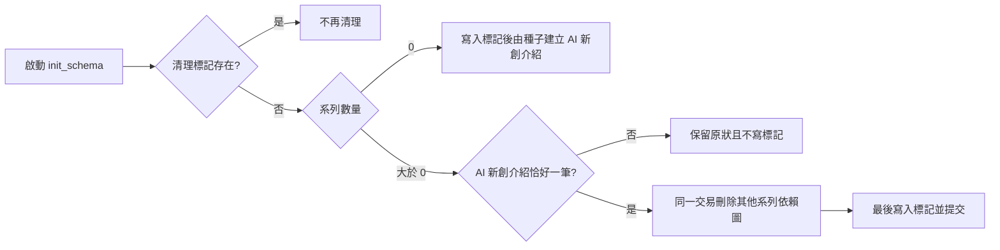

# 單一內容系列清理實作計畫

> 規格來源：`docs/superpowers/specs/2026-08-01-單一內容系列清理-design.md`
>
> 執行方式：使用者已要求直接做完；本輪採同一工作階段逐片執行，不另做文件審閱。

## 產品結果

工作站第一次以新版開啟既有資料庫時，只保留唯一的「AI 新創介紹」及其完整內容；其他系列與其題目、來源綁定、成效及輪播資料永久刪除。之後透過程式新增的系列不會再被清理。介面不再提供手動新增系列，但仍可編輯、管理及顯示程式新增的系列。

## 資料流與安全邊界



- 清理範圍：`performance`、`carousel_pages`、`carousel_sources`、`idea_sources`、`ideas`、`theme_sources`、`themes`。
- 保留範圍：目標系列全資料、共用 `sources`、全部 `brand_assets`。
- 真實資料庫操作前，使用 SQLite Backup API 備份；任何驗證失敗都停止，不碰下一份資料庫。

## Task 1：一次性、原子化的資料清理

**檔案**

- 修改：`daibu/db.py`
- 測試：`tests/test_db_migration.py`

### 1.1 完整依賴圖清理

- [ ] Red：新增 `test_single_series_cleanup_keeps_target_graph_and_shared_assets`，建立目標與非目標系列、兩邊題目與四種依賴資料、共用來源及品牌素材；執行：

  ```bash
  .venv/bin/pytest -q tests/test_db_migration.py::test_single_series_cleanup_keeps_target_graph_and_shared_assets
  ```

  預期：因尚未清理其他系列而失敗。

- [ ] Green：在 `daibu/db.py` 新增常數與私有函式，並在欄位遷移完成後呼叫：

  ```python
  SINGLE_SERIES_CLEANUP_KEY = "single_series_cleanup_v1"
  SINGLE_SERIES_NAME = "AI 新創介紹"


  def _cleanup_to_single_series(conn: sqlite3.Connection) -> bool:
      marked = conn.execute(
          "SELECT 1 FROM config WHERE key = ?",
          (SINGLE_SERIES_CLEANUP_KEY,),
      ).fetchone()
      if marked:
          return True

      theme_count = conn.execute("SELECT COUNT(*) AS count FROM themes").fetchone()["count"]
      if theme_count == 0:
          conn.execute(
              "INSERT INTO config (key, value) VALUES (?, '1')",
              (SINGLE_SERIES_CLEANUP_KEY,),
          )
          return True

      targets = conn.execute(
          "SELECT id FROM themes WHERE name = ?",
          (SINGLE_SERIES_NAME,),
      ).fetchall()
      if len(targets) != 1:
          return False

      target_id = targets[0]["id"]
      conn.execute("SAVEPOINT single_series_cleanup")
      try:
          for table in (
              "performance",
              "carousel_pages",
              "carousel_sources",
              "idea_sources",
          ):
              conn.execute(
                  f"DELETE FROM {table} WHERE idea_id IN "
                  "(SELECT id FROM ideas WHERE theme_id IS NOT NULL AND theme_id != ?)",
                  (target_id,),
              )
          conn.execute(
              "DELETE FROM ideas WHERE theme_id IS NOT NULL AND theme_id != ?",
              (target_id,),
          )
          conn.execute("DELETE FROM theme_sources WHERE theme_id != ?", (target_id,))
          conn.execute("DELETE FROM themes WHERE id != ?", (target_id,))
          conn.execute(
              "INSERT INTO config (key, value) VALUES (?, '1')",
              (SINGLE_SERIES_CLEANUP_KEY,),
          )
          conn.execute("RELEASE SAVEPOINT single_series_cleanup")
      except Exception:
          conn.execute("ROLLBACK TO SAVEPOINT single_series_cleanup")
          conn.execute("RELEASE SAVEPOINT single_series_cleanup")
          raise
      return True
  ```

- [ ] 再跑同一測試，預期通過；在測試保護下把重複的資料列建立整理成小型 helper。

### 1.2 標記保護未來程式新增的系列

- [ ] Red：新增 `test_single_series_cleanup_runs_only_once`；第一次清理後用 `db.add_theme()` 新增「未來主題」，再跑 `init_schema()`，預期兩個系列都存在。
- [ ] Green：確認標記檢查發生在任何刪除前，讓測試通過。
- [ ] 指令：

  ```bash
  .venv/bin/pytest -q tests/test_db_migration.py::test_single_series_cleanup_runs_only_once
  ```

### 1.3 目標缺失或重複時拒絕破壞

- [ ] Red：依序新增並執行 `test_single_series_cleanup_preserves_data_when_target_is_missing` 與 `test_single_series_cleanup_preserves_data_when_target_is_ambiguous`；兩者都要驗證資料未少且標記未寫入。
- [ ] Green：目標筆數不是一時直接回傳 `False`，由 `init_schema()` 正常提交其他無破壞性 schema 更新。
- [ ] 指令：

  ```bash
  .venv/bin/pytest -q tests/test_db_migration.py -k single_series_cleanup
  ```

- [ ] Refactor：把清理 SQL 的題目篩選一致化，執行整個 migration 測試檔。
- [ ] Commit：`feat: add one-time single-series cleanup`

## Task 2：新資料庫只預設 AI 新創介紹

**檔案**

- 修改：`daibu/seeds.py`
- 測試：`tests/test_seeds.py`

- [ ] Red：把 `test_load_seeds_themes_without_duplicates` 改為精確斷言：

  ```python
  assert [theme.name for theme in themes] == ["AI 新創介紹"]
  ```

  執行：

  ```bash
  .venv/bin/pytest -q tests/test_seeds.py::test_load_seeds_themes_without_duplicates
  ```

  預期：目前仍建立三個系列而失敗。

- [ ] Green：從 `DEFAULT_THEMES` 移除「AI 近期大事」與「本週熱門 Claude/Codex Skill」，保留所有 `DEFAULT_SOURCES`；同步移除測試中已失效的 general 系列斷言。
- [ ] Refactor：確認 AI 新創仍是 `company_profile` 且五個來源綁定不變。
- [ ] 指令：`.venv/bin/pytest -q tests/test_seeds.py`
- [ ] Commit：`feat: seed only AI startup series`

## Task 3：移除手動新增入口並更新空狀態

**檔案**

- 修改：`pages/1_選題.py`
- 修改：`daibu/overview.py`
- 測試：`tests/test_app_smoke.py`

### 3.1 不再顯示新增控制，但程式新增系列仍可見

- [ ] Red：新增 AppTest，先以 `db.add_theme()` 建立系列，斷言系列按鈕存在、`＋ 新增內容系列` 與 `建立內容系列` 不存在。
- [ ] Green：刪除 `pages/1_選題.py` 中 `new-theme` popover/form；保留管理區的名稱、來源編輯與刪除確認。
- [ ] 指令：

  ```bash
  .venv/bin/pytest -q tests/test_app_smoke.py::test_selection_hides_manual_series_creation_but_lists_code_added_series
  ```

### 3.2 空狀態改說明程式管理方式

- [ ] Red：新增無系列的選題頁與首頁測試，斷言顯示「請透過專案設定新增」，且不再指示使用者手動建立。
- [ ] Green：更新 `pages/1_選題.py` 空狀態與 `daibu/overview.py` 的下一步／提示文字。
- [ ] Refactor：共用一致措辭：「目前沒有內容系列；請透過專案設定新增。」
- [ ] 指令：`.venv/bin/pytest -q tests/test_app_smoke.py -k 'series_creation or no_series'`
- [ ] Commit：`feat: remove manual content-series creation`

## Task 4：備份並執行一次性永久清理

### 4.1 先處理測試副本

- [ ] 停止目前 8502 Streamlit 程序，記錄精確 PID。
- [ ] 建立唯一備份目錄：

  ```bash
  mktemp -d /tmp/daibu-single-series-cleanup.XXXXXX
  ```

- [ ] 用 Python `sqlite3.Connection.backup()` 備份 `daibu.db` 與 `/tmp/daibu-workstation-redesign.db`，不可在連線仍寫入時用檔案層硬拷貝。
- [ ] 記錄兩份資料庫清理前的系列、題目狀態分布及目標系列識別碼。
- [ ] 只先對 `/tmp/daibu-workstation-redesign.db` 執行 `db.init_schema()`；驗證：
  - 只剩「AI 新創介紹」；
  - BillionToOne 正文仍為 478 字；
  - 查證來源 1 筆、輪播 7 張完整；
  - 共用來源與品牌素材未被清除；
  - 標記為 `1`。

### 4.2 再處理真實資料庫

- [ ] 只有測試副本全部通過後，對 `daibu.db` 執行 `db.init_schema()`。
- [ ] 驗證只剩「AI 新創介紹」與原本 6 則候選；題目狀態分布、正文與目標系列關聯未改。
- [ ] 驗證備份可開啟，且仍含清理前 3 系列、8 題。
- [ ] 將備份路徑與前後筆數寫進 `HANDOFF.md`。

## Task 5：產品理解檢查點與視覺驗收

- [ ] 交付產品理解檢查點：能力、使用者體驗、技術結構、資料流、為何採一次性標記、備援（僅改預設值不清舊資料）及其缺點、安全／成本、測試證據、剩餘限制。
- [ ] 啟動：

  ```bash
  DAIBU_DB_PATH=/tmp/daibu-workstation-redesign.db .venv/bin/streamlit run app.py --server.port 8502 --server.headless true
  ```

- [ ] 依 `playwright-cli` 執行兩輪，每輪只截桌機與手機各一張；第一輪發現問題後修正，第二輪覆寫最終檔案：

  ```bash
  playwright-cli open http://localhost:8502/選題
  playwright-cli resize 1280 800
  playwright-cli screenshot --filename=.screenshots/desktop.png
  playwright-cli resize 375 812
  playwright-cli screenshot --filename=.screenshots/mobile.png
  ```

- [ ] 每輪檢查：層次、留白、字體、配色、對齊、375px 無橫向溢出、提示／載入／錯誤／完成狀態、微動效；以 Before／After／Why 表格記錄 Emil 規範檢視。

## Task 6：全測、交接、合併、推送與重啟

- [ ] 特定測試：

  ```bash
  .venv/bin/pytest -q tests/test_db_migration.py tests/test_seeds.py tests/test_app_smoke.py
  ```

- [ ] 全套測試一次：`.venv/bin/pytest -q`
- [ ] 靜態檢查：`git diff --check`
- [ ] 更新 `HANDOFF.md` 本輪狀態，維持 4 KB 內，附測試結果、資料前後筆數、備份及最終截圖路徑。
- [ ] Commit：`docs: record single-series cleanup handoff`
- [ ] 合併到 `main`；若衝突或會覆蓋未提交內容，停止並回報。
- [ ] `main` 再跑 `.venv/bin/pytest -q`，通過後推送既有 `origin/main` 並確認遠端包含提交。
- [ ] 專案無正式部署流程；重啟 8502 的 `/tmp` 工作站，實跑「選題 → AI 新創介紹 → 查看既有候選」核心流程並檢查 console／伺服器無關鍵錯誤。
- [ ] 只用 `git branch -d codex/single-series-cleanup` 清理本機分支；若 Git 拒絕即停止，不改用 `-D`。

## 規格覆蓋自查

- 永久刪除舊系列與完整關聯圖：Task 1、4。
- 保住共用來源、品牌素材與 AI 新創內容：Task 1、4。
- 只執行一次且不誤刪未來程式新增系列：Task 1.2。
- 目標缺失／重複時安全停止：Task 1.3。
- 新資料庫預設只建立 AI 新創：Task 2。
- 移除手動新增、保留編輯／刪除及泛用顯示：Task 3。
- 備份、視覺驗收、全測、交接、合併推送：Task 4–6。
- 文件無 `TBD`、`TODO` 或未決型別；所有測試、資料表及畫面入口均使用現有專案名稱。
