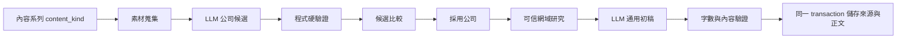

# AI 新創公司候選與自動文案設計

日期：2026-07-31  
狀態：產品方向已核可，待使用者確認書面規格

## 1. 目標

「AI 新創介紹」永遠只產生具體公司，不再出現「未指定公司」或空泛觀點題。使用者比較候選時只需要知道公司名稱與「這家公司在做什麼」；採用後可按一次按鈕，讓系統用可信來源產生一份可繼續修改的 350–500 字通用初稿。

成功標準：

- AI 新創介紹的新候選都有公司、白話定位、可信來源網址與可核對引文。
- 不合格候選不寫入資料庫；不足指定數量時允許少產，不拿空資料湊數。
- 候選畫面不再顯示「未指定公司」。
- 採用後出現「AI 幫我寫初稿」；成功才寫入正文，失敗保留既有內容。
- 現在 8502 測試複本中的六則舊候選，在備份後只刪除這六則。

## 2. 固定系列規則

資料層為內容系列新增內部欄位 `content_kind`：

- `general`：一般內容系列。
- `company_profile`：公司介紹系列。

這不是使用者可切換的「模式」。既有「AI 新創介紹」在 schema migration 時固定標記為 `company_profile`；改名後仍保留規則。畫面不顯示切換器，新建系列仍預設 `general`。未來若要建立另一個公司系列，另做系列模板流程，本輪不做。

## 3. 使用者流程

### 3.1 找公司

1. 使用者在「AI 新創介紹」按「開始找題材」。
2. 系統讀取系列素材來源並要求免費 LLM 回傳公司候選。
3. 程式在寫入資料庫前逐則驗證。
4. 合格候選進入比較清單；不合格候選直接捨棄。
5. 若全部不合格，顯示「這次沒有找到可核對的公司，沒有建立空候選」，原資料不變。

公司候選必須同時符合：

- `company` 非空白。
- `title` 是一句白話的「這家公司在做什麼」，非泛用議題標題。
- `source_url` 是本次素材中實際存在的 HTTPS 網址。
- `source_excerpt` 非空白，且能在該素材的 snippet 中逐字找到。

### 3.2 選公司

公司系列的候選詳情只顯示：

- 公司名稱。
- 這家公司在做什麼（沿用 `title` 欄位）。
- 「查看來源」。
- 採用、微調、淘汰。

內部仍保留 `angle` 作為後續文案方向，但不把「為什麼現在值得講」放在主比較畫面搶焦點。一般內容系列維持既有候選呈現。

### 3.3 AI 幫我寫初稿

1. 採用公司後進入正文區。
2. 空白正文上方顯示唯一主要操作「AI 幫我寫初稿」。
3. 系統先從系列設定的網域、公司官網與既有可信編輯網域搜尋並驗證資料。
4. 至少取得一筆可信來源後，免費 LLM 產生 350–500 字繁體中文通用初稿。
5. 初稿與查證來源在同一個資料庫 transaction 成功寫入；任一步驟失敗都不改正文或既有來源。
6. 成功後正文編輯器載入初稿，使用者可自由修改。

若正文已有內容，主畫面不直接提供覆蓋按鈕；改在「重新產生初稿」確認區說明會覆蓋內容與再次使用免費額度，確認後才執行。

## 4. 初稿內容規則

初稿是一份 Threads 與 Instagram 都能再修改使用的通用版本：

- 350–500 個字元，繁體中文。
- 開頭用一句清楚鉤子，但不誇張、不製造焦慮。
- 白話說明公司在做什麼、解決誰的什麼問題、AI 扮演什麼角色。
- 所有公司事實只能來自已驗證來源；證據不足就明說。
- 不加入投資建議、未查證數字、客戶或人物。
- 結尾提供一個讓讀者思考或留言的問題。
- 輸出純文字，不輸出 JSON、Markdown 標題或來源清單。

程式會驗證非空白與 350–500 字；模型最多重試一次。兩次都不合格就回報失敗，不儲存半成品。

## 5. 系統結構與資料流

主要元件：

- `daibu/models.py`、`daibu/db.py`：內容系列類型與 migration。
- `daibu/llm/prompt.py`：依 `content_kind` 建候選 prompt，以及初稿 prompt／解析驗證。
- `daibu/selection.py`：公司候選的最後一道驗證與原子寫入。
- `daibu/fetch/company_research.py`：沿用既有可信網域研究。
- 新增 `daibu/copywriting.py`：研究、產文、驗證、原子儲存的服務邊界。
- `pages/1_選題.py`：公司候選簡化畫面與初稿按鈕／狀態。

## 6. 錯誤與資料保護

- 候選缺公司、定位、有效素材 URL 或逐字引文：不寫入。
- 合格公司少於要求數量：保留合格者並告知實際數量。
- 找不到可信公司資料：不呼叫文案生成，提示補來源。
- LLM 超時／額度用完／文案格式不合格：保留原正文與來源。
- 重新產生正文：必須明確確認，成功後才覆蓋。
- 刪除目前六則舊候選前，先備份 `/tmp/daibu-workstation-redesign.db`；只刪 `theme_id=3 AND status='候選'`，正式 `daibu.db` 不動。

## 7. 測試與驗收

依 TDD 垂直切片：

1. Migration 保留舊系列並把既有 AI 新創介紹標為 `company_profile`。
2. 公司候選缺任一必要欄位時不寫入；一般系列不受影響。
3. 候選來源 URL／引文必須與本次素材相符。
4. 公司候選畫面只顯示公司與白話定位，沒有「未指定公司」。
5. 採用後顯示「AI 幫我寫初稿」。
6. 初稿 prompt 只使用驗證來源，字數驗證與一次重試正確。
7. 研究或 LLM 失敗時正文與來源皆不變；成功時一起儲存。
8. Gemini 或 Groq 真實契約至少驗證一個免費 provider 的純文字回傳。
9. AppTest 核心流程、全套 pytest、1280×800 與 375×812 視覺自檢。

## 8. 成本、限制與非目標

- 成本：沿用 Gemini／Groq 免費額度；找候選與寫初稿各自使用一次額度，格式錯誤時最多多一次重試。
- 安全：API key 仍只走環境變數；來源限既有可信網域；不新增外部儲存。
- 限制：本輪只產一份通用初稿，不同平台版本、語氣選擇、排程發布與自動貼文不做。
- 正式資料：本輪只清除 8502 測試複本的舊候選；若日後要清正式資料庫，必須另行明確授權。
