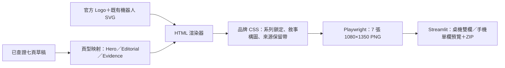

# 「一布懂 AI 新創」輪播敘事視覺設計

> 日期：2026-07-31  
> 狀態：使用者已核准「好奇」作為封面情緒，並要求直接完成實作  
> 適用範圍：AI 公司拆解七頁 IG 輪播  
> 優先順序：本文件取代舊規格中封面產業標籤、封面來源、來源自然跟隨內容，以及七頁共用單一版型的視覺規則；資料查證、官方 Logo、固定 SVG 圖解與 1080×1350 輸出規則繼續有效。

## 1. 產品結果

讀者在 IG 九宮格中先認出「一布懂 AI 新創」，點開後因一個有根據的好奇鉤子停留，接著依序看懂公司、問題、AI 角色、工作變化、證據限制與結論。七張要像同一篇有節奏的圖像文章，不是同一張模板換文字。

## 2. 視覺方向

定案方向是「品牌編輯室 × 友善 AI 實驗室」：保留 LINE Seed TW、淺藍、白、品牌藍與珊瑚橘；使用大字、紙張留白、清楚的編輯層級，再加入少量與內容有關的實驗室標記。禁止 tiny all-caps 英文、霓虹漸層、隨機軌道點線、單側 accent border，以及沒有資訊功能的裝飾卡片。

唯一固定的實驗室簽名是「呆一布 AI 實驗室」。每頁最多再有一種輔助標記，例如拆解進度、觀察刻度或證據索引，不能同時堆疊多套科技符號。

## 3. 封面：先製造好奇

封面只保留四層：

1. 系列鎖定「一布懂 AI 新創」，成品約 76–84px，九宮格縮圖仍可辨認；
2. 公司 Logo 與公司名，Logo 不得壓過系列；
3. 直接使用 `cover.heading` 的好奇鉤子，成為封面主要閱讀句；
4. 「一句話定位」作為鉤子的解答預告。

封面不顯示「產業分類」，也不顯示來源。資料結構仍可保留兩個 section，避免破壞舊草稿與資料庫；渲染器只是不把產業分類畫出來。

新的草稿提示要求封面 heading 為 12–24 個中文字的好奇鉤子：優先用問題、反差或意外結果，但不得誇張、製造焦慮、加入來源沒有的事實或使用空泛 clickbait。

## 4. 三種鏡頭與七頁節奏

| 頁 | 鏡頭 | 讀者情緒 | 主要構圖 | 角色任務 |
|---|---|---|---|---|
| 1 封面 | Hero | 好奇 | 系列大字、公司識別、鉤子、角色主視覺 | `think` 沿著觀察線看向鉤子 |
| 2 公司 | Editorial | 建立輪廓 | 大標＋兩段編輯文字 | `point` 指向白話定位 |
| 3 問題 | Editorial | 看見代價 | 問題段落＋三節點問題鏈 | `think` 面向阻礙節點 |
| 4 AI 角色 | Evidence | 理解機制 | 三步直式圖解為主 | `point` 指向 AI 介入點 |
| 5 工作變化 | Evidence | 看見改變 | 使用前後圖解＋必要解釋 | `happy` 托住「現在」結果 |
| 6 觀察訊號 | Evidence | 保持判斷 | 三個證據指標＋限制 | `note` 記錄觀察項目 |
| 7 收束 | Hero | 記住並回應 | 結論、讀者問題、追蹤邀請 | `wave` 邀請繼續拆解 |

情緒順序固定為：好奇 → 輪廓 → 痛點 → 理解 → 改變 → 判斷 → 記住。

## 5. 角色參與敘事

使用 `assets/mascot/` 既有官方 SVG，不新增生成式圖片。角色不是固定放在 `mascot-bay`，而是由渲染器依頁型加入 `character-stage`，再用每種鏡頭的 CSS 讓角色面向或靠近當頁的關鍵資訊。

角色可局部跨入內容區，但不得遮住文字、Logo、圖解文字或來源。角色尺寸以大輪廓在縮圖可辨識為準，小道具只作加分，不能承擔唯一語意。

## 6. 內頁與來源

第 2–7 張上方固定顯示：系列名、頁碼／頁型、公司小 Logo。系列名優先於通用 Lab 英文標籤。

來源位於卡片內容的最下方保留帶中，與正文、角色及圖解分區；它不是覆蓋層，也不使用絕對定位壓住內容。成品字級 28–30px，文字與白底對比至少 4.5:1，長來源可換行但不得溢出。封面完全不放來源。

內容區塊改用完整輪廓、底色或排版間距分組，不再使用 3–8px 單側彩色邊框。內文維持 29–34px，主標與內文至少相差兩級。

## 7. 長內容與長公司名

公司名依長度套用 `short`、`medium`、`long` 三種字級；禁止單行硬塞或裁切。內容仍以既有 140–220 字驗證為主，CSS 需通過現有最長測試草稿。Logo 使用 `object-fit: contain`，不改色、不變形。

## 8. 系統邊界

不更改 SQLite schema，不重寫已存草稿，不新增圖片生成服務，也不變更來源驗證。舊草稿重新產圖即可套用新版；只有之後重新產生草稿時，才會得到新的封面好奇鉤子。

## 9. 錯誤與安全

- 缺 Logo 仍然阻擋產圖，草稿不刪除。
- 吉祥物檔案缺失時直接報錯，不靜默使用錯誤版本。
- 所有公司名、標題、section 與來源仍需 HTML escape。
- 不下載新 Logo、不修改官方 Logo、不增加外部服務與費用。

## 10. 驗收條件

- 封面出現「一布懂 AI 新創」，無產業分類、無來源。
- 封面以 `heading` 作好奇鉤子；草稿提示明確要求非 clickbait 的好奇句。
- 七頁分成 Hero／Editorial／Evidence 三種 DOM／CSS 鏡頭，構圖可辨識。
- 七頁各使用指定的既有機器人姿勢，角色不遮文字、Logo、圖解或來源。
- 第 2–7 張來源位於最下方保留帶，字級至少 28px、對比至少 4.5:1。
- 無單側 accent border、無 tiny all-caps 英文 Lab 標籤；只留中文「呆一布 AI 實驗室」。
- 七張皆為 1080×1350、LINE Seed TW 實際載入、無 DOM overflow。
- Streamlit 預覽桌機兩欄、375px 手機單欄，沒有水平捲動或裁切。
- 視覺自檢至少兩輪；每輪只保留桌機 1280×800 與手機 375×812 兩張，最後路徑寫入 `HANDOFF.md`。

## 11. 方案取捨

主方案是修改既有唯一模板，讓所有舊草稿立即得到一致新版，維護成本最低。備援是新增「舊版／實驗室版」切換，優點是可回退，缺點是測試、客服與視覺規則都會加倍；目前沒有保留舊版的產品需求，因此不採用。

## 12. Non-goals

- 不判斷公司或內容值不值得發。
- 不修改七頁事實內容、來源或證據。
- 不新增自動插畫、Logo 搜尋或外部圖片 API。
- 不重做整個選題編輯器；只確保現有輪播預覽在桌機與手機正常。
