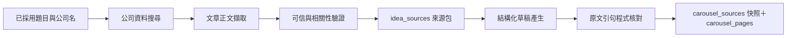

# 公司研究與輪播十項驗收修正

> 日期：2026-07-31  
> 狀態：使用者已核可設計，並明確免除 written spec 再次審閱等待。  
> 來源：`docs/2026-07-30-輪播全流程驗收回饋.md`

## 1. 產品結果

使用者採用一則有公司名的題目後，按一次「產生輪播草稿」，系統會先在可信網域搜尋
更完整的公司資料，擷取文章正文，逐筆驗證，保存本次來源快照，再依證據產生七頁草稿。

產品不替使用者判斷「值不值得發」；只負責顯示哪些是官方說法、哪些是第三方報導，以及
草稿實際使用了哪句原文。

本規格取代 `docs/specs/2026-07-30-來源蒐集與出圖接線-design.md` 的「不做來源自動
蒐集」與「手動為主」決定。原有人工新增／編輯來源的能力保留，Logo 限官網或官方品牌素材的
規則不變。

## 2. 核心資料流

各單元單一負責：

1. `CompanyResearcher`：根據公司名建立「公司定位」「產品與 AI 角色」「使用者／成果／融資」
   三類查詢，透過 Tavily 搜尋，每類最多取 3 筆候選。
2. `ArticleExtractor`：優先使用 `<article>`、`<main>` 與 article JSON-LD；排除導覽、頁尾、存取性文字與
   分享按鈕，只在完整句號處截斷。
3. `EvidenceValidator`：檢查 HTTPS、網域、公司名是否出現在標題或正文、原文引句是否逐字存在，
   並去除重複網址與重複文章。
4. `GroundedDraftGenerator`：只取得驗證後的 1–8 筆來源，用一次 Gemini 結構化輸出產生固定
   七頁。不做第二次 LLM 修復。
5. 儲存層：只有草稿與所有證據都通過時，才以同一個 SQLite transaction 替換來源包、來源快照
   與七頁草稿；失敗時不改寫現有成果。

## 3. 可信網域與證據規則

### 3.1 搜尋邊界

Tavily 每次都必須傳入 `include_domains`，不做不限網域的搜尋。動態白名單來自：

- 題目已綁定來源的網域；
- 已驗證來源或已儲存 Logo 所指的公司官方網域；
- 程式維護的編輯白名單：`techcrunch.com`、`venturebeat.com`、`ycombinator.com`、
  `a16z.com`、`producthunt.com`、`inside.com.tw`、`reuters.com`、`prnewswire.com`、
  `businesswire.com`。

網域在白名單只代表「允許驗證」，不代表「搜到就相信」。論壇、社群貼文、內容農場與不明轉載站不納入。

### 3.2 來源分類

`VerifiedSource` 新增 `source_kind`：

- `official`：公司官網、官方 blog、新聞室或品牌素材頁，畫面顯示「官方說法」。
- `third_party`：白名單媒體與機構，畫面顯示「第三方報導」。
- `manual`：舊資料或人工新增來源；保持相容，不自動宣稱其獨立性。

`idea_sources` 與 `carousel_sources` 各新增 `source_kind TEXT NOT NULL DEFAULT 'manual'`。航程中斷或舊資料庫
搬遷時，舊列數、內容、狀態與順序必須完全保留。

### 3.3 原文引句

`ContentSection` 新增 `evidence_quotes`，每筆含 `source_id` 與 `quote`。程式必須驗證：

- `source_id` 存在於本次快照；
- `quote` 是對應 `excerpt` 中逐字存在的非空字串；
- 有事實敘述的 section 至少有一筆證據；
- section 的 `source_ids` 由 `evidence_quotes` 推導，不讓兩者互相矛盾。

公開資料不足時，第 2–6 頁使用既有的替代模組，並明寫「目前公開證據有限」；140–220 字是目標，
不能為達字數而補造事實。

## 4. Gemini 輸出契約

- 使用 JSON Schema `prefixItems` 逐頁定義 `page_no`、`page_type`、section 數量、diagram 類型與證據格式；
  不再使用「七個任意順序的通用頁」。
- prompt 只寫內容規則與來源包，不重複貼一份 JSON Schema。
- 第 4–7 頁 heading 必須含公司全名或一致的公司簡稱。
- 第 7 頁固定為「新的收束結論＋一個明確問題＋追蹤提示」，不重複前六頁的三點摘要。
- 任何 schema、七頁順序、公司標題、CTA 結構或引句核對失敗，都回傳一次可懂的錯誤，不發起第二次付費／計額的模型呼叫。

## 5. 使用者介面

1. 「產生輪播草稿」依序顯示「搜尋資料 → 讀取文章 → 驗證證據 → 產生七頁」；執行中按鈕
   不可重複點擊。
2. 成功後顯示「本次使用 N 筆來源：官方 X、媒體 Y」，可展開查看出版方、日期、網址與證據原句。
3. 「重新產生草稿」只使用已存來源快照，不重搜。
4. 次要動作「重新搜尋公司資料」必須二次確認，明說會清除舊草稿與已產生圖片；確認後才搜尋。
5. 來源區只提供證據與分類，不顯示發佈分數或價值判斷。
6. 官方 Logo 上傳與已修正的 submit 流程保持不變；不新增圖片搜尋。

## 6. 七圖與預覽修正

- 預覽的 HTML 資料順序永遠是 1→7；桌機以 CSS 雙欄 grid 顯示，375px 以下改單欄，不以兩個獨立
  column 容器分配奇偶頁。
- 封面也渲染 `source_label`；七頁一律能在單張分享時追回來源。
- 1080px 原圖的頁型與來源字級提高，縮到 375px feed 寬時視覺尺寸不得低於 12px，對比至少 4.5:1；
  長來源可換行，不裁切。
- 維持現有 LINE Seed TW、青色單一主色、紙張質感與七頁版型，不做無關的視覺重設。
- 互動狀態必須有 loading、disabled、成功與可恢復錯誤；焦點可見，觸控目標至少 44px。只加 150–200ms
  的按壓／狀態回饋，並遵守 `prefers-reduced-motion`。

## 7. 直接網址 404

`/\u9078\u984c` 重新整理時會把 Streamlit 內部的 `/_stcore/health` 與 `/_stcore/host-config` 錯誤解析到子路徑。
主方案新增 Streamlit `st.App` 啟動入口，為 `/{page}/_stcore/health` 與
`/{page}/_stcore/host-config` 提供僅 GET 的同源 redirect，其餘路由現有 `app.py` 處理。正式與本機啟動指令
改用該入口，但頁面網址不變。

備援方案是繼續由首頁導覽、避免在子頁重新整理；因無法滿足 console 0 error，不採用。

## 8. 失敗處理

- 單筆搜尋或下載失敗：記錄該筆原因，繼續其他候選。
- 至少一筆通過：可依現有替代模組產生資料有限的七頁，不補造。
- 零筆通過：停止產稿，顯示搜尋網域、失敗原因與「手動新增來源」恢復路徑。
- Gemini schema 或證據失敗：不寫入 DB，不重試模型，顯示可重新按下的錯誤。
- 任何失敗都不清空使用者已有的草稿、人工來源、Logo 或題目狀態。

## 9. 十項問題的完成對應

| # | 驗收問題 | 設計對應 |
|---|---|---|
| 1 | 未受來源支持的產品事實 | 來源研究＋逐字證據引句＋原子寫入 |
| 2 | Logo submit 死鎖 | 保留已修正回歸行為 |
| 3 | 首次 LLM 兩次仍無法解析 | 七頁 `prefixItems` schema＋只呼叫一次 |
| 4 | PR Newswire 正文雜訊與半句 | article/main/JSON-LD 優先＋完整句截斷 |
| 5 | 手機預覽奇偶順序 | 單一 DOM 順序＋響應式 grid |
| 6 | 封面無來源 | cover 渲染同一 source label |
| 7 | 頁型與來源字過小 | feed 寬度至少 12px 視覺尺寸與 4.5:1 對比 |
| 8 | 第 4–7 頁標題缺主詞 | schema/prompt/驗證器同時要求公司名 |
| 9 | CTA 重複 | 新結論＋一個明確問題＋追蹤提示 |
| 10 | `/\u9078\u984c` reload 兩個 404 | `st.App` 路徑 redirect 啟動入口 |

## 10. 驗收與安全邊界

實作固定用 TDD 垂直切片：每個問題先有一個可重現失敗的測試，只加最少實作讓它通過，再重構。

自動測試必須包含：

- 舊 DB 搬遷後主題、題目、狀態、原來源與草稿完全保留；
- 搜尋每次傳入白名單，越界 URL 即使 Tavily 回傳也會被丟棄；
- 官方／第三方分類、公司相關性、去重與完整句擷取；
- 每個事實 section 的引句存在於對應 excerpt，不支援的草稿不入庫；
- Gemini 真實契約能一次產生七頁可解析結構；
- Tavily 真實契約回傳的 URL 都位於白名單；
- 手機順序、七頁來源、字級、公司標題、CTA 與 Logo 回歸行為；
- 直接開啟與 reload `/\u9078\u984c` 後 console 無 404/error。

最終手動驗收必須：

1. 先記錄真實 `daibu.db` mtime，再 `cp daibu.db /tmp/daibu-test.db`。
2. 只以 `DAIBU_DB_PATH=/tmp/daibu-test.db` 與 port `8502` 啟動。
3. 實際走過搜尋、證據、產稿、編輯、出圖與 ZIP，不判斷內容值不值得發。
4. 整輪只截 `.screenshots/desktop.png` 1280×800 與 `.screenshots/mobile.png` 375×812。
5. 結束時再比對真實 `daibu.db` mtime，必須完全不變。

成本上，第一次產稿與「重新搜尋公司資料」會使用最多三次 Tavily 查詢、數筆公開網頁下載與
一次 Gemini；「重新產生草稿」只使用快照與一次 Gemini。不新增付費模型、圖片生成、自動發文或
發布價值評分。
