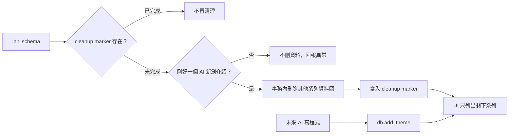

# 單一內容系列清理 Design

## 目標

目前工作站只留下「AI 新創介紹」，永久刪除現有的其他內容系列與它們底下的內容。移除前端手動新增內容系列的入口，但保留程式層 `db.add_theme()`，以後由 AI 寫程式新增的系列要能正常顯示，不可被後續開啟應用時再刪除。

## 已核准的產品決策

- 採用「一次性清理＋修改預設值」，不是只從畫面隱藏。
- 清理前必須停止 8502，並分別備份真實 `daibu.db` 與 `/tmp/daibu-workstation-redesign.db`。
- 刪除範圍是「AI 新創介紹」以外的現有系列，以及這些系列所屬的題目、正文、成效、題目來源、輪播來源與輪播頁。
- 保留「AI 新創介紹」的全部內容，包括 BillionToOne 正文與七頁草稿。
- 保留共用的素材來源庫與 `brand_assets`；未來程式新增系列仍可重用。
- 管理區的編輯與已有刪除確認流程保留；只移除「＋ 新增內容系列」。

## 方案比較

### A. 一次性清理＋修改預設值（採用）

給已有資料庫一個只執行一次的清理標記，同時將全新資料庫的預設系列縮減為一個。現有資料與新安裝的行為一致，未來程式新增不受影響。

### B. 只執行一次 SQL（不採用）

當下能清乾淨，但全新資料庫還是會建立三個預設系列，結果會再次分歧。

### C. 只隱藏前端（不採用）

風險最低，但資料仍在，不符合「永久刪除」的明確決定。

## 架構與資料流

### 1. 資料庫一次性清理

`db.init_schema()` 在表格與舊版搬遷完成後檢查 `single_series_cleanup_v1`。沒有標記時：

1. 查詢名稱剛好等於「AI 新創介紹」的系列。
2. 整個 `themes` 為空時直接寫入清理標記，再由 seed 建立唯一的預設系列。這能保證全新資料庫之後以程式新增的系列不會在下次啟動被刪。
3. 資料庫已有系列，但目標數量不是一個時，停止清理，不寫標記，也不刪任何資料。
4. 數量剛好一個時，在同一個 SQLite transaction 依關聯順序刪除其他系列的 `performance`、`carousel_pages`、`carousel_sources`、`idea_sources`、`ideas`、`theme_sources` 與 `themes`，然後寫入標記。
5. 任一步驟失敗必須 rollback；不允許留下「部分刪除但已標記完成」的狀態。

標記使清理只執行一次。日後 `db.add_theme()` 新增的系列會直接保留。

### 2. 預設資料

`seeds.DEFAULT_THEMES` 只留「AI 新創介紹」，並繼續使用 `company_profile`模式與現有的五個來源。`DEFAULT_SOURCES` 不刪減，以便未來程式建立其他系列時重用。

### 3. 前端

- `pages/1_選題.py` 移除新增系列 popover 與表單，不留隱藏的可互動入口。
- 已有系列仍來自 `db.get_themes()`，不將畫面寫死為單一名稱。
- 首頁與內容工作站的空狀態改成「目前沒有內容系列；請透過專案設定新增」，不再引導手動操作。
- 現有系列編輯、來源綁定與帶確認的刪除流程保留。

## 實際資料影響

### `daibu.db`

- 刪除 theme 1「AI 近期大事」與 theme 2「本週熱門 Claude/Codex Skill」。
- 刪除 theme 1 底下 1 則已發與 1 則採用；theme 2 目前沒有題目。
- 保留 theme 3「AI 新創介紹」與其 6 則候選。

### `/tmp/daibu-workstation-redesign.db`

- 刪除 theme 1、theme 2 與 theme 1 底下 2 則採用內容。
- 保留 theme 3「AI 新創介紹」的 3 則候選、1 則採用，以及 idea 15 BillionToOne 的正文、S1 證據與七頁草稿。

## 備份與復原

實作開始前停止 8502，使用 SQLite 備份 API 把兩個資料庫存到獨立的 `/tmp/daibu-single-series-cleanup-<timestamp>/`。不用直接複製正在寫入的 SQLite 檔案。備份路徑要記入 `HANDOFF.md`。

若清理後發現範圍錯誤，停止應用後才能以對應備份復原；本輪不自動復原。

## 錯誤處理

- 已有系列但找不到「AI 新創介紹」：不刪、不標記，保留原狀。
- 找到多個同名系列：不刪、不猜哪個是正式資料。
- 刪除中任一 SQL 失敗：整筆 transaction rollback，不寫 marker。
- 備份失敗：不啟動新版進行真實資料清理。

## 驗收與 TDD

依垂直切片一次只處理一個失敗測試：

1. 真實 SQLite 測試先建立保留與刪除系列的完整關聯資料，確認清理後只剩目標資料圖。
2. 重開 `init_schema()` 後不再清理；之後以 `db.add_theme()` 新增的系列必須保留。
3. 目標為零或重複時不得刪任何資料。
4. 全新資料庫的 seed 只產生「AI 新創介紹」，其 `content_kind` 仍為 `company_profile`。
5. Streamlit AppTest 確認內容工作站沒有「＋ 新增內容系列」、「內容系列名稱」與「建立內容系列」控件，但程式新增的多個系列仍全部顯示。
6. 首頁與內容工作站空狀態不再引導手動建立。
7. 在 `/tmp` 複本執行資料清理後，核對系列數、各狀態數量、BillionToOne 正文字數、S1 與 1–7 頁。
8. 完成兩輪桌機 1280×800 與手機 375×812 視覺驗收，最終確認只有一個系列、沒有新增入口、無穿模與橫向捲動。
9. 全套 pytest、`git diff --check`、真實資料庫與備份體積／關鍵數量核對，再合併、推送與重啟 8502。

## 非目標

- 不刪素材來源庫或品牌 Logo 資產。
- 不移除編輯、來源綁定或現有刪除系列流程。
- 不把前端寫死為只會顯示「AI 新創介紹」。
- 不在本輪新增 CLI 或 AI 建立系列工具。
