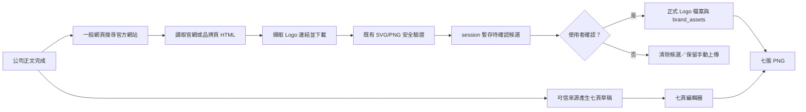

# 官方 Logo 候選與正文可見性設計

## 目標

讓已採用的公司題目在產生正文後，正文一定可讀，並自動從公司官網或官方品牌素材頁找出一張待確認 Logo。Logo 必須先由使用者確認，才可成為正式品牌資產與進入七張圖。

## 使用者結果

1. 正文文字框在淺色、深色、主題切換後與頁面重跑後都看得到既有內容。
2. 公司正文完成且尚無 Logo 時，系統自動嘗試一次官方 Logo 搜尋。
3. 找到後顯示 Logo 預覽、候選素材網址與承載該素材的官方頁面；狀態明寫「待你確認」。
4. 使用者按「確認是官方 Logo」後才寫入 `brand_assets`；按「不是官方 Logo」不留下正式資產。
5. 找不到、下載失敗、格式不安全或缺少 Tavily key 時，顯示原因與恢復方式，並保留既有手動上傳。
6. 七頁輪播草稿不依賴 Logo，可先產生與編輯；Logo 只擋最後七張 PNG。

## 固定安全規則

- 禁止呼叫圖片搜尋；只使用一般網頁搜尋定位可能的公司官網。
- Logo 只能從搜尋到的公司官網頁面或該官網連出的品牌／媒體素材頁擷取。
- 搜尋結果只產生「待確認候選」，不可宣稱已驗證官方。
- 候選必須是 HTTPS，檔案只接受既有規則允許的 SVG 或透明 PNG，維持 2 MB、像素、`viewBox` 與 SVG 安全檢查。
- 未確認候選只放在 Streamlit session state，不寫資料庫、不放進正式 Logo 目錄、不允許出圖。
- 正式來源欄保存承載 Logo 的公司官網／官方品牌頁，不用圖片搜尋結果頁。
- 不修改真實 `daibu.db`；手動與瀏覽驗收使用 `/tmp/daibu-workstation-redesign.db`。

## 架構與資料流

### 元件邊界

- `daibu/fetch/search.py`：新增不帶網域白名單的一般網頁搜尋，只供「找可能的官方站」；既有可信內容搜尋維持白名單。
- `daibu/cards/logo_discovery.py`：辨識可能官網、解析官網 HTML、排序 Logo 線索、下載與安全驗證，回傳 `LogoCandidate`，不碰資料庫。
- `pages/1_選題.py`：控制每個 session 自動嘗試一次、顯示預覽、接受確認／拒絕、保留手動上傳。
- `daibu/theme.py`：讓 textarea 的前景、底色與游標直接使用呆一布語意色票。

## 官網與 Logo 候選判斷

1. 一般網頁搜尋查詢 `"<公司>" official website logo brand assets`。
2. 排除新聞、百科、社群、募資資料庫與搜尋結果頁；結果的標題、摘要或網域必須能對上公司名稱。
3. 先讀官方站首頁，再讀首頁明確連出的 `brand`、`press`、`media`、`assets` 頁，總頁數設上限。
4. 只考慮頁面實際引用、描述中含 `logo`／公司名的 SVG 或 PNG；不猜常見 `/logo.svg` 路徑。
5. 下載後套用既有 `validate_upload()`；不合格就看下一個候選。
6. 找到一張合格候選即停止，交給使用者判斷品牌版本是否正確。

## 畫面設計

缺 Logo 區塊由單純上傳表單改成三層：

1. **待確認卡**：Logo 預覽最大寬 240px、公司名、明確「待你確認」狀態、官方頁與素材連結。
2. **決策按鈕**：「確認是官方 Logo」為唯一主要操作；「不是官方 Logo」為次要操作，兩者至少 44px 高且可鍵盤操作。
3. **備援**：自動搜尋失敗或拒絕後仍可重新搜尋，底下保留既有手動上傳。

不新增裝飾性動畫；沿用既有按壓回饋與 reduced-motion 規則。錯誤訊息放在 Logo 區塊內，說清楚原因與下一步。

## 錯誤與成本

- 搜尋／官網抓取／下載任一步失敗：不影響正文、來源或既有七頁草稿。
- 沒有 Tavily key：提示到設定頁補 key，仍可手動上傳。
- 一個 session 對同一題只自動嘗試一次，避免頁面重跑反覆花免費搜尋額度；使用者可明確按鈕重試。
- 不新增付費供應商或套件，沿用 Tavily 免費額度與標準函式庫。

## 驗收

- 單元測試證明一般網頁搜尋不套內容白名單，但既有白名單搜尋不變。
- Logo finder 測試證明只從官網頁面引用擷取、跳過第三方／不安全／不合格資產、回傳可追溯來源。
- AppTest 證明候選不會自動寫 DB，確認後才儲存，拒絕後仍有手動上傳與重試路徑。
- CSS 測試與真實瀏覽器 computed style 證明 textarea 在淺／深模式均有可讀對比。
- 8502 使用 `/tmp` DB 產生並顯示 BillionToOne 七頁草稿；正式 `daibu.db` mtime 不變。
- 視覺自檢兩輪，每輪桌機 1280×800 與手機 375×812，最後只保留 `.screenshots/desktop.png`、`.screenshots/mobile.png`。
