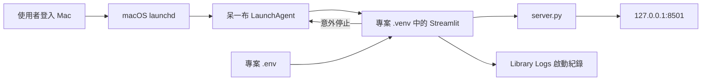

# 呆一布內容工作站 macOS 常駐服務設計

日期：2026-08-10
狀態：使用者已於 2026-08-10 確認，進入實作計畫

## 1. 背景與目標

目前工具以手動執行 Streamlit 程序的方式運作。瀏覽器的
`http://localhost:8501` 只是本機網址；當 Streamlit 程序結束時，網址仍然存在，
但沒有服務接收請求，因此瀏覽器顯示「localhost 拒絕連線」。

本輪要讓工具在使用者登入這台 Mac 後自動啟動，程序意外停止時自動恢復。使用者不需
每次開 Terminal 輸入指令。

成功後的使用者結果：

- 登入 Mac 後直接開啟 `http://localhost:8501` 即可使用。
- Streamlit 意外停止時，macOS 會自動重新啟動。
- 啟動失敗時有固定的紀錄位置可查原因。
- 未來可用一條明確命令停用並移除背景服務。

## 2. 範圍與限制

### 本輪包含

- 使用目前登入帳號的 macOS LaunchAgent。
- 自動啟動、意外停止後重新啟動、啟動節流。
- 固定使用 `127.0.0.1:8501`，不開放區域網路或公開網路存取。
- 標準輸出與錯誤紀錄寫入使用者的 `~/Library/Logs/DaibuContentBrain/`。
- 可測試的安裝、狀態查詢與移除命令。
- 缺少 `.env` 時，以 `.env.example` 建立權限為 `600` 的本機 `.env` 骨架，
  但不代填、顯示或記錄任何 API key。

### 本輪不包含

- Mac 關機、登出或長時間睡眠時仍可使用。
- 讓其他電腦或社團成員透過網際網路使用。
- 雲端部署、網域、登入系統或多人權限。
- 將 API key 寫入 Git、LaunchAgent plist 或啟動紀錄。
- 更改選題、文案、Logo、輪播圖等產品功能。

## 3. 方案比較與決策

### 方案 A：LaunchAgent（採用）

LaunchAgent 是 macOS 內建的登入帳號背景服務管理器。它在登入後載入程序，並能在程序
停止後重新啟動。

優點：免費、Mac 原生、可自動恢復、不需安裝新的常駐工具。

限制：只在該使用者已登入且 Mac 醒著時工作；專案資料夾移動後要重新安裝設定。

### 方案 B：登入項目／捷徑

登入時執行一次啟動腳本。

優點：概念簡單。

限制：Streamlit 之後若當掉不會自動恢復，無法達成「保持開啟」。

### 方案 C：雲端部署

把應用程式搬到雲端主機。

優點：Mac 關機後仍可使用，也能分享網址。

限制：需要外部帳號、秘密管理、部署維護與可能的費用；不符合本輪選擇的本機範圍。

## 4. 架構與資料流

資料流：LaunchAgent 使用專案虛擬環境中的 Streamlit，並把工作目錄固定在專案根目錄；
應用程式既有的 `python-dotenv` 從該目錄讀取 `.env`。瀏覽器只透過本機回環位址
`127.0.0.1` 連線，不接受其他裝置的請求。

## 5. 元件設計

### 5.1 本機服務管理器

新增一個 Python 命令列工具，提供：

- `install`：驗證專案、虛擬環境與入口檔；產生 plist；載入並啟動服務。
- `status`：顯示服務是否載入、8501 是否健康，但不輸出秘密。
- `uninstall`：先卸載服務，再刪除本工具建立的 plist；保留資料庫、`.env` 與紀錄。

plist 使用固定 label `io.daibu.content-brain`，包含：

- `RunAtLoad = true`
- `KeepAlive = true`
- `ThrottleInterval = 10`
- 完整的 Streamlit 執行檔與 `server.py` 絕對路徑
- `--server.address=127.0.0.1`
- `--server.port=8501`
- `--server.headless=true`
- 專案根目錄作為 `WorkingDirectory`
- 獨立的 stdout／stderr 紀錄檔

### 5.2 API key 與 `.env`

目前 `.env` 不存在，而設定頁輸入的 key 只存在當次程序記憶體；程序結束後就會消失。
這也是常駐服務重啟後仍可能「畫面能開、AI 功能不能用」的風險。

安裝器只在 `.env` 缺少時複製 `.env.example`，並將檔案權限設為只有目前帳號可讀寫。
API key 必須由使用者在本機填入，不能貼進聊天。填寫完成後重啟 LaunchAgent，應用程式
會透過既有 `python-dotenv` 載入。

本輪不改設定頁的保存行為，避免把秘密寫檔與前端表單修改混成同一個工作項目。

### 5.3 錯誤處理

- 缺少 `.venv/bin/streamlit` 或 `server.py`：安裝中止，清楚指出缺少項目，不留下半套服務。
- 8501 被其他程序占用：狀態命令指出占用，不強制終止不明程序。
- 服務啟動失敗：LaunchAgent 依節流間隔重試；狀態命令提供錯誤紀錄路徑。
- 專案資料夾被移動：狀態命令顯示路徑失效，重新執行 `install` 即可更新。
- `.env` 缺 key：網站仍可開啟；AI／搜尋功能沿用既有缺少 key 的錯誤提示。

## 6. 安全、成本與可逆性

- 綁定 `127.0.0.1`，只有這台 Mac 能連線。
- plist、命令輸出與紀錄都不得包含 API key。
- `.env` 已被 `.gitignore` 排除，另設檔案權限 `600`。
- 不刪除或改寫既有 `.env`；只在完全不存在時建立空白骨架。
- `uninstall` 不刪資料庫、Logo、`.env` 或紀錄，因此可恢復且不傷使用者資料。
- 使用 macOS 內建能力，沒有新增訂閱或雲端費用。

## 7. TDD 與驗證策略

以垂直切片進行：一次寫一個失敗測試，再做最小實作讓它通過。

1. plist 產生器：測試 label、RunAtLoad、KeepAlive、節流、固定本機位址、port、工作目錄與紀錄路徑。
2. 安裝前檢查：測試缺少 Streamlit 或入口檔時拒絕建立 plist。
3. `.env` 建立：測試只在缺少時由範本建立、權限為 `600`，既有檔案內容不被覆寫。
4. 安裝／移除命令：以暫存目錄和假的 launchctl 邊界驗證正確命令與可逆行為。
5. 真實邊界驗收：實際安裝 LaunchAgent，確認 launchctl 已載入、健康端點回應、瀏覽器可開。
6. 自動恢復驗收：取得目前服務 PID，終止該 PID，確認 launchd 產生新 PID 且健康端點恢復。
7. 專案全套測試通過後，更新 `HANDOFF.md`，只提交本輪相關檔案。

## 8. 驗收標準

- `http://localhost:8501/_stcore/health` 回應成功。
- `http://localhost:8501` 可在瀏覽器載入首頁。
- LaunchAgent 顯示已載入且正在執行。
- 終止 Streamlit 後，10 秒左右自動啟動新程序並恢復健康。
- plist 與紀錄中找不到 Gemini、Groq 或 Tavily key。
- 既有資料庫內容不變。
- 移除命令只移除背景服務設定，不刪除產品資料與秘密檔。
- 全套 pytest 無新增失敗。

## 9. 剩餘限制

「永遠保持開啟」在本設計中的精確意思是：這台 Mac 已開機、使用者已登入且系統沒有
睡眠時，工具會自動保持運行。若未來需要 Mac 關機後仍可使用，必須另開雲端部署設計。
