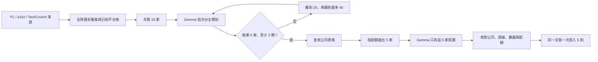

# AI 新創選題多樣性設計

## 問題

目前 AI 新創來源裡，基礎建設與企業工具的公司比例很高。若系統只依來源順序取前幾家，每次產出的公司與敘事都會集中在相近領域，社群貼文看起來像在反覆介紹同一類產品。

這次不是刪掉基礎建設公司，而是讓每批五則有明確的內容組合限制。

## 使用者可見規則

- 「AI 新創介紹」每次產生 5 則；其他系列維持原本設定。
- 每批最多 1 則 AI 基礎建設。
- 每批最多 2 則企業／產業應用。
- 其餘任何單一類別也最多 2 則。
- 每批至少涵蓋 3 個類別。
- 公司依核心產品與主要客戶只歸到一個主類別，不依這次貼文角度改分類。
- 若看完最多 40 家仍無法湊出合格的 5 家，整批不寫入，畫面說明「已檢查 40 家」以及不符合的原因。

## 六個主類別

1. `ai_infrastructure`：模型、算力、雲端、資料／開發平台、部署與觀測等 AI 基礎建設。
2. `enterprise_industry`：提供企業或特定產業工作流程的 AI 應用。
3. `consumer_creator`：直接服務一般消費者、個人或內容創作者的工具。
4. `robotics_physical`：機器人、移動載具、製造、物流或其他實體世界系統。
5. `science_health_biotech`：科學研究、醫療、健康與生技。
6. `governance_social_business`：治理、風險、公共／社會議題與新商業模式。

已知例子用於 prompt 與契約測試：Railway、Dipole、Marengo 是 AI 基礎建設；Feldy、Billow AI Labs、Almanac 是企業／產業應用；Risklytics 是治理／社會／新商業模式。

## 資料流

## 技術設計

### 分類器

新增獨立 `company_diversity` 模組。它把公司名稱、目錄描述、標籤與來源送入既有 `generate_research_text`。目前路由器會先用 Gemma，遇可恢復錯誤自動改用 Gemini 3.5 Flash-Lite。回應必須是 JSON 陣列，且每家公司恰好一筆、類別只可為六個允許值；缺漏、重複或未知公司都視為整批分類失敗。

分類只用目錄現有描述，不為每家公司多打一個 Tavily 搜尋。分類結果本輪不寫入資料庫，避免新增 schema 與過期分類問題。

### 漸進擴張

來源目錄一次可取得候選清單，但分類模型只分三個增量批次：前 15 家、接著 10 家、最後 15 家。已分類公司不重送，因此最壞是三次分類呼叫。每個階段都嘗試用已分類且資格合格的公司湊出五家；成功就停止。

### 配額選擇

選擇器必須回傳剛好五家，並驗證：基礎建設不超過一、任何其他類別不超過二、不同類別至少三。選擇以來源原始排序為主要優先，並在可行組合中優先選類別數較多者，讓多樣性不是只做到最低門檻。

### 公司資格

沿用現有資格快取與 YC 官方快速判定。尚未查核的公司只在成為可用組合所需時做既有 Tavily／LLM 資格查核；不合格或 unknown 的公司從本輪候選池排除，再由同一分類池補位。分類本身不新增搜尋成本。

### 寫題與驗證

模型只看到最後選定的五家公司與各自素材，要求回傳五則。程式再次核對：

- 恰好五則；
- 五家公司與選定名單一一對應，不能漏掉、重複或替換；
- 每則來源網址與逐字引文都能在對應素材找到；
- 最終五家仍符合分類配額。

任何一項失敗都不寫入。

### 原子寫入

五則使用同一個 SQLite savepoint 寫入。savepoint 像「整批暫存區」：五筆都成功才確認；中途任何一筆失敗就全部回復，因此不會留下 1–4 筆半批候選。既有 `db.add_idea` 會自行 commit，不適合直接用在這個批次，因此新增不自動 commit 的批次寫入介面。

## 錯誤與狀態文案

- 分類中：「正在替公司分主類別…」
- 擴到 25：「目前組合太集中，正在查看更多公司（25 家）…」
- 擴到 40：「仍缺少足夠類別，正在查看最後一批（40 家）…」
- 40 家仍不足：顯示已檢查數、目前各類別可用數量，以及哪一條配額無法滿足。
- 分類模型兩個路徑都失敗：顯示分類暫時失敗，舊內容保留。
- 模型回傳公司或數量不一致：顯示模型格式不完整，舊內容保留。

## 成本、安全與限制

- 無新付費服務、無新 API key、無資料庫 schema 變更。
- 最壞情況為 3 次分類模型呼叫、既有必要資格查核，以及 1 次寫題呼叫。
- Gemma 與 Gemini 共用 Google API；Gemini 備援只能處理單一模型繁忙，不能處理 Google 整體服務中斷。
- 分類依目錄短描述，少數跨領域公司可能與人的判斷不同；未來若累積明顯誤判，再設計可人工覆寫並持久化的分類表，本輪不提前做。

## 驗收

- 單元測試覆蓋所有配額、至少三類、無解、解析錯誤與公司對應錯誤。
- 選題整合測試覆蓋 15／25／40 漸進分類、資格淘汰後補位、五則原子寫入與失敗零寫入。
- 真實 Gemma 契約測試驗證六類 JSON 可以解析。
- 正式資料庫副本實跑一次，確認新增恰好五則且正式庫不變。
- Streamlit 桌機 1280×800 與手機 375×812 做兩輪截圖自檢，確認狀態、錯誤與無水平破版。
