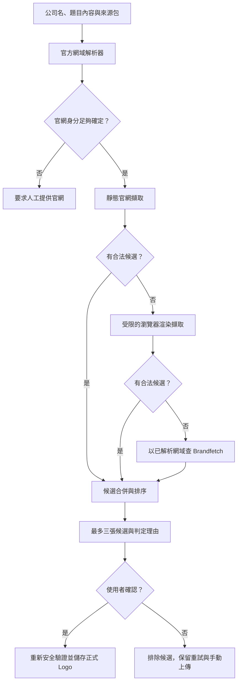

# 官方 Logo 高命中與身分驗證設計

> 2026-08-15 由使用者核可：官網優先、Brandfetch 只作備援；任何候選不論信心高低，
> 一律由使用者確認後才能儲存與出圖。

## 背景與根因

目前 Logo 搜尋直接用公司名稱查一般網頁，再要求公司名稱必須等於網域中的完整一段。
這對名稱短、常見或與網域不完全相同的公司特別脆弱。

SUN 的實際案例中，查詢 `"SUN" official website logo brand assets` 回傳五個不相關網站；
真正官網 `sunapp.ai` 沒有出現在前五筆。即使它出現，現行完整網域段比對仍會因
`sun != sunapp` 而淘汰。搜尋結果不是空陣列，所以現行第二條搜尋也不會執行。

因此畫面上的「找不到可安全預覽的官方 SVG 或透明 PNG」混合了兩種不同失敗：

1. 尚未成功辨認官方網站。
2. 已進入官網，但沒有找到通過格式與安全檢查的 Logo。

本設計先解決公司身分，再解決素材擷取，避免用放寬安全規則換取表面命中率。

## 目標

- 對短名稱、縮寫、同名公司及公司名與網域不同的案例，提高正確官網與 Logo 命中率。
- 將「官網身分是否正確」與「Logo 是否適合出圖」拆成兩道可觀察的關卡。
- 官網找不到素材時，以 Brandfetch 作為第三方備援，但只按已解析且證據充分的網域查詢。
- 最多呈現三個可追溯候選，讓使用者選擇完整字標、品牌符號或明暗版本。
- 未經人工確認的候選不得寫入資料庫、正式 Logo 目錄或任何輸出圖。
- 保持正文、來源與七頁輪播草稿不受 Logo 搜尋失敗影響。

## 非目標

- 不自動宣稱任何第三方素材為官方。
- 不接受圖片搜尋結果作為正式來源。
- 不用 AI 生成、重畫、去背或修改 Logo。
- 不使用字母圖、favicon、Brandfetch 預設圖或其他占位素材假裝已找到 Logo。
- 不取消既有手動上傳流程。
- 不把 Logo 搜尋擴張成通用品牌資產管理系統。

## 方案比較與決策

### 方案 A：只修正網域比對與搜尋備援

改動最小，但搜尋仍只有公司名，短名稱與同名公司仍容易得到不相關結果。官網使用
JavaScript 或 CSS 載入 Logo 時也無法處理。找到率中等、誤認風險中等，不採用。

### 方案 B：官方網域解析＋加強官網擷取

先用來源與公司脈絡找官網，再擷取靜態及動態頁面。來源可信、沒有新服務依賴，但官網
沒有公開可下載素材時仍會失敗。作為主要路徑，但不足以單獨最大化找到率。

### 方案 C：官方網域解析＋官網擷取＋Brandfetch 備援

在方案 B 後加入以證據充分的網域查詢 Brandfetch。找到率最高；代價是新增外部依賴與
Client ID，且第三方素材仍可能過期或選錯版本。以人工確認、來源揭露及嚴格占位圖排除
控制風險。採用此方案。

## 核心產品原則

「找到候選」和「確認正確」是兩個不同狀態：

- 系統負責盡可能找到、交叉驗證並說明判斷理由。
- 使用者負責最後確認品牌身分與版本。
- 即使是官網直接擷取或高信心候選，也不得自動採用。

## 架構與資料流

### 元件邊界

1. **官方網域解析器**：只回答「哪一個網站屬於這家公司」，不下載 Logo。
2. **官網素材擷取器**：只從已解析官網及其同站品牌頁找素材，不自行判斷公司身分。
3. **Brandfetch adapter**：只以已解析且證據充分的網域查詢，回傳第三方候選及來源資訊。
4. **候選評估器**：去重、排除占位圖、套用格式與安全規則、產生信心理由。
5. **Streamlit 工作台**：暫存候選、呈現證據、接收確認或拒絕。
6. **既有品牌資產服務**：只有確認後才重新驗證並寫入檔案與 `brand_assets`。

各元件均以純資料物件溝通，外部網路呼叫可注入測試替身，避免 UI、網路與資料庫糾纏。

## 第一階段：官方網域解析

### 輸入

- 公司名稱。
- 題目標題、角度或正文中的公司描述。
- `idea_sources` 的來源網址、publisher、excerpt。
- 候選公司原始目錄資料中可取得的官方網站連結。

### 優先順序

1. YC、a16z、Product Hunt 等原始公司頁明確標示的官方網站連結。
2. 既有可信來源中指向公司的 canonical website 或「Visit website」連結。
3. 多組一般網頁搜尋，查詢包含公司名及產品描述、創辦人或加速器等消歧資訊。
4. Brandfetch Brand Search 只能協助提出網域候選，不得單獨證明公司身分。

搜尋應合併多組結果後再評估；不得因第一組有五筆不相關結果就停止，也不得以公司名等於
完整網域段作為唯一規則。

### 身分證據

官網候選至少需要兩個相互獨立的正向訊號，或一個強官方訊號：

- 強官方訊號：原始公司目錄的官方網站欄直接連到該網域。
- 其他訊號：網站 title／Organization 結構化資料含公司名、產品描述相符、創辦人相符、
  官網連回同一個官方社群帳號，或兩個獨立可信來源指向同一網域。

遇到同名、縮寫、相互矛盾的來源或只有第三方名稱搜尋結果時，不自動選定網域；畫面要求
使用者提供或選擇官網。

解析結果只存在目前 session，直到使用者確認 Logo。確認 Logo 即同時確認該素材承載頁
屬於正確公司；本輪不新增獨立公司主檔或長期官網資料表，避免超出 Logo 功能範圍。

## 第二階段：官網 Logo 擷取

### 靜態擷取

依序檢查：

1. ``、`srcset` 及明確標記為 Logo 的圖片。
2. 內嵌 SVG。
3. `Organization.logo` 等結構化資料。
4. CSS 明確用於 header／navigation 品牌區的背景圖片。
5. 官網連出的 `brand`、`press`、`media`、`assets`、`about` 頁。

只跟隨同一註冊網域下的 HTTPS 頁面與素材。不可猜測不存在於頁面的 `/logo.svg`，不可把
Open Graph 宣傳圖、文章圖片或 favicon 當成正式 Logo。

### 動態擷取備援

靜態 HTML 沒有素材時，才以既有 Playwright／Chromium 載入官網一次，讀取渲染後 DOM、
computed style 及已載入的同站圖片。此步驟有獨立逾時與頁面數上限，不執行登入、表單、
追蹤互動或任意下載。

### 候選數量與排序

- 收集後去重，最多呈現三張，不在第一張合法素材就停止。
- 優先順序：完整 Logo／wordmark、品牌 symbol、App icon。
- 顯示 light／dark 版本標記；不因版型偏好修改官方檔案顏色。
- 仍套用既有 SVG 與透明 PNG 的大小、像素、透明度及安全規則。

## 第三階段：Brandfetch 備援

### 呼叫條件

- 官方網域已足夠確定。
- 靜態與動態官網擷取均沒有可用素材。
- 設定中存在 `BRANDFETCH_CLIENT_ID`。

### 查詢規則

- 使用明確網域路由，例如 `domain/sunapp.ai`，禁止只以 `SUN` 查 Logo。
- 分別查詢 `logo`、`symbol`，並視需要取得 light／dark 版本。
- 指定找不到時回傳 404；排除 lettermark、Brandfetch 品牌圖及透明占位圖。
- 保存 Brandfetch 素材網址、查詢網域及回傳類型，讓 UI 完整揭露來源。
- 下載後仍套用本機格式與安全驗證；第三方成功回應不等於可採用。

Brandfetch Client ID 走 `.env`／設定頁，不 hardcode、不 commit。依 2026-08-15 官方文件，
Logo API 與 Brand Search API 目前提供免費額度；實作前仍需再次核對當時條款與 rate limit。

## 候選信心與畫面

### 高信心

- 官網直接引用；或
- Brandfetch 網域與已解析官網完全一致，且品牌名稱／素材可與官網交叉對應。

### 需注意

- 網域已有充分身分證據，但素材只存在 Brandfetch，官網沒有可交叉比對的 Logo。

### 不顯示

- 官方網域未確認。
- 候選屬於另一個同名公司。
- 只有 favicon、字母圖、預設圖、空白占位圖或廣告圖片。
- 格式、安全或尺寸驗證失敗。

每張候選卡顯示：

- 公司名稱與已解析官網。
- Logo 預覽及類型（完整字標、品牌符號、App icon）。
- light／dark 版本。
- 素材來源（官網或 Brandfetch）。
- 官方承載頁與素材網址。
- 信心等級與具體判定理由，不只使用顏色。
- 「確認是官方 Logo」與「不是官方 Logo」。

畫面沿用現有內容工作台的卡片、字體、色票與間距節奏，不另創視覺風格；候選來源與信心
屬於資訊層次調整，不改變整站導覽。

任何等級都一律要求人工確認。候選只存在 Streamlit session state；使用者確認後再次執行
既有 `validate_upload()`，才呼叫既有 `store_logo()`。拒絕後把素材網址加入目前 session 的
排除清單，可繼續查看下一張、重新搜尋或手動上傳。

## 錯誤與恢復方式

畫面不得再用同一句話概括所有失敗，至少區分：

| 階段 | 使用者訊息 | 恢復方式 |
|---|---|---|
| 官網解析 | 找不到可信的官方網站 | 提供官網或重新搜尋 |
| 官網解析 | 找到多個可能的同名公司 | 由使用者選擇官網 |
| 官網擷取 | 找到官網，但沒有公開 Logo | 進入 Brandfetch 或手動上傳 |
| 格式驗證 | 找到圖片，但不是 SVG／透明 PNG | 顯示官方素材頁並建議手動取得其他版本 |
| 安全驗證 | 素材未通過安全或尺寸檢查 | 不預覽、不儲存，繼續下一候選 |
| 第三方備援 | Brandfetch 沒有這個網域 | 手動上傳 |
| 外部服務 | 搜尋／官網／Brandfetch 暫時無法使用 | 顯示服務名稱，可由使用者重試 |

任何錯誤都不得刪除正文、來源、輪播草稿或既有已確認 Logo。缺 Logo 只阻擋七張 PNG。

## 成本、安全與隱私

- 延用 Tavily 免費搜尋；多組查詢須設總次數上限並只在使用者明確重試時再次消耗額度。
- Brandfetch 是新增外部依賴；只傳公司名稱或官方網域，不傳正文、來源引文或使用者資料。
- 動態官網擷取只讀公開頁面，限制頁數、下載大小、逾時與同站導覽。
- 不執行官網提供的下載程式、不登入、不提交表單。
- 所有外部素材都視為不可信輸入，必須先通過既有 SVG／PNG 驗證。
- 未確認候選不落地至正式資產目錄，避免半成品被其他題目重用。

## TDD 與驗收

實作須依垂直切片逐一 Red → Green → Refactor，不可一次寫完所有測試再實作。

### 已知答案校準

先選兩個可人工確認的案例校準測量方法：

1. **SUN／`sunapp.ai`**：名稱短且與網域不同，必須找到正確官網，不得誤選
   `suny.edu`、`getsun.io` 或其他 SUN。
2. **名稱與網域明確、官網直接提供 Logo 的公司**：必須走官網主路徑成功，證明系統不會
   一律退到 Brandfetch。

每次回報找到率或通過數，都必須說明案例集合、輸入欄位與判定方法；空輸出不得直接解讀為
不存在。

### 垂直切片

1. 從原始公司來源解析官方網站；SUN 得到 `sunapp.ai`。
2. 聚合多組搜尋結果；第一組全錯時仍會繼續消歧。
3. 官網身分評估；同名錯誤網域不會進入素材擷取。
4. 靜態 HTML 取得 `img`、`srcset`、SVG 與 Organization.logo。
5. 靜態失敗才使用受限瀏覽器渲染；逾時不影響其他資料。
6. 官網失敗後才以確定網域呼叫 Brandfetch。
7. Brandfetch 404、lettermark、預設圖與空白占位圖均不成為候選。
8. 最多三張候選去重、分型並顯示來源與信心理由。
9. 候選在確認前不寫 DB／正式目錄；確認後重新驗證且只寫一次。
10. 拒絕、重試、缺 key、服務逾時及手動上傳流程保持可用。

### 真實邊界測試

- Tavily：以受控查詢驗證實際結果 shape；不可假設 mock 排序等於正式服務。
- 官網：以一個允許自動讀取的公開站驗證靜態擷取，動態測試限制在必要案例。
- Brandfetch：只有設定 Client ID 時才跑 contract test，驗證 domain route、404 fallback、
  MIME type 與實際素材格式。
- 真實邊界測試只讀外部服務，使用 `/tmp` 資料庫，不修改正式 `daibu.db`。

### 使用者流程驗收

- SUN 顯示正確官網、候選來源與判定理由。
- 桌機 1280×800、手機 375×812 均能查看最多三張候選且無橫向溢出。
- loading、官網不確定、官網無素材、Brandfetch 無結果、格式不合格與確認成功都有明確狀態。
- 鍵盤可完成查看、確認、拒絕及重試；按鈕至少 44px，信心不只靠顏色表達。
- 依專案規範完成至少兩輪桌機／手機截圖自檢。

## 預期產品結果

使用者不再只看到模糊的「找不到 Logo」。系統會先說明認定哪個官網、從哪裡取得候選、
為何相信它屬於同一家公司，以及素材是否直接受到官網支持。第三方資料庫提高覆蓋率，
人工確認則保留品牌正確性的最後控制權。

## 剩餘限制

- 無法保證網路上一定存在可公開下載的官方 Logo。
- 人工確認可防自動誤採，但仍需要使用者辨認品牌版本是否最新、是否適合本次版面。
- Brandfetch 的資料、免費額度與條款可能變更；實作與上線前必須再次查核官方文件。
- 本輪不建立公司主檔；若未來需要跨功能重用官網與品牌身分，應另案設計資料模型。
