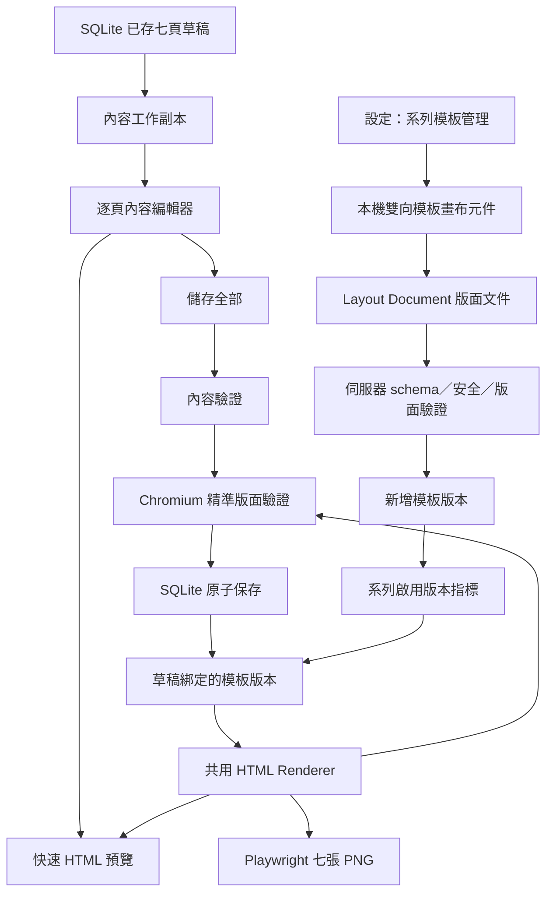

# 七頁內容與系列模板編輯器 — 設計規格

> 2026-08-20 由使用者逐段確認。本文件只定義產品與技術設計；實作需另寫 TDD 計畫，
> 嚴格依 Red → Green → Refactor 執行。

## 一句話

把目前「七頁表單排成一長串、存完才看得到圖片」的輪播流程，改成可逐頁編輯、即時預覽、
整份安全儲存的內容工作台；並在設定頁加入受限制的 PPT 式系列模板編輯器，讓使用者能調整
既有元素的位置與大小，又不會因一次改版弄壞舊貼文。

---

## 0. 閱讀前先懂這些詞

| 名詞 | 白話與在產品裡的角色 |
|---|---|
| `CarouselDraft` | 一整包七頁草稿，像一份尚未輸出的簡報檔；一次保存就是保存這整包 |
| SQLite | 工具在本機使用的資料庫，像一個有欄位規則的電子資料櫃 |
| transaction（交易） | 像把七頁裝進同一個信封再投遞：要嘛全部放進資料庫，要嘛一頁都不改 |
| Renderer（排版轉譯器） | 把內容與模板組成真正 HTML 畫面的唯一排版工廠；預覽與產圖都必須經過它 |
| Layout Document（版面文件） | 記錄每頁元素座標、尺寸與文字框設定的資料，角色類似 PPT 檔裡的物件位置 |
| schema（格式規則） | Layout Document 允許有哪些欄位與數值的契約，像表單的欄位規格，可阻擋亂碼或危險內容 |
| Component（嵌入元件） | 放在 Streamlit 頁面裡的小型互動前端，負責逐字預覽、拖曳與縮放，不負責正式保存 |
| DOM／bounding box | DOM 是瀏覽器眼中的畫面元素樹；bounding box 是瀏覽器算出的實際矩形，用來判斷越界與碰撞 |
| repository（資料存取層） | 專門讀寫某類資料的程式邊界，讓畫面不必自己拼 SQL |
| migration／backfill（搬遷／補資料） | 升級舊資料庫結構，並替舊草稿補上原本沒有的模板版本資料；不得改掉既有內容 |
| registry（元素登錄表） | 系統允許出現在七頁模板裡的正式物件清單，決定哪些能移動、哪些能重疊 |
| active version（啟用版本） | 之後新草稿預設採用的模板版本；它不是強制改寫所有舊貼文的開關 |
| Chromium／Playwright | Chromium 是實際排版與截圖的瀏覽器；Playwright 是自動操作它做檢查與產圖的工具 |

---

## 1. 背景與問題

### 1.1 現有能力

專案已經具備以下基礎：

- `CarouselDraft → CarouselPage → ContentSection／DiagramSpec` 的七頁內容結構。
- `pages/1_選題.py` 內的七頁標題與段落文字編輯欄位。
- `db.save_carousel_draft()` 的整份交易式保存；驗證失敗時不覆寫舊草稿。
- `render.page_html()` 產生 1080×1350 HTML，`shoot.carousel_pngs()` 用 Chromium 產出七張 PNG。
- 來源快照、查證引文、官方 Logo、圖片預覽與 ZIP 下載。
- v15.1 七頁視覺原型，以及 SUN、Billow AI Labs、Shiraz AI 三家公司雙尺寸壓力測試。

### 1.2 現在不好用的地方

1. 七頁表單垂直堆疊，使用者無法一邊修改、一邊判斷單頁實際構圖。
2. 圖解節點的標題、說明與符號會出現在圖片上，卻沒有完整暴露在編輯介面。
3. 文字字數驗證與真正的瀏覽器排版檢查分開，使用者通常到產圖時才知道哪裡跑版。
4. 模板仍主要由固定 HTML／CSS 控制，細節調整必須改程式，不能像 PPT 一樣直接移動。
5. 若未來只保留一份「最新模板」，修改模板就可能讓舊貼文重新產圖時整批變樣。

### 1.3 產品目標

- 日常工作只處理「這一篇的內容」，不讓模板工具干擾寫作。
- 所有屬於貼文內容、且觀眾看得到的文字都有清楚的編輯入口。
- 預覽反應快，正式儲存與產圖則以瀏覽器實際測量為準。
- 模板以內容系列為單位管理；一次調好後供之後的貼文共用。
- 每個貼文草稿固定綁定一個模板版本，避免舊內容被新版模板悄悄改動。
- 模板可調整，但第一版不做成可任意破壞品牌系統的完整 Canva。

---

## 2. 已確認的產品決策

| 議題 | 決策 |
|---|---|
| 內容編輯介面 | 左側切換 1–7 頁；中間編輯該頁欄位；右側即時預覽 |
| 內容與模板的入口 | 分開；日常內容留在內容製作工作台，模板放在「設定 → 系列模板管理」 |
| 預覽 | 輸入後立即更新快速 HTML 預覽；不在每次按鍵後重產 PNG |
| 可編輯內容 | 頁面標題、段落文字、圖解／流程節點文字與符號；來源 ID、查證引文與結構角色鎖定 |
| 未儲存內容 | 切頁時保留；離開或重新整理前提示 |
| 正式保存 | 按一次「儲存全部變更」，七頁一起驗證、一起成功或一起失敗 |
| 過長內容 | 即時提醒；確定超限或實際溢出時阻擋儲存與產圖，不自動縮字或截斷 |
| 精準檢查 | 儲存時用與正式產圖相同的 Chromium 版面測量；產圖前再守一次 |
| 模板調整範圍 | 可移動、縮放既有元素；文字可調字級、文字框寬度與對齊 |
| 第一版鎖定項目 | 品牌字體、色票、元素種類、固定文案角色與圖層規則不可任意改 |
| 模板版本 | 每次保存建立新版本；新版預設只供之後建立的新貼文使用 |
| 舊貼文 | 維持原本綁定版本；只有使用者明確升級才換版 |
| 版本回復 | 可把舊版本重新設為該系列的啟用版本，但不刪除任何版本 |

### 2.1 採用方案與未採方案

採用「快速 HTML 預覽＋儲存時精準 Chromium 驗證」。它讓打字與切頁維持流暢，同時保留
正式出圖的可靠度。

未採方案：

- **每次輸入都產 PNG**：最接近成品，但每次要啟動或操作瀏覽器，延遲高且容易打斷寫作。
- **只看字數、不量版面**：實作最簡單，卻抓不到字型、Logo 比例、換行與元素碰撞造成的跑版。
- **完整 Canva 式編輯器**：自由度最高，但需要新增／刪除物件、任意圖層、字型、色彩、特效、
  匯入素材與更多歷史管理，已超出這一輪「偶爾細修系列模板」的需求。
- **只用座標輸入框**：技術成本較低，但使用者無法用視覺方式完成細修，不符合需求。

---

## 3. 使用者流程

### 3.1 日常內容編輯

```text
已採用題目
  → 產生／開啟七頁草稿
  → 左側選一頁
  → 中間修改文字
  → 右側立即看到該頁預覽
  → 切換其他頁繼續修改
  → 儲存全部變更
  → 精準檢查七頁
  → 產生七張圖
```

具體規則：

1. 開啟既有草稿時，建立一份只存在本次操作中的 working copy（工作副本）。
2. 每次修改只更新工作副本與預覽，不改 SQLite。
3. 切換頁面不丟棄工作副本。
4. 「儲存全部變更」先組回完整 `CarouselDraft`，跑內容與版面驗證，再用同一個資料庫交易保存。
5. 任何一頁失敗，七頁都不寫入；工作副本與錯誤標示保留。
6. 有未儲存修改時，「產生七張圖」停用，避免產出與畫面不一致。
7. 儲存成功後才更新草稿指紋，既有 PNG 快取自動失效。

### 3.2 系列模板管理

```text
設定
  → 系列模板管理
  → 選內容系列
  → 選模板版本與頁面
  → 拖曳／縮放元素或調整文字屬性
  → 用實際內容與壓力內容預覽
  → 儲存為新版本
  → 設為之後新貼文的啟用版本
```

具體規則：

1. 模板編輯器只操作目前選定系列，不改貼文內容。
2. 畫布固定以 1080×1350 邏輯座標保存，畫面上可以等比例縮放顯示。
3. 拖曳時有格線吸附、同邊／中心對齊線與安全範圍。
4. 支援復原、重做與「恢復此頁原始排版」；這些操作只影響尚未保存的工作副本。
5. 儲存前由伺服器重新驗證，瀏覽器送回的座標不能直接信任。
6. 保存成功永遠建立新版本；原版本保持不可變。
7. 使用者可選擇哪一版是「目前啟用」，啟用只影響之後新建立的草稿。

### 3.3 舊草稿手動升級

內容編輯器顯示：

> 此草稿使用模板 v1；本系列目前啟用 v3。

只有使用者按下「改用 v3」並確認後，系統才會：

1. 以原內容套用 v3 做七頁精準驗證。
2. 驗證全數通過後，原子性更新草稿綁定版本並讓圖片快取失效。
3. 任一頁失敗時保留 v1，並指出需要調整的頁面與區塊。

---

## 4. 系統架構



核心原則是 **一個 Renderer（排版轉譯器）**：快速預覽、精準檢查與正式 PNG 都必須從同一份
內容、同一份模板版本與同一套 HTML/CSS 產生。不可另外手刻一份「長得差不多」的預覽。

### 4.1 邏輯元件與責任

| 元件 | 做什麼 | 不做什麼 |
|---|---|---|
| 內容編輯器 | 管理七頁工作副本、欄位錯誤、頁面切換與儲存按鈕狀態 | 不直接寫 SQL、不改模板 |
| 內容組裝器 | 把 widget 值組回 `CarouselDraft`，保留鎖定的來源與結構資料 | 不渲染 HTML |
| Layout Document schema | 定義可調元素、座標、尺寸、文字屬性與安全限制 | 不保存貼文文字 |
| 模板版本 repository | 建立版本、取得版本、切換系列啟用版本、綁定草稿 | 不判斷視覺碰撞 |
| 共用 Renderer | 把草稿＋公司／Logo＋模板版本轉成 HTML | 不寫資料庫、不啟動 UI |
| 快速預覽 | 在編輯畫面顯示 Renderer 結果 | 不產 PNG、不視為最終驗證 |
| 精準 Layout Validator | 用 Chromium 測量溢出、裁切與不合法碰撞 | 不自動改字或改座標 |
| 本機編輯元件 | 內容模式提供逐字更新預覽；模板模式提供拖曳、縮放、對齊線與復原／重做 | 不決定是否可保存 |
| PNG 產圖 | 使用已保存草稿與其綁定版本，輸出七張 1080×1350 PNG | 不讀未儲存工作副本 |

### 4.2 本機雙向編輯元件的技術邊界

一般 Streamlit 文字欄位不保證每個按鍵都立即重跑，Streamlit 本身也沒有可雙向回傳拖曳
座標的 PPT 畫布。因此採用一套**本機雙向 Streamlit Component**，提供兩個模式：

- **內容模式**：持有七頁未保存工作副本，輸入時直接更新同一份 Renderer HTML 裡帶有
  `data-edit-key` 的文字節點，所以預覽能逐字反映，又不需要每個按鍵都產 PNG。
- **模板模式**：在同一份 Renderer DOM 上加選取框、拖曳／縮放控制點與對齊線，修改後送回
  Layout Document。

白話來說，它是嵌在 Streamlit 裡的小型編輯器：瀏覽器負責流暢互動，Python 負責資料庫、
安全規則與最終驗證。

- HTML、JavaScript 與 CSS 全部隨專案打包，可離線使用，不載入外部 CDN 或 SaaS。
- Renderer 產生的 HTML 由 Python 傳入；元件只用穩定欄位 key 更新文字節點或已登錄元素的
  幾何屬性，不自行重建另一套版面。
- 元件只接收與回傳符合 schema 的內容 JSON／Layout Document，不接受使用者提供的任意
  HTML／CSS。
- 正式產圖仍由 Python Renderer 與 Playwright 負責，前端畫布不是第二套產圖引擎。
- 若前端元件失效，既有草稿、模板與產圖仍可讀取；只是內容即時編輯與設定頁拖曳暫時不可用。

---

## 5. 資料模型

現有 `themes` 就是產品介面所說的「內容系列」，不另建重複的 series 表。

### 5.1 `carousel_template_versions`（新增）

一列代表某系列的一個不可變模板版本：

| 欄位 | 說明 |
|---|---|
| `id` | 主鍵 |
| `theme_id` | 所屬內容系列，FK → `themes.id` |
| `version_no` | 該系列內遞增的 v1、v2、v3… |
| `schema_version` | Layout Document 格式版本，供未來安全搬遷 |
| `layout_json` | 七頁元素位置、尺寸與允許調整的文字屬性 |
| `created_at` | 建立時間 |

約束：`(theme_id, version_no)` 唯一。已被草稿引用的版本不可修改或刪除。

### 5.2 `carousel_template_settings`（新增）

每個系列一列：

| 欄位 | 說明 |
|---|---|
| `theme_id` | PK／FK → `themes.id` |
| `active_version_id` | 之後新草稿預設綁定的模板版本 |

將「目前啟用版本」獨立保存，可避免在版本表裡意外出現兩個 active 版本。
儲存時還要驗證 `active_version_id` 與 `theme_id` 屬於同一系列。

### 5.3 `carousel_drafts`（新增父層 metadata）

現有資料庫只有 `carousel_pages` 與 `carousel_sources`，缺少代表「整份草稿」的一列。
新增：

| 欄位 | 說明 |
|---|---|
| `idea_id` | PK／FK → `ideas.id` |
| `template_version_id` | 這份草稿固定使用的模板版本 |
| `content_revision` | 每次成功保存加一，用於預覽／PNG 快取失效 |
| `updated_at` | 最後成功保存時間 |

`carousel_pages`、`carousel_sources` 的內容結構維持，不把七頁重新塞回一個大 JSON。

### 5.4 草稿與版本的生命週期

- 新草稿建立時，讀取該 `theme_id` 的 `active_version_id` 並固定寫進 `carousel_drafts`。
- 支援目前七頁 registry 的新系列，若尚無模板，第一次開啟模板管理或產生草稿時在同一個交易
  建立基準 v1 與 active pointer。
- 編輯內容不改 `template_version_id`。
- 切換系列啟用版本不批次更新任何既有草稿。
- 手動升級只更新指定草稿，且必須先通過新版七頁精準驗證。
- 刪除 idea 時，既有刪除流程一併刪除 `carousel_drafts`；淘汰 idea 仍完整保留。
- 刪除系列前，既有「會刪除多少內容」提示要包含模板版本與輪播草稿；實際刪除順序不得留下孤兒資料。

---

## 6. Layout Document 版面文件

版面文件用 1080×1350 的固定邏輯座標，避免百分比在編輯器、預覽與 Chromium 之間出現
不同捨入結果。設定頁只把整張畫布等比例縮小顯示。

概念結構：

```json
{
  "schema_version": 1,
  "canvas": {"width": 1080, "height": 1350},
  "pages": {
    "cover": {
      "elements": {
        "company-logo": {"x": 820, "y": 72, "w": 150, "h": 90},
        "company-name": {"x": 650, "y": 180, "w": 300, "h": 720},
        "heading": {
          "x": 90, "y": 390, "w": 600, "h": 250,
          "font_size": 74, "text_align": "left"
        },
        "mascot": {"x": 760, "y": 1030, "w": 240, "h": 240}
      }
    }
  }
}
```

上面數字只示範格式，不是最終視覺座標；實際 v1 由已核可的 v15.1 原型校準後建立。

### 6.1 可由使用者修改

- 所有已登錄元素的 `x`、`y`、`w`、`h`。
- 文字元素的 `font_size`、`text_align` 與文字框寬度／高度。
- 頁面切換與當次未保存的復原／重做歷史。

### 6.2 不可由使用者修改

- `element_id`、元素種類、資料綁定角色與頁面結構。
- 品牌字型檔、主色票、固定字重階層與 Logo／機器人素材來源。
- 任意 CSS、任意 HTML、script、URL、檔案路徑。
- z-index 與碰撞政策。
- 元素新增、刪除、旋轉、傾斜、濾鏡或透明度特效。

### 6.3 元素登錄表

伺服器保存一份不由瀏覽器修改的 element registry，為每個元素定義：

- 所屬頁型與資料角色。
- 可調整屬性的白名單與數值上下限。
- 最小可讀字級、最小／最大尺寸與安全範圍。
- `avoid`（不可重疊）、`allow`（可故意重疊）或 `background`（不參與碰撞）的政策。
- 是否為必要元素；Logo、公司名、主標與呆一布機器人不可移出畫布或縮成看不見。

瀏覽器即使送回未知元素、負數尺寸、超大字級或任意 CSS，伺服器也必須拒絕。

### 6.4 標題換行契約

- 標題一行放得下時維持一行。
- 一行放不下時最多兩行，不因固定字數強迫提早換行。
- 編輯者可輸入明確換行以保護詞組；預覽必須原樣呈現。
- 不可把英文字、數字單位或公司名稱從中間切斷。
- 超過兩行或文字框實際溢出時阻擋保存，不靠縮小字體補救。

---

## 7. 內容編輯器設計

### 7.1 桌面佈局

採已確認的 A 方案：

- **左欄**：1–7 頁導覽、頁型名稱、完成／警告／錯誤狀態。
- **中欄**：目前頁的可編輯欄位；鎖定的來源與查證資訊可展開查看。
- **右欄**：目前頁依草稿綁定模板版本產生的即時預覽。
- **固定操作列**：未儲存狀態、全篇錯誤摘要、「儲存全部變更」與「產生七張圖」。

不再把七個完整表單垂直排成一長串，也不把內容欄位做成大量同樣外觀的小格子。

### 7.2 可編輯與鎖定欄位

可編輯：

- `CarouselPage.heading`
- 每個 `ContentSection.text`
- 每個 `DiagramNode.title`
- 每個 `DiagramNode.text`
- 每個 `DiagramNode.expression`

鎖定：

- `page_no`、`page_type`
- section label／block role
- `source_ids`、`evidence_quotes`、`source_label`
- diagram kind 與節點數量／角色
- 系列名稱、公司名稱與 Logo 的資料來源

鎖定不等於隱藏。來源 ID、查證引文與結構角色要能查看，但必須和真正可輸入欄位有明顯
視覺差異，避免使用者以為所有字都能改。

### 7.3 即時字數與版面訊號

- 正常：不顯示干擾性訊息。
- 接近建議上限：橘色顯示目前字數與建議值，仍可繼續修改。
- 超過硬上限：紅色標示，停用儲存與產圖。
- 未超過字數但 Chromium 實測溢出：保存時回到精確頁面與欄位顯示錯誤。

既有語意字數限制保留為第一層快速判斷。模板保存時必須用接近上限的壓力內容驗證，
因此使用者不能把文字框縮到連合法內容都容不下。

### 7.4 響應式行為

- 寬螢幕使用三欄。
- 窄螢幕把頁面導覽改成橫向頁籤，內容表單在上、預覽在下。
- 不允許橫向破版；儲存、錯誤與未儲存狀態在手機仍可讀取與操作。

---

## 8. 系列模板管理介面

設定頁新增與「系統設定」分開的「系列模板管理」區域。

### 8.1 桌面佈局

- 頂部：系列選擇、目前啟用版本、版本歷史與「設為啟用版本」。
- 左側：七頁縮圖與錯誤狀態。
- 中間：可拖曳／縮放的 1080×1350 等比例畫布。
- 右側：選取元素的 x／y／寬／高，以及文字專屬的字級與對齊。
- 底部：復原、重做、恢復本頁、測試模板、儲存為新版本。

拖曳與屬性面板操作同一份工作副本；不論用滑鼠或輸入數字，畫布與欄位都要同步。

### 8.2 互動細節

- 點擊元素後顯示選取框與八個縮放控制點。
- 拖曳接近同邊、中心線、畫布安全線時吸附並顯示對齊線。
- 接近不合法碰撞時顯示橘色；已碰撞或越界時顯示紅色。
- 背景圖形與允許重疊的裝飾不顯示假警報。
- 鍵盤方向鍵可做小幅移動，Shift＋方向鍵做較大幅移動；所有控制有 focus 狀態。
- 儲存新版本前顯示版本差異摘要，例如「第 5 頁：移動 3 個元素、調整 2 個文字框」。

### 8.3 手機狀態

第一版不在手機提供拖曳編輯。手機開啟時顯示目前版本、七頁唯讀縮圖與「請使用桌面版修改
模板」說明；其他設定功能不能被模板區塊拖垮或產生橫向捲動。

---

## 9. 預覽、驗證與產圖

### 9.1 快速預覽

輸入：未儲存 `CarouselDraft` 工作副本、公司與 Logo、草稿綁定的 Layout Document。

輸出：由共用 Renderer 產生的該頁 HTML，嵌入內容編輯器。它不寫磁碟、不啟動 Chromium、
不修改資料庫。

### 9.2 儲存時精準驗證

按「儲存全部變更」後，依序執行：

1. 結構驗證：七頁、頁型、固定 section／diagram roles 完整。
2. 內容驗證：必填、語意字數、來源與查證快照仍一致。
3. Layout Document schema 與安全白名單驗證。
4. 以共用 Renderer 產生七頁 HTML。
5. Chromium 測量所有必要元素的 bounding box（瀏覽器算出的實際矩形）。
6. 檢查畫布溢出、文字框溢出、安全範圍、Logo／機器人可見性與不合法碰撞。
7. 全部通過才在單一 SQLite transaction 寫入七頁並增加 `content_revision`。

### 9.3 模板保存驗證

模板較少修改，可以接受較完整的驗證。每次建立新版本至少測：

- 目前系列的一份實際七頁草稿。
- 接近各欄位合法上限的七頁壓力內容。
- 短公司名與長公司名。
- 橫向與直向兩種合法 Logo 比例。
- 七頁必要元素、碰撞政策與安全範圍。

任一組失敗就不建立新版本；目前啟用版本完全不變。

### 9.4 產圖前最後防線

正式產圖只讀取**已保存草稿**與其 `template_version_id`。`carousel_pngs()` 在截圖前再次跑
Layout Validator；這不是重複浪費，而是避免模板資料損壞、字型載入失敗或日後 schema 搬遷
造成錯圖。

---

## 10. 錯誤與復原

### 10.1 錯誤必須可行動

錯誤訊息包含：頁碼、可理解的區塊名稱、問題與下一步。例如：

> 第 4 頁「要注意的點」超出底部安全範圍 18px。請縮短文字，或到系列模板管理增加文字框高度。

不可只顯示「Validation failed」或檔名。

### 10.2 儲存失敗

- 七頁資料庫內容維持原狀。
- 工作副本、目前頁與使用者輸入保留。
- 左側頁面導覽標出所有失敗頁；目前頁直接標出欄位。
- 若精準檢查需要時間，顯示「正在檢查七頁排版」，不可讓使用者重複送出。

### 10.3 未儲存離開

- 在工具內切換七頁不警告。
- 離開這則貼文、重新產生草稿、重新整理或關閉頁面前顯示未儲存提示。
- 第一版不把未按儲存的內容寫進 SQLite；若使用者明確選擇離開，工作副本可以被丟棄。

### 10.4 模板版本復原

- 復原／重做只處理本次未保存操作。
- 已保存版本不覆寫；要「復原」正式模板時，把舊版重新設為啟用版本。
- 不提供版本刪除，避免既有草稿失去依賴。

---

## 11. 安全、成本與資料完整性

- 所有 Layout Document 必須在 Python 端依 schema、元素白名單與數值界線重新驗證。
- 不允許使用者輸入任意 HTML、CSS、JavaScript、URL 或本機路徑。
- 模板 JSON 設定合理大小上限，未知欄位拒絕，不默默忽略。
- Logo 仍沿用既有官方來源、SVG 安全與 PNG 尺寸／透明度檢查。
- 內容保存、模板新增、切換 active version 與手動升級都使用 SQLite transaction。
- 不使用付費圖片服務、不增加每次編輯的 LLM 呼叫；預覽與模板操作都在本機。
- 產圖與模板壓力驗證會使用本機 Chromium，成本是數秒等待與少量本機 CPU／記憶體。
- 正式資料搬遷前建立 SQLite 備份；搬遷後用真實使用者流程驗證，不只看 migration 指令成功。

---

## 12. 搬遷與相容性

### 12.1 初始模板版本

- v15.1 視覺原型是這次編輯器的初始視覺基準。
- 實作時將 v15.1 的七頁元素轉成 schema version 1 的 Layout Document 與共用 Renderer 規則，
  建立每個適用系列的模板 v1。
- v1 延續已確認的輸出規則：圖片不顯示頁碼、來源或日期；來源與查證資訊只留在內容編輯器
  供核對。公司識別、正式 Logo 安全區與呆一布機器人保留。
- v15.1 原型內的公司測試資料不搬進正式資料庫，只搬版面規則。

### 12.2 既有草稿 backfill

資料搬遷找出已有 `carousel_pages` 的 `idea_id`：

1. 依 `ideas.theme_id` 找到該系列的模板 v1。
2. 建立一列 `carousel_drafts`，綁定 v1，`content_revision` 從 1 開始。
3. 不改 `carousel_pages`、`carousel_sources`、ideas、正文、來源、Logo 或狀態。
4. 沒有七頁草稿的 idea 不預先建立空 draft；第一次產草稿時才綁定當下 active version。

搬遷可重複執行而不建立重複版本或 draft metadata。

### 12.3 未來其他系列

- 每個 `theme` 有自己的模板版本歷史與 active pointer。
- 使用相同七頁 page types／element registry 的系列，可從基準 v1 複製後獨立調整。
- 若未來系列需要不同頁數、不同 page types 或新增／刪除元素，必須先以另一份設計擴充
  element registry；第一版編輯器不讓使用者自行改內容架構。

---

## 13. 測試策略

實作計畫必須使用垂直切片 TDD，一次一個失敗測試，不可一次先寫完整測試集。

### 13.1 單元測試

- Layout Document 合法／未知元素／越界／非法屬性／非法字級。
- 模板版本建立後不可變，版本號按系列遞增。
- 新草稿綁 active version；編輯內容不換版；手動升級才換版。
- 工作副本組回完整 `CarouselDraft` 時，圖解文字會更新，來源與角色維持。
- 未儲存修改使 PNG 快取失效或產圖按鈕停用。
- 錯誤報告正確對應頁碼與使用者可辨識的區塊名稱。

### 13.2 SQLite integration tests

- migration 只新增模板與 metadata，不改既有七頁、來源、ideas 或正文。
- migration 重跑不重複建立資料。
- 七頁內容保存任一失敗時全部 rollback。
- 模板新版本保存失敗時，舊版與 active pointer 不變。
- 切換 active version 不改既有 draft binding。
- 刪 idea／刪系列不留下模板設定或 draft 孤兒資料。

### 13.3 真實瀏覽器／元件邊界

- Playwright 真的拖曳、縮放與修改文字屬性，確認回傳 JSON 與畫布一致。
- 快速預覽與正式 Renderer 使用相同元素位置與文字內容。
- Chromium 真的量測文字溢出、Logo／機器人裁切與不合法碰撞；不可只 mock report。
- 七頁合法內容可以產生 1080×1350 PNG，失敗內容不會留下半套圖片或半套資料。

### 13.4 Streamlit 使用者流程

1. 打開已存草稿，七頁導覽、內容欄位與右側預覽存在。
2. 修改某頁 heading、section 與 diagram node；切頁再回來，未存內容仍在。
3. 觸發超限，看到頁面／欄位錯誤，儲存與產圖停用。
4. 修正後一次保存七頁，重新開啟仍是新內容。
5. 建立模板 v2，確認新草稿用 v2、舊草稿用 v1。
6. 舊草稿手動升級失敗時仍用 v1；修正後成功升級才改成 v2。

### 13.5 視覺 QA

- 用 SUN、Billow AI Labs、Shiraz AI 三家公司測七頁。
- 同時測短／長公司名、橫／直 Logo、短／接近上限內容。
- 內容工作台至少完成兩輪 1280×800 與 375×812 截圖自檢。
- 模板編輯器完成兩輪桌面截圖；手機驗證唯讀提示與無橫向溢位。
- 逐頁檢查主標層次、字級、段距、左右基線、線／框、Logo、機器人與安全範圍。
- 檢查 hover、focus、選取、拖曳、儲存中、空狀態與錯誤狀態。

---

## 14. 驗收條件

1. 使用者能逐頁查看並修改七頁所有可編輯內容，不再面對七個完整表單的長頁面。
2. 修改後預覽立即更新；資料庫只有按「儲存全部變更」且七頁驗證通過才改變。
3. 頁面切換不遺失未儲存文字；離開時有明確提示。
4. 圖解節點文字與符號可修改，來源 ID、引文、page type 與 block roles 不可誤改。
5. 文字超限或實際跑版時，能指出頁面與區塊；系統不縮字、不截字、不產錯圖。
6. 預覽、精準檢查與 PNG 使用同一個 Renderer 與同一個模板版本。
7. 設定頁能選系列與七頁，移動／縮放既有元素並調整文字框、字級與對齊。
8. 不合法的越界、碰撞、未知元素與任意 CSS 無法保存。
9. 保存模板建立新版本；新貼文使用 active version，舊貼文保持原綁定版本。
10. 使用者可重新啟用舊模板，也可在驗證通過後手動升級指定草稿。
11. 現有七頁內容、來源快照、Logo 與正文在 migration 前後完全保留。
12. 三家公司、七頁、桌機／手機與實際 Chromium 邊界測試全部通過。

---

## 15. 實作拆分與交付順序

這份設計是一個完整產品能力，但程式實作必須拆成三個可獨立展示、逐段全測的階段，不能等到
最後才一起驗證。

### Phase A：版本與共用排版基礎

- Layout Document schema、元素登錄表與安全驗證。
- v15.1 初始 v1、模板版本資料表、active pointer 與 `carousel_drafts` metadata。
- 既有資料 backfill、草稿綁定、共用 Renderer 與精準 Layout Validator。
- 驗收：舊內容資料不變，指定草稿可用綁定版本重現七頁 HTML／PNG。

### Phase B：逐頁內容編輯器

- 本機元件內容模式、七頁工作副本、左頁導覽／中欄位／右預覽。
- heading、sections、diagram nodes 編輯，字數狀態、未儲存警告、七頁原子保存。
- 有未存內容時阻擋產圖；錯誤精確回到頁面與欄位。
- 驗收：使用者能完成「改七頁 → 預覽 → 保存 → 產圖」的完整日常流程。

### Phase C：系列模板畫布

- 本機元件模板模式、拖曳／縮放／對齊線、屬性面板、復原／重做與單頁恢復。
- 模板壓力驗證、建立新版本、切換 active version、舊草稿手動升級。
- 桌面完整編輯與手機唯讀狀態。
- 驗收：v2 只影響新草稿，舊草稿保持 v1，失敗操作不改壞任何版本。

Phase B 依賴 Phase A；Phase C 依賴 Phase A，但不阻擋 Phase B 先投入日常使用。後續 TDD 計畫要
照此順序再拆成一次一個紅燈的垂直切片。

---

## 16. 第一版明確不做

- 任意新增、刪除、旋轉或重新分層模板元素。
- 任意更換品牌字體、色票或上傳模板背景素材。
- 每篇貼文單獨拖曳模板元素。
- 不同頁數或完全不同 page type 結構的視覺化 schema 編輯。
- 手機拖曳模板、多人同時編輯、雲端同步或權限管理。
- 自動把既有貼文批次升級到新版模板。
- 自動縮小字體、自動截斷、自動改寫內容以通過版面。
- 自動發文或呼叫付費圖片生成服務。

這些限制保留模板的專業一致性，也讓第一版聚焦在使用者真正會做的兩件事：日常逐頁修內容，
以及偶爾替一個系列把七頁模板調整到位。
