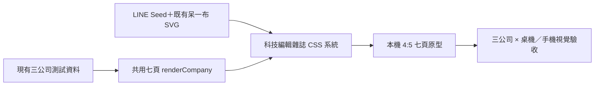

# 「一布懂 AI 新創」科技編輯雜誌輪播視覺重設

> 日期：2026-08-20  
> 狀態：使用者已核准「科技編輯雜誌風」方向，待 written spec 確認  
> 適用範圍：三公司七頁本機視覺原型；正式產圖模板、內容資料與 SQLite 暫不修改

## 1. 為什麼不能再細修現版

現版已經沒有明顯破版，但仍像一般社群帳號模板，問題不在單一間距，而是缺少可辨認的編輯觀點：

1. 封面的標題、說明與呆一布各自佔一區，沒有共同形成主視覺。
2. 內頁反覆使用色塊、框線與卡片重新排列，頁與頁之間只有配色一致，沒有節奏。
3. 橢圓流程圖、小標籤與浮動註記帶有簡報／AI 產圖感，降低成熟度。
4. 畫面雖有留白，但部分留白只是內容沒有被組織到那裡，不是在製造層次。

本輪不再以「把現版排整齊」為目標，而是建立一套能被認出的七頁編輯系統。

## 2. 產品結果

讀者在九宮格先被一張像科技雜誌封面的主視覺吸引；開始滑動後，每頁構圖不同，但能從固定的欄線、字體比例、註記方式與呆一布角色位置認出同一系列。

七頁的視覺節奏是：

```text
封面重擊 → 身分展開 → 問題推進 → 機制拆解 → 前後翻轉 → 證據整理 → 問題收束
```

內容、事實與七頁順序維持現況；本輪只改視覺組織。

## 3. 定案視覺方向

方向為「科技編輯雜誌」：以 Swiss Modernism 2.0 的嚴格格線為骨架，加入雜誌跨欄標題、拉線註記與不對稱構圖。不是極簡留白，也不是 Bauhaus 幾何拼貼。

### 3.1 保留

- LINE Seed TW 既有字體資產；不新增外部字型請求。
- 深藍 `#102F3D`、紙白 `#FAFBF8`、青色 `#86CCD4`、珊瑚橘 `#EC9870`。
- 既有呆一布 SVG；角色必須參與當頁構圖，不能只是角落貼圖。
- 公司名、系列名與現有七頁內容。

### 3.2 新的視覺簽名

- **十二欄編輯格線**：每頁使用同一組左右邊界與欄寬，但允許內容跨欄。
- **一條有任務的註記線**：每頁最多一條珊瑚橘線，必須連接標題、流程或註記，不作純裝飾。
- **超大關鍵字**：每頁最多一個，可來自公司名、核心動詞或轉折字；用裁切、跨欄或反白製造記憶點。
- **呆一布敘事位置**：角色面向或壓住當頁關鍵線，不固定右下角。
- **色彩權重**：單頁以深藍／紙白為基底，只允許青色或珊瑚橘其中一個成為主要強調；另一色只作小面積標記。

### 3.3 明確禁止

- 一排排相同的卡片或 bento grid。
- 橢圓流程圖、膠囊標籤、hashtag 小方格。
- 無功能的圓形、軌道線、漸層光暈與科技粒子。
- 隨意的小標籤、頁碼、來源或日期；本機原型不新增這些內容。
- 圓角卡片、柔和陰影與「乾淨現代」式 SaaS 視覺。
- 為填空白增加新文案、emoji 或生成式插畫。

## 4. 共用排版系統

### 4.1 畫布與格線

- 成品比例維持 4:5，正式搬移時仍對應 1080×1350。
- 內容安全邊界：左右各 7%，上下各 6.5%。
- 十二欄、欄距約 1.4% 畫布寬；主要文字起點只允許落在欄線上。
- 0px 圓角、無陰影；層次用色面、字級、跨欄與細線建立。

### 4.2 字級層次

- 主標：7.8–11cqw、900 weight、行高 0.92–1.02、緊縮字距。
- 關鍵句：4.8–6.4cqw、700–900 weight。
- 內文：2.9–3.35cqw、400–700 weight、行高 1.45–1.58。
- 標籤：2.1–2.45cqw、900 weight，只用於真正的資訊角色。
- 主標與內文至少相差兩級；不能只靠顏色區分。

### 4.3 標題換行標準

- 換算後不超過約 10 個全形字：單行。
- 約 11–18 個全形字：兩行，優先在語意分句處換行。
- 超過 18 個全形字：允許三行，但先縮小 6–8%，不得硬切專有名詞、動詞片語或公司名。
- 「從節目搜尋到直接生成」等對比句，連接詞必須保留，並成為構圖的一部分。

## 5. 七頁構圖

| 頁 | 視覺角色 | 新構圖 | 呆一布任務 |
|---|---|---|---|
| 1 封面 | 重擊 | 深藍全版；公司名放大裁切成背景字，主標跨 7–9 欄，定位句沿珊瑚橘註記線排列 | 角色壓住或指向註記線，和主標成為同一主視覺 |
| 2 公司身分 | 展開 | 不使用三格；左側為大尺寸白話定位，右側以兩條欄線承接使用情境與一句話理解 | 角色從欄線邊緣探出，指向「一句話理解」 |
| 3 問題 | 推進 | 三個問題階段沿單一垂直／斜向基線推進；文字塊大小依代價遞增，不用相同卡片 | 角色在最後一段記錄問題，不固定頁角 |
| 4 AI 機制 | 拆解 | 三步以階梯式跨欄排列；AI 介入步驟使用整塊青色，輸出與人的責任共享最後一個深藍區 | 角色直接指向 AI 步驟和人工責任交界 |
| 5 工作變化 | 翻轉 | 保留左右雙色滿版；標題橫跨兩半，巨大的「到」以反白／裁切穿過接縫，不再是一個小標籤 | 角色只出現在「現在」側，作為結果的視覺句點 |
| 6 觀察訊號 | 整理 | 三條橫向 ledger 記錄，每條由小標、粗體訊號與一句判斷組成；不用三張框 | 角色拿筆貼近第三條訊號，強化「仍需觀察」 |
| 7 收束 | 收尾 | 以一個大問題或結論佔據中央 7–8 欄，CTA 成為底部全寬跑帶；不再堆三個內容框 | 角色放大並面向讀者，成為唯一插圖主角 |

## 6. 封面專項驗收

封面是本輪第一優先，必須同時做到：

1. 兩秒內先讀到主標，再讀到公司名與一句話定位。
2. 公司名不是右上角小字，而是裁切或跨欄的背景字形資產。
3. 呆一布與一條註記線共同參與主視覺，不能再放在獨立矩形色塊中。
4. 畫面不存在連續超過約 25% 高度、沒有文字／角色／色面關係的無作用空白。
5. SUN、Billow AI Labs、Shiraz AI 三種長度都能保持同一概念，不改成另一張模板。

## 7. 響應與長內容

瀏覽器展示維持桌機雙欄、375px 單欄。卡片本身仍以 container query 尺寸縮放，因此桌機與手機應保持相同構圖，而不是在手機改成另一套版型。

- 公司名依長度套用 short／medium／long 級距。
- 所有句子採嚴格中文斷行；不在詞語中間換行。
- 內容超過當頁容量時先降低 4–8% 字級，再調整跨欄；不得隱藏內容或縮到難讀。
- 呆一布可縮小或移位，但不能遮住主標、公司名、流程文字或 CTA。

## 8. 技術邊界與資料流



白話比喻：資料像同一篇稿件，格線與字體是雜誌的版型，呆一布是固定專欄角色。這輪換的是美術編輯方式，不改稿件內容，也不動資料庫。

## 9. 實作策略與備援

### 主方案：另建 v11 原型

保留 v10 作為失敗基準，新增 v11 隔離重做。v11 保留公司資料、切換器、標題長度函式與七頁順序，只重寫頁面結構標記與視覺 CSS。優點是能清楚比較、也避免在現有多層覆寫規則上繼續疊補丁；缺點是核可前會暫時存在兩份原型，但兩者都位於 `.superpowers/`，不影響正式產品。

### 備援：直接重構 v10

若本機預覽工具無法切換到新檔，才在 v10 內先刪除舊視覺規則，再寫入新系統。不得只在檔案底部追加覆寫，否則同一元素會同時受多代規則控制，無法可靠細修。

## 10. 驗收與測試

### 10.1 TDD 垂直切片

1. 封面：先建立會因現版獨立矩形角色區與無作用空白而失敗的幾何測試，再重做封面。
2. 第二頁：先驗證三格結構仍存在而失敗，再改為定位主欄＋兩條資訊欄。
3. 第四頁：先驗證橢圓存在而失敗，再改成階梯式流程。
4. 第五頁：先驗證「到」仍是小標籤而失敗，再改成跨接縫大字。
5. 第六、七頁：逐頁建立舊卡片／底部空洞的回歸條件，再改成 ledger 與收束海報。

一次只做一個紅燈 → 最小實作 → 綠燈 → 重構，不能一次寫完全部測試再一起改。

### 10.2 視覺驗收

- 至少兩輪；每輪固定 1280×800 與 375×812 各一張。
- 檢查層次、留白、字體、配色、對齊、響應式、互動狀態與微動效。
- 三家公司各七頁，在兩種寬度共 42 個狀態必須 0 overflow、0 text clipping。
- 瀏覽器 console 必須 0 errors／0 warnings。
- 封面額外檢查主標／公司名／定位句閱讀順序，以及無作用空白比例。

## 11. 安全、成本與限制

- 不新增 API、圖片生成服務、外部字體或付費操作。
- 不寫 SQLite、不修改正式草稿與正式產圖模板。
- 不更動公司事實與文案；所有視覺壓力測試仍只代表排版適配，不代表內容查證完成。
- 本機原型核可後，正式搬移仍需另寫實作計畫與跑正式模板測試；不能把原型通過直接等同正式上線。

## 12. Non-goals

- 不改七頁內容策略、字數、事實或公司選擇。
- 不新增頁碼、日期、來源、hashtag 或額外 CTA。
- 不增加自動插畫、公司 Logo 搜尋、動畫影片或發文功能。
- 不在本輪修改 Streamlit 工作台、資料庫或正式 PNG 產出流程。
