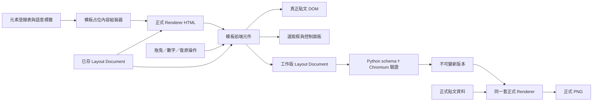

# 模板編輯器即時畫布與語意占位符 — 設計規格

> 2026-08-23 由使用者確認方向。本文件只定義產品與技術設計；實作前需另寫 TDD 計畫，
> 並嚴格依 Red → Green → Refactor 執行。

## 一句話

讓模板編輯器真正像簡報工具：拖曳或輸入座標時，選取框與貼文元素一起移動；畫布上的
可變資料改用「公司名稱」「企業 Logo」「封面標題」等語意占位符，不再讓 SUN 看起來像
模板內建的固定公司。

---

## 1. 問題與根因

### 1.1 使用者目前看到的問題

1. 拖曳元素後只有白色選取框移動，框內真正的文字或圖形仍留在原位。
2. 封面右側大型透明字直接顯示 `SUN`，讓人以為模板固定綁定這家公司，而不是顯示這裡
   應放「公司名稱」。
3. 過去瀏覽器測試只驗證選取框與數字欄位互相同步，沒有量真正貼文元素的位置，所以測試
   通過仍漏掉使用者眼前的錯誤。

### 1.2 已確認的技術根因

模板元件每次 render 都把 Python 傳來的 `previewHtml` 重新放進畫布；尚未保存的工作版面
只用來計算選取框與屬性欄，沒有重新套到帶有 `data-layout-id` 的真正預覽 DOM。兩套畫面
因此分離：控制層在動，內容層沒有動。

`SUN` 則來自編輯器預覽固定取用的第一組壓力測試資料。它不是正式模板資料，卻沒有任何
「這只是範例」的提示，因此造成錯誤的產品理解。

---

## 2. 已確認的產品決策

| 議題 | 決策 |
|---|---|
| 畫布內容模式 | 模板編輯器預設只顯示語意占位符，不顯示 SUN 或其他測試公司的真實內容 |
| 占位符範圍 | 所有會隨公司或貼文改變的欄位都使用角色名稱 |
| 固定視覺元素 | 呆一布機器人、裝飾線、圓、底色與固定版面語法保留真實外觀 |
| 公司名稱 | 右側大型透明字顯示「公司名稱」，不是任一家公司名稱 |
| 公司 Logo | 顯示中性的「企業 Logo」占位圖，不載入任一測試 Logo |
| 其他動態內容 | 顯示「系列名稱」「封面標題」「一句話定位」「頁面標題」「圖解標題」等角色名稱 |
| 拖曳／數字調整 | 選取框與真正貼文元素必須同步移動、縮放或更新文字屬性 |
| 正式出圖 | 繼續使用實際公司與貼文資料；占位符只存在於模板設定畫面 |
| 手機模式 | 維持唯讀，不開放精確拖曳與保存 |

同一個排版元素若內含多個文字欄位，畫布使用該元素在元素登錄表中的主要角色標籤，例如
「問題階段一」；不為每個巢狀句子再疊一個小標籤，以免占位符本身破壞版面判讀。

---

## 3. 使用者結果與流程

```text
開啟「設定 → 系列模板管理」
  → 七頁畫布顯示語意占位符
  → 選取一個既有元素
  → 拖曳、縮放或修改 X／Y／寬高／字級／對齊
  → 選取框與真正貼文元素立即同步
  → 復原、重做、重設也立即同步
  → 儲存時仍由 Python 與 Chromium 驗證
  → 建立不可變的新模板版本
```

使用者不用知道 SUN 是測試公司，也不需要猜右側透明字要放什麼。模板畫布回答的是
「這個位置的角色是什麼」；正式內容工作區和正式出圖才回答「這次實際顯示什麼」。

---

## 4. 系統架構與資料流



### 4.1 三個主要區塊

| 區塊 | 白話角色 | 責任 |
|---|---|---|
| 占位內容組裝器 | 像簡報母片上的欄位名稱 | 依元素登錄表產生中性、可理解的模板預覽內容 |
| 前端畫布元件 | 像 PowerPoint 畫布 | 將安全的工作版幾何同時套到真正 DOM 與選取框 |
| 伺服器驗證與版本庫 | 像存檔前的品管與版本櫃 | 重驗 schema、碰撞與溢出，再建立不可變新版本 |

### 4.2 畫布同步規則

每次收到 Python payload、切頁、選取、拖曳、縮放、屬性欄變更、復原、重做或重設後，
前端都依目前工作版 Layout Document 做一次相同的套用程序：

1. 只尋找 Renderer 已標記的 `[data-layout-id]` 元素。
2. 只讀取已登錄元素的 `x`、`y`、`w`、`h`、`font_size`、`text_align`。
3. 將座標與尺寸以 1080×1350 邏輯像素套到真正 DOM。
4. 選取框從同一筆工作資料計算，不能維護第二份座標。
5. 拖曳中的每一幀都更新真正 DOM；放開滑鼠後才把完成狀態送回 Python。

瀏覽器不接受任意 CSS、HTML、JavaScript、URL 或檔案路徑。它只套用既有 schema
白名單中的幾何和文字屬性。

### 4.3 語意占位符來源

占位符優先使用現有元素登錄表的穩定 label，避免在另一個檔案複製一套容易漂移的名稱。
跨頁固定的動態角色另有一個小型映射：

| 動態角色 | 模板畫布顯示 |
|---|---|
| 公司名稱／大型封面字 | 公司名稱 |
| 公司 Logo | 企業 Logo |
| 內容系列 | 系列名稱 |
| 封面主標 | 封面標題 |
| 封面副標 | 一句話定位 |
| 內頁主標 | 頁面標題 |
| 圖解節點 | 對應元素登錄表標籤，如「問題階段一」 |
| 結論／提醒區 | 對應元素登錄表標籤，如「要注意的點」 |

占位符文字本身不寫入 SQLite 的模板版面文件，也不成為貼文草稿。它是編輯器建立
`previewHtml` 時使用的暫時內容。

---

## 5. 採用方案與備援

### 主方案：前端安全地同步真正 DOM

收到一份 Renderer HTML 後，由前端把工作版幾何直接套到真正元素。這個方案互動即時、
不需要拖曳每一幀都讓 Streamlit 重跑，也沿用現有元素登錄表與 schema。

### 備援：每次操作都請 Python 重產 HTML

優點是所有結果天然從伺服器 Renderer 重建；缺點是拖曳會頻繁跨過 Streamlit 邊界，延遲
明顯，也容易閃爍。它可作為前端同步機制失效時的除錯方式，不作為主要互動模式。

### 不採用：只移動選取框

這只能編輯一組抽象數字，不能讓使用者判斷實際構圖，正是目前 bug，不能保留。

---

## 6. 錯誤、安全與相容性

- 若某個已登錄元素在 Renderer HTML 裡找不到，畫布顯示可理解的同步錯誤並停用保存，
  不再默默讓選取框與內容分離。
- Python 保存流程仍是最後權威：重新驗證 schema、七頁壓力資料、碰撞、溢出與邊界。
- 既有 Layout Document、模板版本、草稿綁定與 sessionStorage 工作副本格式不變，無資料庫
  migration。
- 不新增外部套件、CDN、付費服務或 LLM 呼叫。
- 正式 Renderer 的資料入口不變；只有設定頁建立預覽 payload 的內容來源改為占位內容。

---

## 7. TDD 與 QA 驗收

### 7.1 垂直測試切片

1. **語意內容切片**：先寫失敗測試，證明模板預覽仍包含 `SUN`；最小實作改為公司名稱等
   占位符，並驗證七頁不含 SUN、Billow AI Labs、Shiraz AI。
2. **拖曳同步切片**：真實 Chromium 量同一元素的 DOM 矩形與選取框，拖曳 16 邏輯像素；
   先看到只有選取框移動，再讓兩者移動相同距離。
3. **屬性同步切片**：依序驗證 X／Y、寬高、字級與對齊修改會更新真正 DOM，而非只更新
   欄位或框線。
4. **歷史操作切片**：驗證復原、重做、Escape 取消與重設後，真正 DOM 和選取框仍一致。
5. **保存邊界切片**：驗證編輯中不寫 DB，合法保存仍建不可變新版本；缺失 DOM hook 時
   保存被阻擋。
6. **正式輸出回歸**：用實際公司內容產生七頁，確認正式 HTML／PNG 仍顯示真實公司名稱與
   Logo，不會出現占位符。

### 7.2 可量測驗收標準

- 拖曳或屬性調整後，真正元素與選取框的渲染位移差不超過 1 CSS px。
- 七頁模板畫布都不出現三家壓力測試公司的名稱或 Logo。
- 公司名稱、企業 Logo 與主要文字角色不需要猜測其用途。
- 工作中 DB 版本數量不變；保存後只新增一個未啟用版本，既有版本不被覆寫。
- 正式產圖仍以實際公司資料通過七頁版面與 PNG 回歸。
- 1280×800 桌機可完整操作；375×812 手機維持唯讀、無水平捲動。
- 完成前依前端規範跑至少兩輪桌機／手機截圖自檢，逐項檢查層次、留白、字體、配色、
  對齊、響應式、狀態與微動效。

---

## 8. 不在本輪範圍

- 新增、刪除、旋轉元素或修改 z-order。
- 更換品牌字型、色票、背景素材或呆一布機器人。
- 在模板畫布直接編輯正式貼文文案。
- 改變模板不可變版本、啟用版本或舊草稿升級的既有產品規則。
- 將本機工具改成雲端多人協作設計工具。
